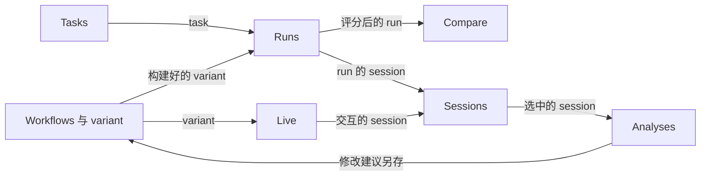

# Magi Dashboard

Magi Dashboard 是在本机评估 [txe-workflow](https://github.com/txehq/txe-workflow)（Magi workflow，`/lfg` 与 `/ic`）的网页。它可以：

- 打开本机已有的 Claude Code 与 Codex session，按 workflow 的阶段切块，看每个阶段的请求、token、花费与耗时；
- 修改 skill 得到 variant，用预先定义的 task 让 Claude Code 完整跑一遍 workflow，由 LLM 扮演的模拟用户回答 agent 的提问，跑完后评分；
- 把几个 variant 的分数与花费放在一起对比；
- 用 LLM 分析 session，给出 skill 的修改建议，另存为新的 variant。

完整的使用说明在 Obsidian vault 的 `Project Magi/Dashboard/User Guide.md`，设计与接口在同一目录的 `Brief.md`、`System Design.md`、`Contracts.md`。

## 安装

只支持 macOS（Apple Silicon）。安装分三步：先装好 txe-workflow，再准备 dashboard 用到的账号与工具，最后安装并启动 dashboard。

### 1. 安装 txe-workflow

按 txe-workflow 的 README 安装：<https://github.com/txehq/txe-workflow#install>

1. 按 [getting started](https://github.com/txehq/txe-workflow/blob/main/docs/operations/getting-started.md) 准备好账号、Obsidian vault 与发布用的凭据。
2. 把 README 中 Install 一节的那段 prompt 整段交给 Claude Code。它会运行 `/install`：检查平台与工具，下载并校验稳定版，把 `wf` 装进本机所有的 coding agent，再配置 Linear 与 artifact 发布。
3. 装完后运行 `wf doctor`，确认没有未通过的项。

dashboard 还要读取 txe-workflow 的源码，从它的某个 commit 导出基线 variant：

```sh
git clone https://github.com/txehq/txe-workflow.git ~/Project/txe/txe-workflow
```

放在别的位置时，用环境变量 `WFD_TXE_WORKFLOW` 指向它。

### 2. 准备 dashboard 用到的账号与工具

| 项                                                        | 用途                                                                                  | 安装或配置                                                                                                                                                                                                                          |
| --------------------------------------------------------- | ------------------------------------------------------------------------------------- | ----------------------------------------------------------------------------------------------------------------------------------------------------------------------------------------------------------------------------------- |
| Node 22.12 及以上、pnpm 12.10.1                           | 构建与运行 dashboard                                                                  | `npm install --global pnpm@12.10.1`                                                                                                                                                                                                 |
| `claude`（Claude Code CLI）                               | 被评估的 agent                                                                        | `npm install --global @anthropic-ai/claude-code`；`~/.claude/settings.json` 的 `env` 中要有 gateway 的 `ANTHROPIC_BASE_URL`、`ANTHROPIC_AUTH_TOKEN` 与 sonnet / opus / haiku 的模型名                                               |
| `gh`，登录的账号是 txehq 的成员                           | 每个 run 在 txehq 建一个 `wfe-<runId>` 仓库，/ic 的 PR 也开在那里                     | `gh auth login --hostname github.com --git-protocol https --web`                                                                                                                                                                    |
| Linear MCP 的 OAuth 登录                                  | /ic 的工单副本建在 Linear TXE team 的 "Workflow Eval" project；从 Linear 导入 ic task | 运行 `npx -y mcp-remote https://mcp.linear.app/mcp`，在浏览器中授权，看到 Proxy established 后按 Ctrl-C                                                                                                                             |
| Codex CLI，`~/.codex/auth.json` 与 `~/.codex/config.toml` | skill 中的评审（/review-pr 等）调用 `codex exec`                                      | `codex login`                                                                                                                                                                                                                       |
| Obsidian vault，其中有 `Project Magi Eval/`               | /lfg 的产物写到 `Project Magi Eval/Features/<runId>/`                                 | vault 的位置由环境变量 `MAGI_VAULT` 决定，与 txe-workflow 的 `wf obsidian` 相同（`/install` 把 `export MAGI_VAULT=…` 写进 shell 的配置文件）；没有设时为 `~/Projects/Obsidian/TXE`。然后 `mkdir -p "$MAGI_VAULT/Project Magi Eval"` |
| `wf`、`uv`、`ctx`                                         | variant 的构建与安装；skill 在运行中调用的工具                                        | `wf` 与 `ctx` 由第 1 步装好；uv：`curl -LsSf https://astral.sh/uv/install.sh \| sh`                                                                                                                                                 |
| Rust（`cargo`）                                           | 构建 variant 时从基线 commit 的源码编译 `wf`                                          | `curl --proto '=https' --tlsv1.2 -sSf https://sh.rustup.rs \| sh`，然后在 txe-workflow 目录中运行一次 `cargo --version`，rustup 按它的 `rust-toolchain.toml` 装好钉住的版本                                                         |

### 3. 安装并启动 dashboard

本仓库是 txehq 组织的私有仓库，clone 要用 txehq 成员的 GitHub 账号（第 2 步 `gh auth login` 登录的账号；`gh auth setup-git` 让 git 使用它的凭据）。

```sh
git clone https://github.com/txehq/wf-dashboard.git
cd wf-dashboard
pnpm install
pnpm start
```

浏览器打开 <http://127.0.0.1:7317>。

- `pnpm start` 先构建页面与服务端，再由同一个进程在 7317 端口提供页面与 API。端口用 `WFD_PORT` 修改，例如 `WFD_PORT=7400 pnpm start`。
- 在普通终端（或 Orca 终端）中运行 `pnpm start`。从 Claude Code 的 Bash 后台启动的服务会随那次 Bash 调用一起结束，正在进行的 run 会中断。
- 运行时数据都在 `data/` 下：`db.sqlite`、`variants/`（每个 variant 的源码、构建产物与它自己的 Claude Code / Codex / wf 配置目录）、`runs/`（每个 run 的 workspace 与事件记录）。数据库迁移在服务启动时自动执行。
- 按 Ctrl-C 停止服务：正在运行的 run 记为失败，排队中的 run 保留，下次启动后继续排队。

打开页面后先看左侧导航底部的环境状态。「环境：全部通过」才能发起评估；有未通过的项时点开它，每一项都有真实的输出与修复命令。命令行上 `curl http://127.0.0.1:7317/api/environment` 给出同样的结果。

## 各模块的功能



### Sessions：离线分析

- 列出本机配置（`~/.claude/projects`、`~/.codex`）与每个 variant 配置目录下的 session，按配置、项目分三列选择，勾选后导入。导入的 session 文件变长时自动导入新增的部分。
- session 详情：请求数（含子代理）、token、花费、时长、各 tool 的调用次数，对话与每一次模型请求（思考、回复、tool 调用与结果）。
- 阶段划分：按主 agent 的 Skill 调用与用户输入的 slash 命令（`/lfg`、`/ic` 与阶段名）把 session 线性切块，不调用模型。阶段图的每个阶段框给出调用次数（fix-pr 为修复轮数）、请求、token、花费、耗时，点开列出这个阶段的请求。
- 清除、删除（连同磁盘上的文件）、Codex session 的归档与恢复；在 Live 中 resume。

### Workflows：workflow 与 variant

- 内置三个 workflow：`lfg`（interview、research、plan、ticketing）、`ic`（claim、readiness、implement、acceptance、open-pr、fix-pr、ready-for-review）与 `session-analysis`（分析 session 的九个方面加 synthesize）。也可以新建自己的 workflow，表单或 YAML 编辑阶段的定义，流程图随之更新。
- variant 是一个 workflow 的一组 skill。lfg、ic 的基线从 txe-workflow 的某个 commit 导入；之后派生新 variant，在页面的编辑器中修改 `skills/` 下的文件（Markdown 预览、并排、与基线的 diff、全屏）。
- 构建：lfg、ic 的 variant 用 `wf release build-local` 与 `wf install` 装进 variant 自己的配置目录，彼此隔离，不碰你的 `~/.claude`。其他 workflow 的 variant 由 dashboard 直接复制 skill。
- 生成 workflow 或 variant：写一句需求，在 Live 中由 Codex 或 Claude Code 写 skill，写好后保存。

### Tasks：task 库

- `/lfg` task 的输入是一个想法（例如「做一个计算器」），附模拟用户的 persona 与隐藏需求，以及按 brief、research、plan、tickets 四种产物分组的 rubric。
- `/ic` task 是一张工单加起始仓库，评分用隐藏测试或验收标准。可以手写工单，也可以粘贴 Linear 工单地址导入：正文原样保存，验收标准由 judge 模型从正文中确定，起始仓库与 commit 默认取工单关联的已合并 PR 的 base commit，必需的 CI check 从仓库的 workflow 中算出。

### Runs：发起与观察评估

- 勾选已构建的 variant 与 task，填重复次数、model 与 effort，发起一个 batch。run 进入全局队列（默认同时 3 个），依次经过 queued → preparing（建 GitHub 仓库，/ic 还在 Linear 建工单副本）→ running → grading → succeeded。
- 运行详情：状态、三项花费（agent、模拟用户、评分）、外部链接（仓库、工单、PR、vault 目录），阶段进度、与模拟用户的对话、请求流与产物。
- 运行中可以接管，由你回答 agent 的提问（run 标为有人工干预）；可以交还模拟用户、结束或取消。
- 评分：/lfg 按四种产物逐条 rubric 打分；/ic 给出隐藏测试的通过数或验收标准逐条的得分，以及是否跑到终点。
- 环境出错的 run 可以标为无效；失败、取消或无效的 run 可以重跑。

### Compare：对比 variant

- 选一个 workflow，再选要比较的 variant 与 task，按 variant 或按 variant 与模型分组。
- 分数表（平均分与离散程度，每个点是一次 run，点开看每条 rubric 的平均得分）、产物并排、各阶段的成本对比（花费、token、耗时、tool 调用数）、两个 variant 的 skill diff。
- 默认排除有人工干预的 run、参考了其他 run 的 run 与读取了来源工单的 run，各有开关放回；标为无效的 run 总是排除。

### Live：在页面中运行

- 在页面里的真实终端中运行一个 workflow（Claude Code 或 Codex），选 variant、环境、model 与 effort，由你或模拟用户驾驶；也可以 resume 任何一个 session。
- 「阶段与请求」抽屉显示这个 session 的阶段条、各阶段花费与耗时、请求明细。
- 页面全部关掉 2 分钟后，还在运行的交互进程自动结束；评估的 run 不受影响。

### Analyses：分析 session，优化 skill

- 选同一个配置下的若干 session，用 `session-analysis` 的某个 variant 分析：流程遵守、计划遵守、失败、重复的工作、token 与时间的浪费、和用户的交互、产物质量、与请求的冲突，最后综合出报告。每条发现都有 session 中的原文作证据。
- 修改建议逐处接受或拒绝后另存为新 variant；或点「优化」，在 Live 中交给 Codex 或 Claude Code 按报告修改 skill。

### Magi Agent

导航顶部「Magi Dashboard」右边的小机器人。它是 dashboard 自己的 agent，在 wf-dashboard 的独立 worktree 中工作：回答用法、讨论问题、按你的要求修改 dashboard，检查通过后合并进 main 并重启服务。

## 开发

```sh
pnpm dev
```

- 服务端：http://127.0.0.1:7317（只监听 127.0.0.1），健康检查 `GET /api/health`，实时事件 `GET /api/events`（SSE）。
- 页面：http://127.0.0.1:5173，开发时 `/api` 由 Vite 代理到服务端。

### 多个 worktree 并行运行

端口默认为服务端 7317、页面 5173，由环境变量 `WFD_PORT`、`WFD_WEB_PORT` 覆盖；`pnpm dev`、`pnpm e2e` 与 Vite 的 `/api` 代理都读取这两个变量。Playwright 在端口上已有服务时直接复用它，所以同时在几个 worktree 中运行时，每个 worktree 用一组不同的端口：

```sh
export WFD_PORT=7327 WFD_WEB_PORT=5183
pnpm dev
pnpm e2e
```

每个 worktree 的 `data/` 是各自独立的。

### 命令

| 命令                     | 作用                                                                    |
| ------------------------ | ----------------------------------------------------------------------- |
| `pnpm start`             | 构建后由服务端一个端口提供页面与 API                                    |
| `pnpm dev`               | 同时启动服务端（tsx watch）与页面（Vite）                               |
| `pnpm build`             | 编译服务端到 `server/dist/`，构建页面到 `web/dist/`                     |
| `pnpm check`             | 依次运行 typecheck、lint、test 与 e2e，全机同一时间只运行一份           |
| `pnpm test`              | 基础档的 Vitest                                                         |
| `pnpm test:real [文件…]` | 真实档的 Vitest                                                         |
| `pnpm test:slow [文件…]` | 慢档的 Vitest                                                           |
| `pnpm test:external`     | 在 Linear 建工单的外部系统测试                                          |
| `pnpm e2e [文件…]`       | 基础档的 Playwright，截图写到 `.work/screenshots/`                      |
| `pnpm e2e:real [文件…]`  | 真实档的 Playwright                                                     |
| `pnpm e2e:guide`         | 使用手册的截图（种子数据，不发起 run），写到 `.work/guide/screenshots/` |
| `pnpm typecheck`         | 全部 TypeScript 项目的类型检查                                          |
| `pnpm lint`              | ESLint 与 Prettier 检查                                                 |
| `pnpm format`            | Prettier 格式化                                                         |

修改 `server/src/db/schema.ts` 后，在 `server/` 下执行 `pnpm db:generate --name <迁移名>` 生成新的迁移文件。
