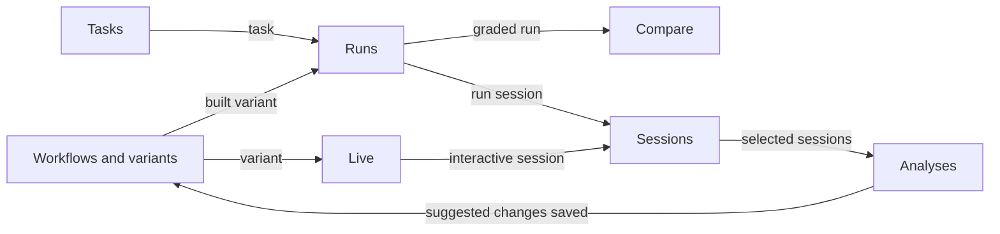

# Magi Dashboard

Magi Dashboard is a local web app for evaluating [txe-workflow](https://github.com/txehq/txe-workflow) (the Magi workflow, `/lfg` and `/ic`). With it you can:

- open the Claude Code and Codex sessions already on this machine, split them into the workflow's stages, and see each stage's requests, tokens, cost and duration;
- edit skills to make a variant, have Claude Code run the whole workflow on a predefined task while an LLM plays the simulated user who answers the agent's questions, and grade the result;
- compare the scores and costs of several variants side by side;
- have an LLM analyze sessions, suggest changes to the skills, and save them as a new variant.

The full user guide is `Project Magi/Dashboard/User Guide.md` in the Obsidian vault; the design and interfaces are in `Brief.md`, `System Design.md` and `Contracts.md` in the same folder.

## Install

For macOS on Apple Silicon. You need:

- `gh` logged in with an account that is a member of txehq (`gh auth login --hostname github.com --git-protocol https --web`);
- Claude Code and the Magi workflow (`wf`), installed as the [txe-workflow README](https://github.com/txehq/txe-workflow#install) describes.

Then run this one command (no clone, no pnpm, no build):

```sh
gh release download --repo txehq/wf-dashboard --pattern install.sh --output - | bash
```

It checks the prerequisites and stops with the failing command's output and the fix when one is missing, installs the Mac app **WF Dashboard** in `/Applications`, and opens it. The app is a window and a menu bar icon: the window shows the dashboard, served by a local server on <http://127.0.0.1:7317> that the app starts for you. The dashboard uses your own Claude Code, Codex, gh, VS Code, Linear sign-in and Obsidian vault; the environment status at the bottom of the navigation lists anything still missing, with the command that fixes it.

- Closing the window keeps the server running, so interactive sessions and runs continue; the menu bar icon opens the window again or quits. Quitting asks first when a run or an interactive session is still running, then stops the server.
- The app starts when you log in, without a window.
- The server runs inside your login shell, so it sees the same `PATH`, `MAGI_VAULT` and proxy settings as a terminal.
- Your data (database, variants, runs) is in `~/Library/Application Support/wf-dashboard/data/`; logs are in `~/Library/Application Support/wf-dashboard/logs/`. Updates and reinstalls keep it.
- It updates itself: at start and every 6 hours it reads the latest release, downloads it, and replaces and reopens the app when no run or interactive session is running. The version is shown at the bottom of the navigation, with the reason when an update waits or fails.
- When txe-workflow is not at `~/Project/txe/txe-workflow` (and `WFD_TXE_WORKFLOW` is not set), the installer clones it into `~/Library/Application Support/wf-dashboard/txe-workflow/`.
- Port 7317 must be free: stop a dashboard started from the repository first.
- A 0.1.0 install (the background service `dev.engapp.wf-dashboard`) is removed by the installer; its `data/` is used as is.

Uninstall (keeps `data/` and tells you where it is):

```sh
"/Applications/WF Dashboard.app/Contents/Resources/uninstall.sh"
```

## Running from the repository

The sections below are for developing the dashboard. Installation has three steps: install txe-workflow, set up the accounts and tools the dashboard uses, then install and start the dashboard.

### 1. Install txe-workflow

Follow the txe-workflow README: <https://github.com/txehq/txe-workflow#install>

1. Set up the accounts, the Obsidian vault and the publishing credentials as described in [getting started](https://github.com/txehq/txe-workflow/blob/main/docs/operations/getting-started.md).
2. Give the whole prompt from the README's Install section to Claude Code. It runs `/install`: checks the platform and tools, downloads and verifies the stable release, installs `wf` into every coding agent on the machine, then configures Linear and artifact publishing.
3. When it finishes, run `wf doctor` and make sure nothing fails.

The dashboard also reads the txe-workflow source to export baseline variants from one of its commits:

```sh
git clone https://github.com/txehq/txe-workflow.git ~/Project/txe/txe-workflow
```

If you put it somewhere else, point the `WFD_TXE_WORKFLOW` environment variable at it.

### 2. Set up the accounts and tools the dashboard uses

| Item                                                       | Used for                                                                                                            | Install or configure                                                                                                                                                                                                                                                                       |
| ---------------------------------------------------------- | ------------------------------------------------------------------------------------------------------------------- | ------------------------------------------------------------------------------------------------------------------------------------------------------------------------------------------------------------------------------------------------------------------------------------------ |
| Node 22.12 or later, pnpm 12.10.1                          | Building and running the dashboard                                                                                  | `npm install --global pnpm@12.10.1`                                                                                                                                                                                                                                                        |
| `claude` (Claude Code CLI)                                 | The agent being evaluated                                                                                           | `npm install --global @anthropic-ai/claude-code`; the `env` in `~/.claude/settings.json` needs the gateway's `ANTHROPIC_BASE_URL` and `ANTHROPIC_AUTH_TOKEN` and the sonnet / opus / haiku model names                                                                                     |
| `gh`, signed in with an account that is a member of txehq  | Each run creates a `wfe-<runId>` repo in txehq, and /ic opens its PR there                                          | `gh auth login --hostname github.com --git-protocol https --web`                                                                                                                                                                                                                           |
| Linear MCP OAuth sign-in                                   | /ic ticket copies are created in the "Workflow Eval" project of the Linear TXE team; importing ic tasks from Linear | Run `npx -y mcp-remote https://mcp.linear.app/mcp`, authorize in the browser, and press Ctrl-C once you see Proxy established                                                                                                                                                              |
| Codex CLI, `~/.codex/auth.json` and `~/.codex/config.toml` | Reviews inside skills (/review-pr and others) call `codex exec`                                                     | `codex login`                                                                                                                                                                                                                                                                              |
| Obsidian vault containing `Project Magi Eval/`             | /lfg writes its output to `Project Magi Eval/Features/<runId>/`                                                     | The vault location comes from the `MAGI_VAULT` environment variable, the same as txe-workflow's `wf obsidian` (`/install` writes `export MAGI_VAULT=...` into your shell config); when it is unset, `~/Projects/Obsidian/TXE` is used. Then run `mkdir -p "$MAGI_VAULT/Project Magi Eval"` |
| `wf`, `uv`, `ctx`                                          | Building and installing variants; tools that skills call while running                                              | `wf` and `ctx` are installed in step 1; uv: `curl -LsSf https://astral.sh/uv/install.sh \| sh`                                                                                                                                                                                             |
| Rust (`cargo`)                                             | Building a variant compiles `wf` from the source at the baseline commit                                             | `curl --proto '=https' --tlsv1.2 -sSf https://sh.rustup.rs \| sh`, then run `cargo --version` once in the txe-workflow directory so rustup installs the version pinned by its `rust-toolchain.toml`                                                                                        |
| `cargo-zigbuild`, `zig`, the Rust Linux target             | When lfg and ic variants run on a remote Linux host, `wf` for that host is cross-compiled on this machine           | `brew install cargo-zigbuild zig`, then run `rustup target add x86_64-unknown-linux-gnu` in the txe-workflow directory (use `aarch64-unknown-linux-gnu` when the remote is aarch64)                                                                                                        |

### 3. Install and start the dashboard

This is a private repository of the txehq organization. Cloning it needs a GitHub account that is a member of txehq (the account you signed in with `gh auth login` in step 2; `gh auth setup-git` makes git use its credentials).

```sh
git clone https://github.com/txehq/wf-dashboard.git
cd wf-dashboard
pnpm install
pnpm start
```

Open <http://127.0.0.1:7317> in a browser.

- `pnpm start` builds the pages and the server, then one process serves both the pages and the API on port 7317. Change the port with `WFD_PORT`, for example `WFD_PORT=7400 pnpm start`.
- Run `pnpm start` in a normal terminal (or an Orca terminal). A server started in the background from Claude Code's Bash tool ends together with that Bash call, and any run in progress is interrupted.
- All runtime data lives under `data/`: `db.sqlite`, `variants/` (each variant's source, build output and its own Claude Code / Codex / wf config directories) and `runs/` (each run's workspace and event log). Database migrations run automatically when the server starts.
- Press Ctrl-C to stop the server: running runs are marked as failed, queued runs stay queued and continue after the next start.

After the page opens, first check the environment status at the bottom of the left navigation. Evaluations can only start when it reads "Environment: all passed". If some checks fail, click it: every check shows its real output and the command that fixes it. On the command line, `curl http://127.0.0.1:7317/api/environment` gives the same result.

## What each part does



### Sessions: offline analysis

- Lists the sessions in the local config (`~/.claude/projects`, `~/.codex`) and in each variant's config directory, chosen in three columns by config and project; check the ones you want and import them. When an imported session file grows, the new part is imported automatically.
- Session details: request count (including subagents), tokens, cost, duration, call count per tool, the conversation, and every model request (thinking, reply, tool calls and results).
- Stages: the session is split linearly by the main agent's Skill calls and the slash commands the user typed (`/lfg`, `/ic` and stage names), with no model call. Each stage box in the stage graph shows the call count (fix rounds for fix-pr), requests, tokens, cost and duration; click it to list that stage's requests.
- Clear, delete (together with the files on disk), archive and restore Codex sessions; resume in Live.

### Workflows: workflows and variants

- Three built-in workflows: `lfg` (interview, research, plan, ticketing), `ic` (claim, readiness, implement, acceptance, open-pr, fix-pr, ready-for-review) and `session-analysis` (nine aspects of a session plus synthesize). You can also create your own workflow and edit its stage definitions in a form or as YAML; the flowchart updates as you edit.
- A variant is a set of skills for one workflow. The lfg and ic baselines are imported from a txe-workflow commit; from there you derive new variants and edit the files under `skills/` in the page's editor (Markdown preview, side by side, diff against the baseline, full screen).
- Build: lfg and ic variants are installed with `wf release build-local` and `wf install` into the variant's own config directory, isolated from each other and from your `~/.claude`. Variants of other workflows have their skills copied directly by the dashboard.
- Generate a workflow or variant: write one sentence describing what you want; Codex or Claude Code writes the skills in Live, and you save the result.

### Tasks: the task library

- The input of a `/lfg` task is an idea (for example "build a calculator"), with the simulated user's persona and hidden requirements, and a rubric grouped by the four outputs: brief, research, plan and tickets.
- An `/ic` task is a ticket plus a starting repo, graded by hidden tests or acceptance criteria. You can write the ticket by hand or import it by pasting a Linear ticket URL: the body is saved unchanged, the judge model determines the acceptance criteria from the body, the starting repo and commit default to the base commit of the merged PR linked to the ticket, and the required CI checks are worked out from the repo's workflows.

### Runs: start and watch evaluations

- Check built variants and tasks, fill in the repeat count, model and effort, and start a batch. Runs go into a global queue (3 at a time by default) and move through queued → preparing (creating the GitHub repo; /ic also creates a ticket copy in Linear) → running → grading → succeeded.
- Run details: status, the three costs (agent, simulated user, grading), external links (repo, ticket, PR, vault folder), stage progress, the conversation with the simulated user, the request stream and the outputs.
- While a run is going you can take over and answer the agent's questions yourself (the run is marked as having human intervention); you can hand it back to the simulated user, end it or cancel it.
- Grading: /lfg scores each rubric item for the four outputs; /ic gives the number of hidden tests passed or a score for each acceptance criterion, and whether the run reached the end.
- A run that failed because of the environment can be marked invalid; failed, cancelled or invalid runs can be rerun.

### Compare: compare variants

- Choose a workflow, then the variants and tasks to compare, grouped by variant or by variant and model.
- Score table (mean and spread, each dot one run; click it for the mean score of each rubric item), outputs side by side, cost per stage (cost, tokens, duration, tool call count), and the skill diff between two variants.
- By default, runs with human intervention, runs that consulted other runs and runs that read the source ticket are excluded, each with a switch to include them; runs marked invalid are always excluded.

### Live: run in the page

- Run a workflow (Claude Code or Codex) in a real terminal inside the page: choose the variant, environment, model and effort, and drive it yourself or let the simulated user drive; you can also resume any session.
- The stages and requests drawer shows the session's stage bar, the cost and duration of each stage, and the request details.
- Two minutes after every page is closed, interactive processes still running end automatically; evaluation runs are not affected.

### Analyses: analyze sessions, optimize skills

- Choose several sessions under the same config and analyze them with a variant of `session-analysis`: process adherence, plan adherence, failures, repeated work, wasted tokens and time, interaction with the user, output quality, conflicts with the request, and finally a synthesized report. Every finding is backed by the original text from the session.
- Accept or reject each suggested change, then save the result as a new variant; or click "Optimize" to hand the report to Codex or Claude Code in Live, which changes the skills accordingly.

### Magi Agent

The small robot to the right of "Magi Dashboard" at the top of the navigation. It is the dashboard's own agent and works in a separate worktree of wf-dashboard: it answers questions about usage, discusses problems, and changes the dashboard on request; once the checks pass it merges into main and restarts the server. In an installed release it works in the package's sources, read-only: it answers and discusses, and deploying is refused because the installation updates from releases.

## Development

```sh
pnpm dev
```

- Server: http://127.0.0.1:7317 (listens on 127.0.0.1 only), health check `GET /api/health`, live events `GET /api/events` (SSE).
- Pages: http://127.0.0.1:5173; during development Vite proxies `/api` to the server.

### Running several worktrees in parallel

The default ports are 7317 for the server and 5173 for the pages, overridden by the `WFD_PORT` and `WFD_WEB_PORT` environment variables; `pnpm dev` and Vite's `/api` proxy both read them. Give each worktree its own pair of ports:

```sh
export WFD_PORT=7327 WFD_WEB_PORT=5183
pnpm dev
```

Each worktree has its own `data/`.

### Commands

| Command          | What it does                                                                           |
| ---------------- | -------------------------------------------------------------------------------------- |
| `pnpm start`     | Builds, then one server port serves the pages and the API                              |
| `pnpm dev`       | Starts the server (tsx watch) and the pages (Vite) together                            |
| `pnpm build`     | Compiles the server to `server/dist/` and builds the pages to `web/dist/`              |
| `pnpm check`     | Runs typecheck, lint and test at the same time; only one runs on the machine at a time |
| `pnpm test`      | Vitest                                                                                 |
| `pnpm typecheck` | Type checks every TypeScript project                                                   |
| `pnpm lint`      | ESLint and Prettier checks                                                             |
| `pnpm format`    | Formats with Prettier                                                                  |

`pnpm check` is the verdict before merging: it runs typecheck, lint and Vitest as three processes at once and prints
each step's time, the total and the load, so the whole check takes as long as its slowest step. Vitest covers the
numbers a page cannot show to be wrong: stage splitting, the Linear stats, session import (tokens, cost, subagents)
and cost refresh. These are pure computation tests: they start no server and use no network.

After changing `server/src/db/schema.ts`, run `pnpm db:generate --name <migration-name>` in `server/` to generate a new migration file.

### Releasing

The version is in the root `package.json`. `pnpm release` builds into `.work/release/`: `WF Dashboard.app` (Electron,
from `desktop/`, signed ad hoc) whose `Contents/Resources/server/` holds the built server and pages, production
`node_modules`, this machine's Node 22 binary, `tasks/`, the server sources with the built-in workflows and skills and
`agent/MAGI.md`; the app zipped as `WF-Dashboard-<version>-arm64.zip`; and `install.sh`. It checks with the bundled
Node that every native module loads. Run it with Node 22 on Apple Silicon; behind a proxy, set
`ELECTRON_GET_USE_PROXY=true` and `HTTPS_PROXY` so the Electron download goes through it.
`pnpm release --publish --commit <sha>` also creates the GitHub Release `v<version>` on txehq/wf-dashboard at that
commit (the snapshot commit on GitHub) and uploads the zip and `install.sh`; installed apps pick it up within 6 hours.

To try the app without touching an existing install, give the installer another app location, port and data
directory, and the local zip. The app remembers the port and data directory for its own location, so the uninstaller
and later opens need neither:

```sh
WFD_INSTALL_APP="$PWD/.work/try/WF Dashboard.app" WFD_INSTALL_PORT=7377 WFD_INSTALL_DATA_DIR="$PWD/.work/try/root/data" \
  WFD_INSTALL_ZIP="$PWD/.work/release/WF-Dashboard-0.2.1-arm64.zip" bash .work/release/install.sh
"$PWD/.work/try/WF Dashboard.app/Contents/Resources/uninstall.sh"
```
