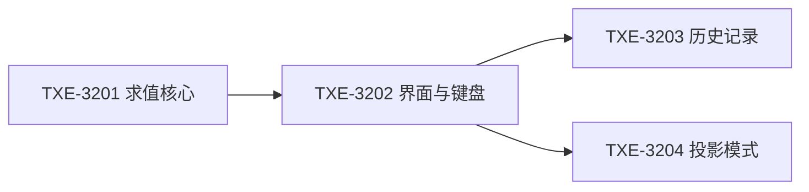

# Tickets：课堂用的网页计算器

| 工单 | 标题 | 估算 | 推荐负责人 | 理由 |
|---|---|---|---|---|
| TXE-3201 | 计算器求值核心：解析、十进制计算与错误位置 | 5 | linhaoz | 近三个月做过 TXE-2890 表达式解析 |
| TXE-3202 | 计算器界面与键盘输入，离线构建 | 3 | Connor Wang | 负责过 TXE-2711 静态页面构建 |
| TXE-3203 | 历史记录：最近 20 条，localStorage | 2 | Connor Wang | 与 TXE-3202 同一套状态 |
| TXE-3204 | 投影模式 | 1 | linhaoz | 只改根字号，工作量小 |

## TXE-3201 求值核心

验收标准：
- [ ] 老师的 10 道题全部得到期望结果（0.1+0.2=0.3 … (1+2 提示"括号不配对"）
- [ ] 负数开平方提示"负数不能开平方"，错误位置精确到字符
- [ ] 结果最多 12 位有效数字，除不尽时 10 位小数并去掉末尾 0

## TXE-3202 界面与键盘输入，离线构建

blocked by TXE-3201

验收标准：
- [ ] 按钮与键盘都能完成 10 道题
- [ ] 构建产物双击即可打开，断网时可用，DevTools 中 0 个网络请求
- [ ] 构建目标 chrome109，在 Chrome 109 中通过 e2e

## TXE-3203 历史记录

blocked by TXE-3202

验收标准：
- [ ] 输入 21 条后只保留最近 20 条；刷新后仍在；"清空历史"后为空
- [ ] 不发起任何网络请求，数据只在本浏览器

## TXE-3204 投影模式

blocked by TXE-3202

验收标准：
- [ ] 一键切换为 2 倍字号，按钮同步放大

## Dispatch gate

四张工单已建在 Workflow Eval project。是否派发 /ic？——用户回答：不派发，到此结束。未派发任何 /ic。
