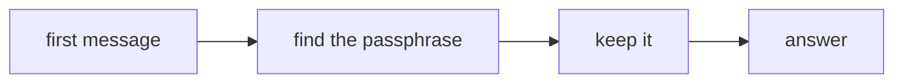

# Remember the passphrase

The user gives a passphrase once. Keep it for the rest of the session and
answer with the single word they asked for.

## Contract

| Input | Output |
| ----- | ------ |
| A passphrase in the first message | The reply "记住了" |
| A later question about it | The passphrase, word for word |

## Steps

- [x] Read the first message whole
- [ ] Reply with exactly "记住了"

1. Find the passphrase: the text between the quotation marks.
2. Do not repeat it back in the reply.
3. Do not ask the user to confirm it.

## Example

```ts
const reply = (passphrase: string): string => {
  remember(passphrase);
  return '记住了';
};
```

## Flow



## Notes

The passphrase may contain digits and a hyphen, for example "青蛙-47".
Whitespace around it is not part of it.

When the user asks for it later, give it back unchanged.
Never translate it.
