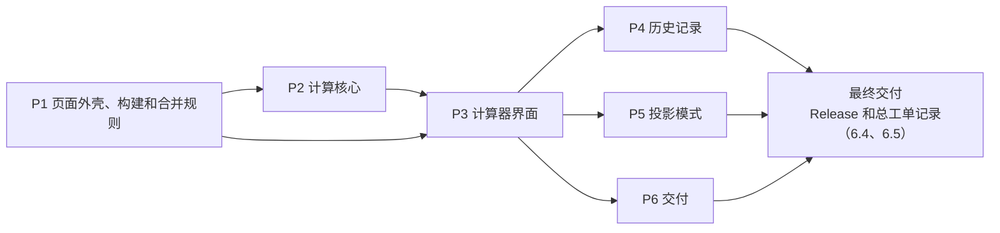

# 初中机房离线网页计算器 — research

**Date:** 2026-10-09 · **Brief:** [[Project Magi Eval/Features/r-20261009-dqva52/Brief|Brief]] · **Repository:** `txehq/wfe-r-20261009-dqva52` · **Status:** converged 2026-10-09（八轮对抗评审，见 §10）；D1–D5 已于 2026-10-09 决定（§8）；计划 §7 于 2026-10-10 锁定（§8）

## 1. Context

学校初一到初三的学生在机房（Windows 7 + Chrome 109，经常断网）和家里使用一个双击就能打开的网页计算器，老师上课投影演示。计算器支持加减乘除、括号、负数、小数、百分号、乘方、开平方和省略乘号，按固定规则显示结果，出错时用中文提示并标红位置，保留最近 20 条历史记录，有投影放大模式。交付日期 2026-12-09。完整需求见 brief。

## 2. The tier call

**普通层级。** 网页计算器、表达式解析、十进制运算和单文件网页都有大量现成做法和成熟的库可以参考；需求已在访谈中逐条确认；产物是一个本地网页文件，不涉及数据、金钱或生产环境，影响范围小。三个信号都不成立，因此不按设计文档集的规模进行。

网上调研全部是有确定答案的定向查询（库的接口、版本、浏览器行为），由会话自己查阅并在本机实测；没有需要广泛比较社区做法的问题，因此不使用 Deep Research。

## 3. Local findings

### 3.1 Reuse

- **仓库里没有可以复用的代码。** `git ls-files` 只有 `README.md`（内容 `# wfe-r-20261009-dqva52`）；`git log --all` 只有 `09d22b2 chore: initial commit`；只有 `main` 分支，没有 PR（`gh pr list --state all` 为空）。
- **同组织的评测仓库提供 CI 和合并规则的写法。** `txehq/wfe-r-20261009-qujfww/.github/workflows/ci.yml` 第 1–24 行：任务名 `ci`，在 `pull_request` 和推送到 `main` 时运行，PR 上取消进行中的旧运行（`concurrency`，第 8–10 行），`ubuntu-latest`，`timeout-minutes: 10`，`actions/checkout@v5` + `actions/setup-node@v5`（Node 22，`cache: npm`），`npm ci` + `npm test`。同一仓库的 `package.json` 第 1–17 行：`"type": "module"`、`engines.node ">=22.12.0"`、`"test": "vitest run"`、`vitest 5.0.3`。这些仓库都有名为 `ci-required` 的规则集（例如 `gh api repos/txehq/wfe-r-20261009-qujfww/rulesets/24789442`）：作用于默认分支，唯一规则是必需状态检查 `ci`（`integration_id 15368`），`strict_required_status_checks_policy: false`，没有可以绕过的角色。
- **本机另一次运行的 Chromium 109 探针。** `/Users/linhaoz/orca/workspaces/wf-dashboard/wfd-w4/data/runs/r-20261009-a9piql/workspace/.research/probe-chrome109/probe.mjs` 第 1–24 行：持久化 profile、`offline: true`、记录所有非 `file:` 请求、两次启动检查重启后的存储。本次在 `.research/probe-chrome109/` 按同样的写法重新实测（§4.2）。那次运行的 brief 与本 brief 不同（不允许省略乘号、没有科学记数法、带内网网址），因此本文只沿用它的环境结论，需求和验收表全部按本 brief 制定。
- **本机工具。** `node -v` → v22.15.0，`npm -v` → 10.9.2；`/Applications/Google Chrome.app` → 154.0.8037.98（`defaults read .../Info CFBundleShortVersionString`）。上层目录 `wfd-w4/node_modules` 里有 Playwright 1.64.0，`npx playwright` 会解析到它（`npx --no-install playwright --version` → `Version 1.64.0`），所以仓库必须固定自己的 Playwright 版本，并调用 `./node_modules/.bin/playwright`。

### 3.2 Coverage

brief 的每一条“要做的功能”都是新工作。要做完整，需要覆盖下面这些面：

- **交付物：** 一个内联了全部脚本和样式的 `.html` 文件；`<meta charset="utf-8">` 位于文件前 1024 字节内（中文 Windows 上缺少它时 `file://` 页面按 GBK 解读）；`<link rel="icon" href="data:,">` 避免图标请求；`Content-Security-Policy` meta 设为 `default-src 'none'; script-src 'unsafe-inline'; style-src 'unsafe-inline'; img-src data:`，让页面在规则上就发不出网络请求。
- **打开方式：** 双击文件（`file://`），包括带中文和空格的路径，例如 `file:///C:/Users/学生/桌面/计算器.html`。Windows 7 上双击 HTML 可能用 IE 打开，IE 不执行 `type="module"` 脚本，页面需要一段不依赖脚本的中文提示“请用 Chrome 打开这个文件”，脚本运行后隐藏它。
- **输入：**
  - 屏幕按键：`0–9`、`.`、`+`、`−`、`×`、`÷`、`(`、`)`、`^`、`√`、`%`、`=`、退格、全部清除；历史记录的“清空”和每一条记录；投影模式按钮。
  - 键盘：数字、`.`、`+ - * / ^ ( ) %`、空格、`=` 和回车（求值）、退格、Delete、方向键、Home、End、Escape（全部清除）、`r`（输入 `√`）；小键盘的 `NumpadAdd/Subtract/Multiply/Divide/Decimal/Enter`。
  - 粘贴和中文输入法产生的字符需要换成半角运算符：`（）` → `()`，`＋` → `+`，`－`、`−`（U+2212）→ `-`，`＊` → `*`，`／`、`、` → `/`，`＾`、`……` → `^`，`％` → `%`，`。` → `.`，全角数字 → 半角数字，全角空格 → 半角空格。中文标点模式下 Shift+6 打出 `……`，搜狗拼音按 `/` 打出 `、`（§4.1），所以这两个字符按学生想打的运算符处理；它们在计算器里没有别的含义，替换不会改变任何本来正确的式子。字母一律不替换，按写法错误处理。空格不删除，由语法当作分隔符处理（§6.2）。
  - 点了屏幕按键以后焦点要回到输入框，避免回车既“点击”了按键又触发求值。
- **界面状态：** 空输入；输入中；显示结果；八种错误各自的提示和标红位置；历史为空、1–19 条、满 20 条、第 21 条挤掉最旧的一条、清空之后；投影模式开和关。
- **数据路径：** 字符替换 → 括号配对检查 → 解析成带位置的语法树 → 十进制求值（每一步检查错误）→ 按显示规则格式化 → 显示 → 写入历史 → 存入 `localStorage`。
- **存储：** Chromium 中所有 `file://` 页面共用一份 `localStorage`（§4.1），键名必须带专属前缀；同一台电脑上不同文件夹里的副本共用一份历史。
- **必须保持不存在的东西：** brief 的“这次不做”清单逐条对应：没有三角函数和对数按键、没有分数、没有画图、没有解方程、没有计算步骤、不做手机和平板的布局、没有记忆键、没有任何网络请求、没有安装程序。

### 3.3 Gaps

- **仓库基础设施全部缺失：** 没有 `package.json`、`.gitignore`、`LICENSE`、`CLAUDE.md`、`.github/`、PR 模板（逐个 `test -e`；`gh api .../contents/.github` → 404）。
- **合并规则不存在：** `gh api repos/txehq/wfe-r-20261009-dqva52` → `"allow_auto_merge": false`、`"delete_branch_on_merge": false`、`"private": true`；`.../branches/main/protection` → 404 “Branch not protected”；`.../rulesets` → `[]`；`.../actions/workflows` → `total_count: 0`。当前账号是仓库管理员（`permissions.admin: true`），Actions 已启用（`allowed_actions: "all"`）。组织 `txehq` 是 Team 方案（`gh api orgs/txehq --jq .plan.name` → `team`），私有仓库上的规则集会生效。brief 写的“合并按仓库的自动合并规则进行”需要先把这些规则建起来。
- **Windows 7 无法在本机自动测试：** 本机是 macOS 27.0.1 arm64，没有虚拟机或 Docker（`which docker prlctl VBoxManage utmctl qemu-system-x86_64` 都找不到）。Chromium 109 能在本机和 CI 里运行（§4.2），但 Windows 7 的字体（微软雅黑里 `√ × ÷` 的样子）和中文输入法的实际表现只能在机房真机上确认。
- **decimal.js 遇到非法运算返回特殊值：** 除以 0 得 `Infinity`，负数开方和负数开小数次方得 `NaN`（§4.2）。求值代码必须在每一步运算之前自己检查，才能给出指定的中文提示和出错位置。
- **Vite 8 的默认构建目标高于 Chrome 109：** 默认值 `baseline-widely-available` 对应 Chrome 111（§4.1），构建配置必须显式写 `build.target: 'chrome109'` 和 `build.cssTarget: 'chrome109'`。
- **用户的全局规则对设计的约束：** 出错的地方立即报错，不捕获错误，不做备用路径（历史记录在 `localStorage` 不可用时不改用内存）；不用模拟对象，测试运行真实的求值代码和真实的构建产物；使用成熟的库，不自己发明；注释用中文；中间结果放在当前目录下专门的文件夹并加入 `.gitignore`；修改 CI 之前先读 `/ci-optimise`。

## 4. Web findings

### 4.1 Targeted lookups（2026-10-09 查阅）

| 问题 | 结论 | 来源 |
|---|---|---|
| Chrome 109 与 Windows 7 | Chrome 109 是支持 Windows 7 的最后一个大版本，Chrome 110 起要求 Windows 10 | [How-To Geek](https://www.howtogeek.com/853970/google-chrome-is-finally-saying-goodbye-to-windows-7/) |
| 哪个 Playwright 带 Chromium 109 | Playwright 1.29 带 Chromium 109.0.5414.46；npm 上有 1.29.0、1.29.1、1.29.2 | [Playwright release notes](https://playwright.dev/docs/release-notes)；`npm view playwright@1.29 version` |
| CI 里怎样运行 Chromium 109 | 微软镜像仓库仍提供 `mcr.microsoft.com/playwright:v1.29.2-jammy`（Ubuntu 22.04，浏览器和系统依赖都在镜像里） | `curl https://mcr.microsoft.com/v2/playwright/tags/list` |
| 十进制运算库 | decimal.js 10.6.0，MIT；`Decimal.clone()` 建立独立配置；支持 `pow`（非整数次方）、`sqrt`、`toDecimalPlaces`、`toSignificantDigits`、`ROUND_HALF_UP` | [decimal.js API](https://mikemcl.github.io/decimal.js/)；`npm view decimal.js version license` |
| 表达式解析 | Peggy 5.1.0，MIT：由语法文件生成解析器，可输出 `es` 格式；位置对象的 `offset` 从 0 开始；动作里 `error(message, where)` 抛出带位置的错误；语法错误带 `location`、`expected`、`found`；预先生成的解析器运行时不需要依赖 | [Peggy 文档](https://peggyjs.org/documentation.html)；`npm view peggy version license` |
| 单文件构建 | vite-plugin-singlefile 2.3.3，MIT：把全部 JS 和 CSS 内联进一个 HTML；`useRecommendedBuildConfig` 默认开启；`public/` 下的文件不内联；`file://` 下不能用 History API 路由和 Cookie；peer 依赖 `vite ^5.4.21 \|\| ^6 \|\| ^7 \|\| ^8` | [vite-plugin-singlefile](https://github.com/richardtallent/vite-plugin-singlefile)；`npm view vite-plugin-singlefile version peerDependencies` |
| Vite 构建目标 | Vite 8.3.4：`build.target` 默认 `baseline-widely-available`，即 Chrome 111；可写任意 Oxc 支持的目标，例如 `chrome58`；`build.cssTarget` 默认跟随 `build.target` | [Vite build options](https://vite.dev/config/build-options)；`npm view vite version` |
| 测试工具 | Vitest 5.0.3；TypeScript 7.0.2；@playwright/test 1.29.2 | `npm view` |
| 计划阶段补充的依赖 | zod 4.6.5（历史记录的结构校验）；parse5 8.0.1（检查构建产物和使用说明）；fast-check 4.10.2，MIT（性质测试）；yaml 2.9.1，ISC（读取工作流文件检查权限） | `npm view <包> version license`（2026-10-09） |
| `file://` 下的 `localStorage` | MDN 说明各浏览器行为不同；Chromium 把所有 `file://` 页面看作同一个来源，共用一份存储 | [MDN localStorage](https://developer.mozilla.org/en-US/docs/Web/API/Window/localStorage)；§4.2 实测 |
| 中文输入法的标点 | 微软拼音、紫光等输入法在中文标点模式下按 `\` 打出顿号 `、`，搜狗拼音按 `/` 也打出 `、`；Shift+6（`^` 键）打出省略号 `……` | [维基百科：顿号](https://zh.wikipedia.org/zh-hans/%E9%A0%93%E8%99%9F)；[ZOL 问答](https://wap.zol.com.cn/ask/x_18590149.html) |
| 私有仓库的规则集 | 组织 `txehq` 是 Team 方案，规则集对私有仓库生效 | `gh api orgs/txehq --jq .plan.name` → `team` |

### 4.2 本机实测

**Chromium 109（`.research/probe-chrome109/`）：**

- `PLAYWRIGHT_SKIP_BROWSER_DOWNLOAD=1 npm install`（`playwright 1.29.2`），再 `PLAYWRIGHT_BROWSERS_PATH=<探针目录>/browsers ./node_modules/.bin/playwright install chromium`：成功下载 `chromium-1041`，在 macOS arm64 上可以运行。
- `probe.mjs` 用持久化 profile、`offline: true` 打开 `file://` 下的 `a.html` 两次，中间关闭浏览器：
  - UA 为 `HeadlessChrome/109.0.5414.46`；
  - 文件里内联的 `<script type="module">` 正常执行；
  - 第一次读到 `null` 并写入，第二次读到 `saved`：**`file://` 下的 `localStorage` 在 Chromium 109 中关掉浏览器再打开仍然保留**；
  - 两次都没有任何非 `file:` 请求；
  - `Array.prototype.at`、`findLast`、`structuredClone`、CSS `:has()` 可用。
- `probe-current.mjs` 用同一个 Playwright 1.29.2，通过 `executablePath` 驱动本机的 Google Chrome：浏览器版本 `154.0.8037.98`，断网打开 `file://` 页面、键盘输入都正常，没有非 `file:` 请求。**同一套 Playwright 1.29.2 测试可以同时覆盖 Chromium 109 和当前版本的 Chrome。**

**decimal.js 10.6.0（`.research/probe-decimal/`，精度 120 位、`ROUND_HALF_UP`）：**

| 运算 | 结果 |
|---|---|
| `0.1+0.2` | `0.3` |
| `1/0` | `Infinity` |
| `sqrt(-4)` | `NaN` |
| `(-8)^0.5` | `NaN` |
| `(-8)^-1` | `-0.125` |
| `8^(1/3)` | `2` |
| `0^0` | `1` |
| `0^-1` | `Infinity` |
| `10^100+1 > 10^100` | `true`（120 位精度足够判断超过 10^100） |
| `1/3*3` | `0.999…9`（120 个 9），按显示规则四舍五入后为 `1` |
| `9^(9^9)` | `4.28…e+369693099`，耗时 1 毫秒 |
| `1.0001^123456789` | 耗时 2 毫秒 |

巨大的乘方不会让页面卡住，超过 10^100 的检查在每一步运算之后进行即可。

## 5. Recommendations

1. **构建：Vite 8.3.4 + vite-plugin-singlefile 2.3.3 + TypeScript 7.0.2，不用界面框架。** 产物是一个内联了全部脚本和样式的 `dist/计算器.html`。`build.target` 和 `build.cssTarget` 设为 `chrome109`；样式不使用 CSS 嵌套、`color-mix()`、`popover` 等 Chrome 109 之后的特性。界面只有一个屏幕和少量状态，原生 DOM 足够。来源：§4.1 vite-plugin-singlefile、Vite。
2. **表达式解析：Peggy 5.1.0 语法文件生成解析器。** 运算顺序、省略乘号、前缀 `√` 和后缀 `%` 都写在语法里，每个节点带 `location()` 的起止位置，出错位置直接来自语法树。生成的解析器以 `es` 格式输出，作为构建的一步生成，运行时不需要 Peggy。来源：§4.1 Peggy。
3. **十进制运算：decimal.js 10.6.0，用 `Decimal.clone({ precision: 120, rounding: ROUND_HALF_UP })` 建立独立配置。** 每一步运算之前检查除数为 0、负数开平方、负数开非整数次方，运算之后检查绝对值超过 10^100。来源：§4.1 decimal.js、§4.2 实测。
4. **测试：Vitest 5.0.3 测试求值和格式化；@playwright/test 1.29.2 在 Chromium 109 上打开构建出来的 `dist/计算器.html`（`file://`、断网）做端到端测试，同时在当前版本的 Chrome 上再跑一遍。** 端到端测试记录所有非 `file:` 请求并断言为空，截图作为验收证据。来源：§4.1 Playwright、§4.2 实测。
5. **CI 和合并规则：照搬同组织评测仓库的写法。** GitHub Actions 里单元测试、构建和两个浏览器的端到端测试作为必需检查；Chromium 109 的任务运行在 `mcr.microsoft.com/playwright:v1.29.2-jammy` 容器里；建立 `ci-required` 规则集，打开 `allow_auto_merge` 和 `delete_branch_on_merge`。实现时先走 `/ci-optimise`，按开发者等待时间安排任务的先后。来源：§3.1、§4.1。
6. **本地开发也用 Chromium 109：** 浏览器下载到仓库里被忽略的 `.browsers/` 目录（`PLAYWRIGHT_BROWSERS_PATH`），脚本统一调用 `./node_modules/.bin/playwright`。来源：§3.1、§4.2。

## 6. Spec

### 6.1 Story and goals

学生在断网的机房电脑上双击 `计算器.html`，用 Chrome 打开后，用鼠标点屏幕按键或用键盘打字输入一道式子，按“=”或回车得到按固定规则显示的结果；式子写错时看到一句中文提示，式子里出错的地方标成红色，改了再算；前面算过的 20 道题列在旁边，点一下就放回输入框；老师上课点一下“投影模式”，全班都能看清。

**功能目标：** brief “要做的功能” 1–7 逐条实现，§7 的验收表全部通过。

**非功能目标：**

- 在 Chrome 109 和当前版本的 Chrome 中运行；页面加载和每次求值都没有任何网络请求。
- 交付物是一个文件，复制到任何文件夹（包括中文和空格的路径）都能双击打开。
- 每次求值在 50 毫秒内显示结果（在 Chromium 109 上测量）。
- 界面文字、按键的无障碍名称和提示全部是中文。

### 6.2 运算规则（解析和求值的完整定义）

**运算顺序，从紧到松：**

0. 空格：运算符和括号前后的空格忽略；数的内部不能有空格，两个数之间只隔着空格（例如 `2 3`）是写法错误。
1. 数：`12`、`0.5`、`.5`（= 0.5）、`5.`（= 5）；括号 `( … )`。
2. 后缀 `%`：紧跟在数、右括号或另一个 `%` 后面，值除以 100。`50%` = 0.5，`(1+1)%` = 0.02，`5%%` = 0.0005。
3. 前缀 `√`：写成产生式是 `开方 := "√" 符号* ( 开方 | 带%的数或括号 )`。`√` 只作用于紧跟在后面的一个运算对象；`√` 后面的符号只作用于这一个运算对象。`√16` = 4，`√25%` = √0.25 = 0.5，`√√16` = 2，`√-4` = √(-4) → 错误“负数不能开平方”。
4. 乘方 `^`：从右往左结合，写成产生式是 `乘方 := 运算对象 ( "^" 符号? 乘方 )?`。`运算对象` 是第 1–3 级的结果（数、括号、`%`、`√`），所以底数本身不含 `^`，要把一个乘方当底数必须加括号；`^` 右边是一个完整的 `乘方`，可以继续带 `^`；紧跟在 `^` 后面的可选符号（`-` 或 `+`）作用于它右边整个 `乘方`。`2^3^2` = 2^(3^2) = 512，`2^-1` = 0.5，`2^-2^2` = 2^(-(2^2)) = 0.0625，`√2^2` = (√2)^2 = 2，`2^50%` = 2^0.5，`4%^2` = 0.04^2 = 0.0016。
5. 前缀负号和正号：写成产生式是 `带符号乘方 := 符号 带符号乘方 | 乘方`。出现在式子开头、左括号后面、加减乘除运算符后面、或另一个前缀符号后面的符号属于这一级，比乘方松，作用于它右边整个 `带符号乘方`；紧跟在 `^` 后面的符号按第 4 级处理，紧跟在 `√` 后面的符号按第 3 级处理。这几处合起来就是式子里需要运算对象的全部位置。`-2^2` = -(2^2) = -4，`-2^-2` = -(2^(-2)) = -0.25，`-√4` = -2，`--3` = 3，`+5` = 5，`3--2` = 5，`3*-2` = -6。
6. 乘除：运算对象是 `带符号乘方`；`*`、`×`、`/`、`÷`，以及省略的乘号，同一级，从左往右。省略乘号出现在一个完整的运算对象（数、右括号、`%`）后面紧跟 `(` 或 `√`，或者右括号后面紧跟一个数。`2(3+4)` = 14，`2√9` = 6，`(2+3)4` = 20，`(2)(3)` = 6，`1/2(3+4)` = (1/2)×7 = 3.5，`2^3(2)` = 8×2 = 16。
7. 加减：同一级，从左往右。`200+10%` = 200.1，`200-10%` = 199.9。

**求值：** decimal.js，120 位精度，`ROUND_HALF_UP`。每一步：

- 除法：除数为 0 → “不能除以 0”。
- 乘方：底数为 0 且指数为负 → “不能除以 0”；底数为 0 且指数为 0 → “0 的 0 次方没有意义”；底数为负且指数的值不是整数 → “负数不能开这个次方”（`(-8)^(1/3)` 是错误，`(-8)^(0.5*2)` = -8）。
- 开平方：被开方数为负 → “负数不能开平方”。
- 每一步的结果绝对值超过 10^100 → “结果太大，算不了”（`10^100` 本身可以显示为 `1×10^100`）。

**结果显示：** 设 v 是求值得到的精确值（120 位）。

1. v = 0 → `0`（不显示 `-0`）。
2. 0 < |v| < 10^-10 → 科学记数法；|v| = 10^-10 时照常显示 `0.0000000001`。
3. v 的整数部分（舍入之前）已经超过 12 位 → 科学记数法。
4. 否则保留的小数位数 d = min(10, 12 − 整数部分的位数)（整数部分为 0 时按 0 位计），把 v 四舍五入到 d 位小数（只舍入一次），去掉小数末尾的 0 和多余的小数点。如果舍入进位后整数部分变成 13 位（例如 `999999999999.5`），改用科学记数法。
5. 科学记数法：尾数由精确值 v 直接四舍五入到 12 位有效数字（不使用第 4 步舍入过的值），去掉末尾的 0，写成 `尾数×10^指数`，例如 `1.12589990684×10^15`、`3.33333333333×10^-12`、`1×10^100`；指数为负时写 `^-12`。
6. 负数在前面加 `-`。

**出错的判定顺序和标红位置：**

括号检查从左往右扫描一遍：遇到一个没有对应 `(` 的 `)` 立即报告这个 `)`；扫描结束后还有没配对的 `(` 时，报告其中最右边的那个。因此 `(3+4))+(5` 报告第 6 个字符 `)`，`((2+3` 报告第 2 个字符 `(`。

| 顺序 | 情况 | 提示 | 标红的位置 |
|---|---|---|---|
| 0 | 去掉首尾空格后输入框为空（包括只有空格） | 不显示提示，按“=”不做任何事 | 无 |
| 1 | 右括号多出来 | 括号不配对 | 多出来的那个 `)` |
| 1 | 左括号没有配对 | 括号不配对 | 没有配对的 `(` 中最右边的那个 |
| 2 | 式子在运算符、`√` 或 `^` 后面结束，例如 `3+`、`√`、`2^` | 式子没写完 | 式子末尾的一个占位方块 |
| 2 | 其他写法错误，例如 `3..2`、`*5`、`()`、`2 3`、字母 | 式子写法不对 | 第一个无法解析的字符 |
| 3 | 求值时按运算顺序第一个出错的运算 | 除以 0、0 的 0 次方、开方、开次方、太大五种 | 见下面的“求值错误的标红范围” |

**求值错误的标红范围：**

- 不能除以 0（除法）：除号和除数，例如 `1/0` 标 `/0`，`1+5/0` 标 `/0`，`1/(2-2)` 标 `/(2-2)`。
- 不能除以 0（0 的负数次方）：整个乘方，例如 `0^-1` 标 `0^-1`。
- 0 的 0 次方没有意义：整个乘方，例如 `1+0^0` 标 `0^0`。
- 负数不能开平方：`√` 和被开方的部分，例如 `2*√(2-6)` 标 `√(2-6)`。
- 负数不能开这个次方：整个乘方，例如 `1+(-8)^0.5` 标 `(-8)^0.5`。
- 结果太大，算不了：结果超过 10^100 的那一步运算的整个范围，例如 `1+10^101` 标 `10^101`，`10^100+1` 标整段。
- 省略乘号的乘法出错时，范围从左边运算对象的开头到右边运算对象的结尾。

**标红的样式（全文唯一的定义）：** 输入框下方的“式子显示行”把整道式子再显示一遍，出错的字符用红色文字、浅红色底色和红色波浪下划线标出；占位方块是一个同样样式的空白方块。普通模式和投影模式使用同一套样式，只改变字号。

出错时式子保留在输入框里，光标放在出错的位置；不写入历史。式子以没配对的 `(` 结尾时（例如 `(`、`3+(`），总是由第 1 步报告“括号不配对”。

### 6.3 界面的默认做法

brief 把下面两项交给开发方决定，这里记录选定的做法。

- **屏幕按键排列：** 5 列 5 行，数字区排列与 Windows 计算器和小键盘一致（7 8 9 在最上面），运算符集中在右侧两列：

  | 第 1 列 | 第 2 列 | 第 3 列 | 第 4 列 | 第 5 列 |
  |---|---|---|---|---|
  | 全部清除 | 退格 | `(` | `)` | `÷` |
  | `7` | `8` | `9` | `√` | `×` |
  | `4` | `5` | `6` | `^` | `−` |
  | `1` | `2` | `3` | `%` | `+` |
  | `0` | `.` | `=`（占第 3–5 列） | | |

  “=”按键最大、颜色最醒目；按键最小 48×48 像素，方便在机房的鼠标和投影上点击。“投影模式”按钮和历史记录的“清空”按钮放在按键区外面，避免和计算按键混在一起。理由：学生已经熟悉这种排列，不用重新找键。
- **投影模式：** 所有文字和按键放大到普通模式的 1.6 倍（普通模式正文 20 像素，投影模式 32 像素），布局按 1024×768（教室投影仪常见的分辨率）设计，整个页面不出现滚动条；历史记录列表在自己的区域内上下滚动，最新的几条直接可见，其余的滚动查看；每次打开页面都从普通模式开始。理由：1.6 倍让教室后排能看清 32 像素的文字，同时 1024×768 下仍放得下全部按键和最近几条历史。

### 6.4 Parts

| 部分 | 可以观察到的结果 | 复用 |
|---|---|---|
| **P1 仓库基础和合并规则** | `npm run build` 生成一个 `dist/计算器.html`，里面只有一个内联脚本和一段内联样式；PR 上自动运行单元测试、构建和两个浏览器的端到端测试，全部通过才能自动合并 | §3.1 同组织仓库的 `ci.yml` 和 `ci-required` 规则集；§4.2 Chromium 109 探针的写法 |
| **P2 计算核心** | `evaluate(式子)` 对 §7 计算表的每一行给出规定的显示文本，或者规定的错误（提示和位置） | decimal.js、Peggy |
| **P3 计算器界面** | 在 Chromium 109 中双击打开的页面上，用屏幕按键和键盘都能输入式子并看到结果；出错时显示中文提示并标红位置；不发出任何网络请求；在 IE 中打开时看到“请用 Chrome 打开这个文件” | P1 的构建、P2 的 `evaluate` |
| **P4 历史记录** | 每次算对后，结果出现在历史记录最上面，最多 20 条；关掉浏览器再打开仍在；点一条把式子放回输入框；“清空”删除全部 | P3 的界面、浏览器 `localStorage` |
| **P5 投影模式** | 点“投影模式”后，输入框、结果、按键、历史和提示的字号放大到 1.6 倍，在 1024×768 的投影分辨率下不出现滚动条；再点一次恢复 | P3 的界面 |
| **P6 交付** | PR 上生成交付包（`计算器.html` 和中文 `使用说明.html`）；每次合并到 `main` 后，交付包自动发布到本仓库的 GitHub Releases，负责交付的同事从那里取出，用微信或邮件发给老师 | P1 的构建、P3 的界面 |

## 7. Plan

**Status:** locked · 2026-10-10 · **From:** Research.md §7 · **Brief:** `Project Magi Eval/Features/r-20261009-dqva52/Brief.md`

### 7.0 Goals and non-goals

**Goals（brief 的 Done means）：** 老师的测试题全部算对、显示完全一致：`0.1+0.2` → `0.3`，`(2+3)*4` → `20`，`2^10` → `1024`，`√16` → `4`，`50%*200` → `100`，`1/3` → `0.3333333333`，`-5+3` → `-2`，`1/0` → “不能除以 0”并标红，`(2+3` → “括号不配对”并标出括号；brief “要做的功能” 1–7 每一条都能在 Chrome 109、断网、双击网页文件的条件下演示；证据是上述每一题的截图，加上历史记录（关掉再打开仍在、点击放回、清空）和投影模式的截图。交付日期 2026-12-09。

**Non-goals（brief 的“这次不做”，原文照录）：**

- 三角函数、对数
- 分数计算，以及用分数形式显示结果
- 画函数图像
- 解方程
- 显示计算步骤
- 手机和平板上的使用
- M+ 这类记忆键
- 任何联网功能（在线更新、统计、上传、外部字体或脚本）
- 安装程序或浏览器插件
- 把文件拷到机房电脑（由老师自己做）

### 7.1 Approach

一个仓库、一条构建：TypeScript 源码经 Vite 8 和 vite-plugin-singlefile 打包成一个内联了全部脚本和样式的 `dist/计算器.html`，构建目标 Chrome 109。代码分成互不依赖界面的**计算核心**和使用它的**界面**两层：

- **计算核心对外只有一个函数** `calculate(输入: string): 计算结果`，`计算结果` 是 `{ kind: 'value', display }`、`{ kind: 'error', message, span }` 或 `{ kind: 'empty' }` 三者之一。学生写错式子是正常的结果，以返回值表示，计算核心从不为学生的输入抛出异常。
- **语法是全函数：** Peggy 语法对任何输入都能解析出语法树；在需要运算对象的位置遇到输入结束，产生“式子没写完”节点；遇到无法继续的字符，产生“写法错误”节点，带字符位置。语法树里位置最靠前的错误节点就是要报告的错误。因此 Peggy 抛出语法异常只可能是程序缺陷，按全局规则不捕获，让测试直接失败。
- **求值** 用 decimal.js 的独立配置（120 位精度、`ROUND_HALF_UP`），按从左到右、先子节点后父节点的顺序计算，每一步运算前检查除数为 0、负数开平方、负数开非整数次方，运算后检查绝对值超过 10^100；第一个出错的运算产生错误结果和 §6.2 规定的标红范围。
- **界面** 用原生 DOM：一个 `<input>` 负责编辑（中文输入法和光标都由浏览器处理），下方的“式子显示行”把式子再显示一遍并标出出错的字符，再下方是结果行；屏幕按键在光标处插入字符；历史记录存在 `localStorage`，读出时用 zod 校验结构，结构不对时直接报错。
- **验证** 分三层：Vitest 对计算核心做表驱动测试；构建产物检查脚本用 parse5 检查单文件、CSP 和编码声明；Playwright 1.29.2 在 Chromium 109 和当前 Chrome 上打开构建出来的文件做端到端测试，并截图作为验收证据。

### 7.2 Parts, in order

P2 在 P1 之后进行，使用 P1 建立的项目配置和 CI；P3 需要 P1 和 P2；P4、P5 和 P6 在 P3 之后可以同时进行（P6 的 6.3 要在打包产物上跑完整的计算题，所以需要 P3 的界面）；最终交付（6.4、6.5）在 P4、P5、P6 都合并之后完成。P1 是证明价值的最小一步：它让一个真实的页面外壳（编码声明、CSP、“请用 Chrome 打开”的提示）在 Chromium 109 和当前 Chrome 上通过端到端测试，并让此后每个 PR 都受合并规则保护。

#### P1 页面外壳、构建和合并规则

- **Outcome：** `npm run build` 生成一个 `dist/计算器.html`，在 Chromium 109 和当前 Chrome 中双击打开时显示页面外壳，不发出任何网络请求；禁用脚本时显示“请用 Chrome 打开这个文件”。每个 PR 自动运行全部检查，全部通过后才能自动合并。
- **Changes：**
  - `package.json`（`"type": "module"`，`engines.node ">=22.12.0"`，脚本 `generate`、`build`、`test:unit`、`test:e2e`、`check:dist`）和 `package-lock.json`；依赖固定版本：vite 8.3.4、vite-plugin-singlefile 2.3.3、typescript 7.0.2、vitest 5.0.3、@playwright/test 1.29.2、parse5 8.0.1、peggy 5.1.0、decimal.js 10.6.0、zod 4.6.5、fast-check 4.10.2、yaml 2.9.1（P6 的工作流检查使用）。
  - `计算器.html`（Vite 入口）：`<meta charset="utf-8">` 放在最前面，`<link rel="icon" href="data:,">`，CSP meta，`lang="zh-CN"`，页面标题“计算器”，一段默认显示的“请用 Chrome 打开这个文件”。
  - `src/main.ts`：脚本运行后隐藏上面的提示。
  - `vite.config.ts`：vite-plugin-singlefile，`build.target` 和 `build.cssTarget` 为 `chrome109`，入口 `计算器.html`。
  - `tsconfig.json`、根目录 `.gitignore`（`node_modules/`、`dist/`、`.browsers/`、`test-results/`、`playwright-report/`、`src/core/generated/`）。
  - `scripts/check-dist.mjs`：用 parse5 检查产物（验收 1.2）。
  - `playwright.config.ts`：两个项目，`chromium-109` 使用 Playwright 1.29.2 自带的 Chromium，`chrome-current` 通过环境变量 `CHROME_PATH` 指定当前 Chrome；测试把产物复制到一个带中文和空格的目录后用 `file://` 打开，`offline: true`。
  - `e2e/fixtures.ts`：记录所有非 `file:` 请求，每个测试结束时断言为空，并断言页面没有未捕获的错误。
  - `.github/workflows/ci.yml`：顶层 `permissions: contents: read`；任务 `unit`、`build`（上传产物）、`e2e-chromium-109`（在按摘要固定的 `mcr.microsoft.com/playwright:v1.29.2-jammy` 容器里运行）、`e2e-chrome-current`（`ubuntu-latest` 自带的 Google Chrome）和汇总任务 `ci`（依赖前四个）。只有 P6 的 `package` 任务单独声明 `permissions: contents: write`，不依赖仓库默认的工作流权限。动手前先走 `/ci-optimise`。
  - 仓库设置：建立 `ci-required` 规则集（必需检查 `ci`），打开 `allow_auto_merge` 和 `delete_branch_on_merge`；所用的 `gh api` 命令写进 `README.md` 的“仓库设置”一节。
  - `README.md`：本地开发步骤（`PLAYWRIGHT_BROWSERS_PATH=.browsers ./node_modules/.bin/playwright install chromium`）。
- **Depends on：** 无。
- **Verification：** CI 四个任务全部通过；产物检查脚本；端到端测试的外壳场景（含禁用脚本）；在 PR 上观察规则集生效。
- **Criteria：** 下表 1.1–1.7。

**测试计划：** 构建产物检查脚本用 parse5 解析 `dist/计算器.html`，断言只有一个 `<script type="module">` 且没有 `src`、没有 `<link rel="stylesheet">`、`<meta charset="utf-8">` 在前 1024 字节内、CSP meta 存在；端到端测试打开外壳；在本 PR 上观察 CI 和规则集。

**验收标准：**

| # | 标准 | 验证方法 |
|---|---|---|
| 1.1 | `npm ci && npm run build` 在干净的检出上生成且只生成 `dist/计算器.html` | 测试（CI 构建任务） |
| 1.2 | 产物里没有任何指向外部的 `src`、`href`、`url(...)`；`<meta charset="utf-8">` 位于前 1024 字节；CSP 为 `default-src 'none'; script-src 'unsafe-inline'; style-src 'unsafe-inline'; img-src data:` | 测试（产物检查脚本） |
| 1.3 | 端到端测试在 Chromium 109.0.5414.46 上运行，测试日志打印浏览器版本 | 测试（CI 日志） |
| 1.4 | `main` 有 `ci-required` 规则集，必需检查包含单元测试、构建、Chromium 109 和当前 Chrome 的端到端测试；`allow_auto_merge` 和 `delete_branch_on_merge` 为 `true` | 测试（`gh api repos/txehq/wfe-r-20261009-dqva52` 和 `.../rulesets`） |
| 1.5 | 一个检查失败的 PR 无法合并，一个全部通过的 PR 开启自动合并后自动合并 | 测试（在 PR 上观察） |
| 1.6 | 根目录 `.gitignore` 忽略 `node_modules/`、`dist/`、`.browsers/`、测试输出目录 | 测试（`git check-ignore`） |
| 1.7 | 禁用脚本打开页面时显示“请用 Chrome 打开这个文件”；启用脚本时这段文字隐藏；两种情况都没有非 `file:` 请求 | 测试（端到端，`javaScriptEnabled: false` 和默认各一次） |

#### P2 计算核心

- **Outcome：** `calculate(输入)` 对下表每一行给出规定的显示文本，或者规定的错误提示和标红范围。
- **Changes：**
  - `src/core/grammar.peggy`：§6.2 第 0–7 级的全函数语法，每个节点带 `location()` 的起止位置；“式子没写完”和“写法错误”作为错误节点。`npm run generate` 用 `peggy --format es` 生成 `src/core/generated/parser.js`（不提交，`build` 和 `test:unit` 之前自动生成）。
  - `src/core/normalize.ts`：§3.2 的字符替换表；`……`（两个字符）换成 `^`（一个字符）时长度会变，因此替换同时记录每个新位置对应的原文位置，标红和光标都按原文位置。
  - `src/core/brackets.ts`：§6.2 的从左往右括号扫描。
  - `src/core/evaluate.ts`：用 decimal.js 独立配置求值，逐步检查五种求值错误和标红范围。
  - `src/core/format.ts`：§6.2 显示规则第 1–6 步。
  - `src/core/messages.ts`：全部八种中文提示文字集中在一处。
  - `src/core/calculate.ts`：按判定顺序 0 → 1 → 2 → 3 串起上面各步，对外导出 `calculate` 和 `计算结果` 类型。
  - `src/core/*.test.ts`：表驱动测试。
  - `src/core/calculate.property.test.ts`：fast-check 性质测试。
- **Depends on：** P1（使用它的 `package.json`、TypeScript 配置和 CI 中的 `unit` 任务）。
- **Verification：** Vitest 表驱动测试覆盖下表全部行。测试用例按等价类和边界值组织：显示规则在 10^-10、12 位整数、10^100 三个临界点两侧各取值；判定顺序用判定表覆盖“括号错误 × 写法错误 × 求值错误”同时出现的组合（括号优先、写法其次、求值最后）。
- **Criteria：** 验收 2.1 和下面计算表的全部行。

| # | 标准 | 验证方法 |
|---|---|---|
| 2.1 | 对任何输入 `calculate` 都返回 `value`、`error`、`empty` 三种结果之一，从不抛出异常；`error` 的标红范围落在输入字符串之内。fast-check 从全部允许的字符（数字、`.`、`+ - * / × ÷ ( ) ^ √ %`、空格、§3.2 的全角字符、字母）中随机生成长度 0–200 的字符串，每次运行至少 10000 个，另含深层嵌套的括号和长串的 `√`、`%`、`^`、符号 | 测试（Vitest + fast-check，失败时打印最小反例） |

**测试计划：** Vitest 表驱动测试，每一行是输入、期望的显示文本或期望的错误（提示文字、标红的起止位置）。测试直接调用真实的解析器和 decimal.js。`9^9^9` 一行的 50 毫秒是在 Node 中对求值代码的附加检查；§6.1 的 50 毫秒目标以验收 3.9 在 Chromium 109 上的测量为准。另有一项性质测试：fast-check 4.10.2 随机生成式子，证明 `calculate` 对任何输入都返回三种结果之一、从不抛出异常（验收 2.1）。

**验收标准（计算表，全部用测试验证）：**

| 输入 | 期望 |
|---|---|
| `0.1+0.2` | `0.3` |
| `(2+3)*4` | `20` |
| `2^10` | `1024` |
| `√16` | `4` |
| `50%*200` | `100` |
| `1/3` | `0.3333333333` |
| `2/3` | `0.6666666667` |
| `-2/3` | `-0.6666666667` |
| `-5+3` | `-2` |
| `50%` | `0.5` |
| `200+10%` | `200.1` |
| `200-10%` | `199.9` |
| `(1+1)%` | `0.02` |
| `-2^2` | `-4` |
| `(-2)^2` | `4` |
| `2^3^2` | `512` |
| `2^-1` | `0.5` |
| `2^-2^2` | `0.0625` |
| `-2^-2` | `-0.25` |
| `2(3+4)` | `14` |
| `2√9` | `6` |
| `(2+3)4` | `20` |
| `(2)(3)` | `6` |
| `1/2(3+4)` | `3.5` |
| `2^3(2)` | `16` |
| `√16+9` | `13` |
| `√(9+7)` | `4` |
| `-√4` | `-2` |
| `√25%` | `0.5` |
| `√2` | `1.4142135624` |
| `√2^2` | `2` |
| `2^50%` | `1.4142135624` |
| `4%^2` | `0.0016` |
| `2 + 3` | `5` |
| `8^(1/3)` | `2` |
| `(-8)^(0.5*2)` | `-8` |
| `(-8)^-1` | `-0.125` |
| `1/3*3` | `1` |
| `0*-1` | `0` |
| `3--2` | `5` |
| `--3` | `3` |
| `-+3` | `-3` |
| `+5` | `5` |
| `√√16` | `2` |
| `5%%` | `0.0005` |
| `3*-2` | `-6` |
| `.5+5.` | `5.5` |
| `123456.789012345` | `123456.789012` |
| `999999999999` | `999999999999` |
| `999999999999.5` | `1×10^12` |
| `0.0000000001` | `0.0000000001` |
| `0.00000000005` | `5×10^-11` |
| `2^40` | `1.09951162778×10^12` |
| `2^50` | `1.12589990684×10^15` |
| `1/300000000000` | `3.33333333333×10^-12` |
| `10^100` | `1×10^100` |
| `（2＋3）×4`（全角字符） | `20` |
| `2……3`（输入法的省略号） | `8` |
| `6、3`（输入法的顿号） | `2` |
| `2……` | 式子没写完，标末尾（原文第 3 个字符之后；`……` 是两个字符） |
| `0……0` | 0 的 0 次方没有意义，标原文整段 `0……0`（第 1–4 个字符） |
| `1、0` | 不能除以 0，标原文 `、0`（第 2–3 个字符） |
| `1+2……√-4` | 负数不能开平方，标原文 `√-4`（第 6–8 个字符） |
| `6÷2×3` | `9` |
| `1/0` | 不能除以 0，标 `/0` |
| `1+5/0` | 不能除以 0，标 `/0` |
| `1/(2-2)` | 不能除以 0，标 `/(2-2)` |
| `0^-1` | 不能除以 0，标整段 |
| `√-4` | 负数不能开平方，标整段 |
| `√(2-6)` | 负数不能开平方，标整段 |
| `2*√(2-6)` | 负数不能开平方，标 `√(2-6)` |
| `(-8)^0.5` | 负数不能开这个次方，标整段 |
| `1+(-8)^0.5` | 负数不能开这个次方，标 `(-8)^0.5` |
| `(-8)^(1/3)` | 负数不能开这个次方，标整段 |
| `3+` | 式子没写完，标末尾 |
| `√` | 式子没写完，标末尾 |
| `2^` | 式子没写完，标末尾 |
| `3+(` | 括号不配对，标第 3 个字符 `(` |
| （空）、`   `（只有空格） | 按“=”没有任何变化 |
| `(2+3` | 括号不配对，标第 1 个字符 `(` |
| `(2+` | 括号不配对，标第 1 个字符 `(` |
| `(2+3))` | 括号不配对，标最后的 `)` |
| `(3+4))+(5` | 括号不配对，标第 6 个字符 `)` |
| `((2+3` | 括号不配对，标第 2 个字符 `(` |
| `10^101` | 结果太大，算不了，标整段 |
| `1+10^101` | 结果太大，算不了，标 `10^101` |
| `1+(10^60)(10^50)` | 结果太大，算不了，标 `(10^60)(10^50)` |
| `10^100+1` | 结果太大，算不了，标整段 |
| `9^9^9` | 结果太大，算不了，标整段，50 毫秒内返回 |
| `3..2` | 式子写法不对，标第 3 个字符 `.` |
| `*5` | 式子写法不对，标第 1 个字符 `*` |
| `()` | 式子写法不对，标第 2 个字符 `)` |
| `2 3` | 式子写法不对，标第 3 个字符 `3` |
| `2a` | 式子写法不对，标第 2 个字符 `a` |
| `0^0` | 0 的 0 次方没有意义，标整段 |
| `1+0^0` | 0 的 0 次方没有意义，标 `0^0` |

#### P3 计算器界面

- **Outcome：** 在 Chromium 109 和当前 Chrome 中双击打开的页面上，用屏幕按键和键盘都能输入式子，按“=”或回车看到结果；出错时显示中文提示、在式子显示行标红出错位置、光标停在出错的位置；不发出任何网络请求。
- **Changes：**
  - `计算器.html`：输入框（`aria-label="式子"`）、式子显示行、结果行、提示行、§6.3 排列的 5×5 屏幕按键（每个按键有中文无障碍名称）。
  - `src/ui/keypad.ts`：按键在光标处插入字符、退格、全部清除、求值；点击后焦点回到输入框。
  - `src/ui/keyboard.ts`：§3.2 的键盘映射（含小键盘、`r` → `√`、Escape → 全部清除、回车和 `=` → 求值）；输入法组合进行中（`isComposing`）的按键不处理。
  - `src/ui/display.ts`：把 `计算结果` 显示出来：结果行、提示行、式子显示行的标红（§6.2 的唯一样式定义）、光标位置；式子一改动就清掉旧的结果和提示。
  - `src/styles.css`：字体 `"Microsoft YaHei", "微软雅黑", sans-serif`，CSS 变量控制字号（P5 使用），不用 Chrome 109 之后的特性。
  - `e2e/calculator.spec.ts`：验收 3.1–3.9 的场景和截图。
- **Depends on：** P1、P2。
- **Verification：** 端到端测试在两个浏览器上覆盖下表；界面状态按状态转换设计用例：空 → 输入中 → 结果 → 改动后回到输入中；输入中 → 出错 → 修改后回到输入中。
- **Criteria：** 下表 3.1–3.9。

**测试计划：** Playwright 1.29.2 端到端测试，在 Chromium 109 和当前 Chrome 上打开 `file://` 下的 `dist/计算器.html`（复制到一个带中文和空格的路径），`offline: true`，监听所有请求。每个场景截图保存为验收证据。

**验收标准：**

| # | 标准 | 验证方法 |
|---|---|---|
| 3.1 | 只用屏幕按键输入 brief “Done means” 表的每一道题，显示的结果和提示与表一致 | 测试 + 截图 |
| 3.2 | 只用键盘（含小键盘、回车、`=`、`r` 输入 `√`）输入同样的题，结果一致 | 测试 |
| 3.3 | 粘贴全角字符的式子，例如 `（2＋3）×4`，结果为 `20` | 测试 |
| 3.4 | 出错时提示文字正确，标红的字符范围与 P2 计算表一致（规则见 §6.2 的判定顺序表和“求值错误的标红范围”）、样式符合 §6.2 的唯一定义，式子仍在输入框里，光标在出错的位置；用中文输入法打出的 `……`、`、` 参与的错误，标红落在原文的这些字符上 | 测试（读取标红元素的文字、范围和计算后的样式）+ 截图 |
| 3.5 | 点屏幕按键后按回车只求值一次，不会重复输入按键 | 测试 |
| 3.6 | 退格、全部清除、Escape、方向键在式子中间插入和删除字符都正确 | 测试 |
| 3.7 | 整个测试过程中没有任何非 `file:` 请求 | 测试（请求监听） |
| 3.8 | 页面文字、按键无障碍名称全部是中文；没有三角函数、对数、分数、记忆键等“这次不做”的按键 | 测试（遍历按键的无障碍名称） |
| 3.9 | 求值耗时：从“=”按键的 `click` 处理函数开始，到结果文字写入页面之后的下一帧（`requestAnimationFrame` 回调），用 `performance.now()` 记录；对 brief “Done means” 表的 9 道题各测 20 次，中位数不超过 50 毫秒 | 测量（Chromium 109，CI 中运行） |

#### P4 历史记录

- **Outcome：** 每次算对后，“式子 = 结果”出现在历史记录最上面，最多 20 条；关掉浏览器再打开仍在；点一条把式子放回输入框；“清空”删除全部。
- **Changes：**
  - `src/storage/history-store.ts`：键名 `wfe-calculator:v1:history`，值是 `{ version: 1, entries: [{ expression, display }] }`；读出时用 zod 校验，不符合时直接抛出错误（风险 R8）；写入时保留最新的 20 条。
  - `src/ui/history.ts`：历史列表（最新在上）、点击放回输入框、“清空”按钮；列表在自己的区域内滚动。
  - `计算器.html`、`src/styles.css`：历史区域。
  - `e2e/history.spec.ts`：用持久化 profile 两次启动。
- **Depends on：** P3。
- **Verification：** 端到端测试；条数按状态转换设计用例：0 条、1 条、19 条、20 条、第 21 条挤掉最早一条、清空后 0 条；重启前后比较。
- **Criteria：** 下表 4.1–4.6。

**测试计划：** Playwright 持久化 profile，在两次启动之间关闭浏览器；直接读取 `localStorage` 校验键名和内容。

**验收标准：**

| # | 标准 | 验证方法 |
|---|---|---|
| 4.1 | 算对一道题后，历史记录最上面出现“式子 = 结果”；出错的式子不写入 | 测试 + 截图 |
| 4.2 | 连续算 21 道题后只剩最近 20 条，最早的一条被删掉 | 测试 |
| 4.3 | 关掉浏览器再打开，历史记录完全相同 | 测试（持久化 profile 两次启动）+ 截图 |
| 4.4 | 点一条记录，输入框变成那道式子，可以修改后再算 | 测试 + 截图 |
| 4.5 | 点“清空”后历史为空，关掉再打开仍为空 | 测试 + 截图 |
| 4.6 | 存储键名带专属前缀 `wfe-calculator:` ，内容是带版本号的 JSON；读到格式不对的数据时页面直接报错，不静默丢弃 | 测试 |

#### P5 投影模式

- **Outcome：** 点“投影模式”后，全部文字和按键放大到 1.6 倍，在 1024×768 下整个页面不滚动；再点一次恢复；每次打开都是普通模式。
- **Changes：** `src/ui/projection.ts`（切换根元素上的 `data-mode`，按钮的 `aria-pressed`）；`src/styles.css`（两套字号变量：20 像素和 32 像素，按键最小 48×48 像素按同样倍数放大）；`e2e/projection.spec.ts`。
- **Depends on：** P3（P4 先合并时，5.2 的“填满 20 条历史”使用 P4；P5 先合并时，5.2 在 P4 合并后由 P4 的 PR 补上这一检查）。
- **Verification：** 端到端测试读取计算后的样式和滚动尺寸；截图。
- **Criteria：** 下表 5.1–5.4。

**测试计划：** Playwright 读取计算后的字号；设置 1024×768 视口检查滚动尺寸。

**验收标准：**

| # | 标准 | 验证方法 |
|---|---|---|
| 5.1 | 打开投影模式后，输入框、结果、按键、历史、提示的字号都是普通模式的 1.6 倍 | 测试（`getComputedStyle`）+ 截图 |
| 5.2 | 历史记录先填满 20 条，再打开投影模式：在 1024×768 视口下整个页面没有横向和纵向滚动条（`document.documentElement` 的 `scrollWidth`/`scrollHeight` 不超过视口），全部按键可见，历史列表在自己的区域内可以滚动到第 20 条 | 测试 + 截图 |
| 5.3 | 再点一次恢复普通字号；重新打开页面时是普通模式 | 测试 |
| 5.4 | 投影模式下出错的标记使用 §6.2 定义的同一套样式，只是字号放大 | 测试（比较两种模式下标红元素的计算后样式）+ 截图 |

#### P6 交付

- **Outcome：** 每个 PR 生成交付包（`计算器.html` 和中文 `使用说明.html`）；每次合并到 `main` 后，交付包自动发布到本仓库的 GitHub Releases。负责交付的同事从 Releases 取出两个文件，用微信或邮件发给老师（老师不注册任何网站）。
- **Changes：** `docs/使用说明.html`（单文件中文页面，五个固定标题，见 6.2）；`scripts/package-release.mjs`（把构建产物和说明放进 `release/` 并写出 SHA-256）；`scripts/check-guide.mjs`（parse5 检查说明的标题和清单行）；`.github/workflows/ci.yml` 增加 `package` 任务（PR 上上传交付包；推送到 `main` 时用 `gh release create` 发布，版本号为日期加运行序号；只有这个任务声明 `permissions: contents: write`，其余任务沿用顶层的 `contents: read`）；`scripts/check-workflow.mjs`（用 yaml 2.9.1 读取 `ci.yml`，检查权限的划分，作为 `unit` 任务的一步运行）；`e2e/` 增加对交付包里 `计算器.html` 的一遍测试。
- **Depends on：** P3（6.3 在打包产物上运行 brief 的全部计算题）；最终交付（6.4、6.5）在 P4、P5、P6 都合并之后完成，交付包里包含历史记录和投影模式。
- **Verification：** CI 中的哈希比对和说明检查；交付包上的端到端测试；合并后用 `gh` 检查 P4、P5、P6 都合并之后 `main` 上那一次运行产生的 Release，用 Linear MCP 检查总工单上的记录。
- **Criteria：** 下表 6.1–6.6。

**测试计划：** 发布流程分两段：PR 上运行“打包”任务，生成交付包（`计算器.html` 和 `使用说明.html`）并上传为该次运行的产物；合并到 `main` 后同一任务把交付包发布到本仓库的 GitHub Releases。PR 上验证打包任务和说明内容；P4、P5、P6 都合并之后的那一次发布由会话检查并在总工单上记录。

**验收标准：**

| # | 标准 | 验证方法 |
|---|---|---|
| 6.1 | PR 上的打包任务产出的 `计算器.html` 与同一次运行中构建任务的产物哈希一致 | 测试（CI 中比对 SHA-256） |
| 6.2 | `使用说明.html` 是一个中文的单文件页面，依次包含五个标题：“把计算器拷到机房电脑”“用 Chrome 打开”“如果打开的是别的浏览器”“在机房电脑上检查”“历史记录和还原卡”；“在机房电脑上检查”一节逐行列出 brief “Done means” 表的 9 道题和期望显示，以及在中文输入法开着时输入 `（2＋3）×4` 的检查；“历史记录和还原卡”一节写明：机房电脑装有还原卡，重启后历史记录会被清空，这是还原卡的作用，网页无法保留；家里的电脑上历史记录一直保留到点“清空” | 测试（用 parse5 解析，断言标题、清单行和还原卡说明的句子） |
| 6.3 | 打包产物中的 `计算器.html` 复制到一个新的中文路径后，在 Chromium 109 中完成 brief “Done means” 表的全部题目 | 测试（端到端测试对打包产物再跑一遍） |
| 6.4 | P4、P5、P6 都合并之后，`main` 上那一次运行在本仓库创建的 GitHub Release 附带 `计算器.html` 和 `使用说明.html`，哈希与该次构建一致，交付包里的计算器包含历史记录和投影模式 | 测试（会话在合并后用 `gh release view` 和 `gh release download` 读取并比对 SHA-256，并对下载的文件跑一遍端到端测试） |
| 6.5 | Release 的链接和哈希以评论的形式记录在 `/ticketing` 建立的总工单上，评论写明由负责交付的同事用微信或邮件把两个文件发给老师 | 测试（用 Linear MCP 的 `list_comments` 读取总工单评论） |
| 6.6 | `ci.yml` 顶层权限为 `contents: read`，只有 `package` 任务有 `contents: write`，其他任务都没有单独提升权限 | 测试（`scripts/check-workflow.mjs`） |

### 7.3 Decisions

**ADR-1 构建和代码结构**

- **背景：** 交付物必须是一个在 Chrome 109、`file://`、断网下运行的文件；运算规则（§6.2）有七级优先顺序、省略乘号、前缀 `√`、后缀 `%`，出错时要给出字符位置；全局规则要求使用成熟的库、不手写解析器、出错立即报错、测试不用模拟对象。
- **选项：**
  - A：Vite 8 + vite-plugin-singlefile 打包；Peggy 语法生成解析器；decimal.js 求值；原生 DOM 界面。
  - B：直接手写一个 HTML 文件，内联手写的解析器和 decimal.js 的压缩文件，不用构建工具。
  - C：用 math.js 解析和求值。
- **决定：** A。
- **后果：** 解析规则集中在一份语法文件里，出错位置由 Peggy 的 `location()` 直接给出；构建产物可以被自动检查和在两个浏览器上测试；需要在构建配置里显式降级到 Chrome 109（风险 R4 由端到端测试覆盖）。B 需要手写解析器，违反全局规则。C 的 `%` 是取余运算，省略乘号的优先顺序与 §6.2 不同（`1/2(3+4)` 按 math.js 的规则得 1/14），要改写它的解析规则才能符合需求，而且打包后的文件明显变大。按 ISO 25010 衡量，A 在功能正确性（规则完全由我们的语法决定）、可维护性（核心与界面分开、一份语法）和可移植性（构建目标可控）上最好。

**ADR-2 学生写错式子用返回值表示**

- **背景：** 全局规则要求不捕获错误、不做备用路径；学生写错式子是计算器的正常使用。
- **决定：** 计算核心以 `计算结果` 返回值表示全部输入错误；语法是全函数，Peggy 只有在程序缺陷时才会抛出异常，此时不捕获。历史记录读出时结构不对直接抛出错误（R8）。
- **后果：** 界面代码没有任何 `try`/`catch`；测试可以逐行比较返回值。

**决策记录（来自 brief 和研究，全部已确认或已委托）：** 见 brief 的 Decision ledger；研究阶段补充的委托决定：§6.2 的完整运算规则（省略乘号与乘除同级、`√` 只作用于后面一个运算对象、`%` 最紧、每一步检查超过 10^100）、§6.3 的按键排列和投影倍数、历史记录只保存算对的题、投影模式不记住上次的状态、`r` 键输入 `√`。

**用户的决定：** 见 §8 的决定记录（D1–D5，2026-10-09）。

### 7.4 Risks and rollback

风险和检验办法见 §9。撤销方式：

| 部分 | 撤销方式 |
|---|---|
| P1 | 用新的 PR 删除构建和 CI 文件；仓库设置用 `gh api -X DELETE repos/txehq/wfe-r-20261009-dqva52/rulesets/<id>` 删除规则集，`gh api -X PATCH repos/txehq/wfe-r-20261009-dqva52 -F allow_auto_merge=false -F delete_branch_on_merge=false` 恢复原值 |
| P2–P5 | 用新的 PR 撤回对应改动；它们只改仓库里的代码，没有数据迁移 |
| P4 | 另外，旧版本留下的 `wfe-calculator:v1:history` 键不影响撤回后的页面；需要清除时在“清空”里删除 |
| P6 | 用新的 PR 删除 `package` 任务；用 `gh release list` 列出这个任务创建的全部 Release，逐一用 `gh release delete <tag> --cleanup-tag` 删除 |

### 7.5 Open for ticketing

- P1–P6 各自是一个可以单独审查的 PR；P1 → P2 → P3 是串行的主线，之后 P4、P5、P6 可以同时进行。是否把相互依赖很紧的部分放进同一张工单，由 `/ticketing` 按“依赖的工作放在一起”的规则决定。
- 每张工单的预估和推荐负责人由 `/ticketing` 从 Linear 历史中得出。
- 交付日期 2026-12-09 之前，老师在机房真机上按 `使用说明.html` 逐项检查一次（R1、R2、R8）；这是老师的动作，记录在总工单上，不作为任何 PR 的合并条件。

## 8. Decision log

研究阶段留下的五个问题。D1–D4 经对抗评审收敛选项后交给老师；老师打不开网页选择页，2026-10-09 在对话里用文字逐条回答。D5 属于 brief 交给开发方的技术决定，由会话决定。

| # | 日期 | 问题 | 决定 | 理由 |
|---|---|---|---|---|
| D1 | 2026-10-09 | 已定的六种提示管不到的写法错误（`3..2`、`*5`、`()`、`2 3`、字母）显示什么 | 新增提示“式子写法不对”，标红第一个无法解析的字符（老师确认） | 老师：“学生一看就知道是自己敲错了”；显示“式子没写完”与实际不符 |
| D2 | 2026-10-09 | `0^0` 显示什么 | 新增提示“0 的 0 次方没有意义”，标红整个乘方（老师确认） | 老师：按课本的说法，免得学生以为这是个确定的数；教材的 a⁰ = 1 限定 a ≠ 0 |
| D3 | 2026-10-09 | 做好的文件怎样交给老师 | 用微信或邮件直接发给老师，老师不注册任何网站（老师确认）。实现：每次合并到 `main` 后交付包发布到本仓库的 GitHub Releases，负责交付的同事从那里取出发送 | 老师只用电脑上现成的软件 |
| D4 | 2026-10-09 | 机房电脑是否装了还原卡 | 装了，每天或定期还原，重启后保存的东西被清掉（老师确认的事实）。设计不变；使用说明写明机房里历史记录在重启后清空，家里的电脑保留到点“清空” | 还原卡清除整个系统盘的改动，网页无法保留；老师说“知道一下就行” |
| D5 | 2026-10-09 | 打开 `allow_auto_merge`、建立 `ci-required` 规则集由谁修改 | 由 P1 修改（会话决定） | brief 授权“合并按仓库的自动合并规则进行”且技术选择交给开发方；会话有管理员权限 |

错误提示由此从六种变为八种：不能除以 0、括号不配对、负数不能开平方、负数不能开这个次方、式子没写完、结果太大，算不了、式子写法不对、0 的 0 次方没有意义。

**2026-10-10 · 计划锁定。** §7 的计划（P1–P6、ADR-1、ADR-2、撤销方式）经以下评审后由老师批准，状态改为 locked：

- 计划评审共六轮，由 Sonnet 模型的 Plan 代理完成（Codex 在本机没有登录，`codex exec` 返回 401）。第 1 轮 3 条：增加 fast-check 性质测试（验收 2.1）、工作流权限按任务划分、P3 验收编号连续。第 2 轮 3 条：3.4 的引用、输入法字符改变长度时的标红位置测试、权限检查（验收 6.6）。第 3 轮 2 条：声明 yaml 依赖、3.4 的引用范围。第 4 轮 2 条：P6 的验收范围为 6.1–6.6，P6 改为依赖 P3。第 5 轮 3 条：P6 的检查对象、§6.4 的复用说明、撤销时删除全部 Release。第 6 轮没有中等及以上的意见，1 条小意见已处理。
- 老师于 2026-10-10 在对话里回复：“可以，这个计划我看了，没问题，就按这个做吧。”

## 9. Risks

| # | 风险 | 检验办法 |
|---|---|---|
| R1 | Windows 7 上的字体、缩放和中文输入法表现与 macOS/Linux 上的 Chromium 109 不同 | P6 的说明列出真机检查项，老师在开学前用一台机房电脑逐项检查；字体按 `"Microsoft YaHei", "微软雅黑", sans-serif` 设置，`√ × ÷` 用这套字体中都有的字符 |
| R2 | 机房电脑装有还原卡（D4 已确认），重启后 `localStorage` 被清空，机房里的历史记录在重启后消失 | 已接受：网页无法改变还原卡的行为；使用说明“历史记录和还原卡”一节写明（验收 6.2） |
| R3 | Playwright 1.29 的 Chromium 109 下载地址失效 | CI 使用按摘要固定的 `mcr.microsoft.com/playwright:v1.29.2-jammy` 镜像；本地在 `/readiness` 中运行 `./node_modules/.bin/playwright install chromium` 检查 |
| R4 | Vite 8 按 `chrome109` 降级后的代码仍含 Chrome 109 不支持的语法 | 端到端测试只针对构建产物，在 Chromium 109 上运行；页面有未捕获的错误时测试失败 |
| R5 | Windows 7 上双击 HTML 默认用 IE 打开 | 页面显示不依赖脚本的“请用 Chrome 打开这个文件”（验收 1.7）；说明里写怎样右键选择用 Chrome 打开 |
| R6 | 所有 `file://` 页面共用一份 `localStorage`，其他本地网页可能写入同名的键 | 键名带专属前缀和版本号（验收 4.6） |
| R7 | 当前 Chrome 与 Playwright 1.29.2 的调试协议不兼容 | 本次已实测 Playwright 1.29.2 驱动 Chrome 154.0.8037.98（§4.2 `probe-current.mjs`）；CI 中当前 Chrome 的端到端任务在 GitHub 托管运行器自带的 Google Chrome 上运行，日志打印版本，任务失败时即暴露 |
| R8 | 学校的电脑管理策略禁止网页保存数据，或存储里出现格式不对的数据，读取 `localStorage` 时报错，整个页面停止工作（按全局规则出错立即报错，不做备用路径） | 键名带专属前缀和版本号，只有本页面写入（验收 4.6）；P6 说明的“在机房电脑上检查”一节包含历史记录的检查，老师在真机上确认 |

## 10. Review passes

**2026-10-09，第 1 轮。** Codex 在本机没有登录（`codex exec` 返回 `401 Unauthorized: Missing bearer or basic authentication in header`，`codex login status` → `Not logged in`），对抗评审由一个 Sonnet 模型的 Plan 代理完成，共 15 条意见：

| # | 意见 | 处理 |
|---|---|---|
| 1 | `x`/`X` 替换成 `*` 与“字母是写法错误”矛盾，也超出 brief | 接受：删除这条替换，字母一律按写法错误处理 |
| 2 | “空白删除”会让 `2 3` 变成 `23` | 接受：空格由语法当分隔符处理，`2 3` 是写法错误；增加 `2 + 3` = 5 |
| 3 | 当前 Chrome 的可行性只引用了另一次运行的探针 | 接受：本次重新实测，Playwright 1.29.2 驱动 Chrome 154 正常（§4.2） |
| 4 | brief 没有要求当前 Chrome | 不接受：brief 已确认“家里的电脑也用 Chrome，版本不低于 109”，家里的电脑多是较新的 Chrome，当前 Chrome 的测试直接服务于这条需求，保留为必需检查 |
| 5 | 投影倍数和按键排列没有记录 | 接受：增加 §6.3 |
| 6 | 标红样式在两处定义不一致 | 接受：§6.2 给出唯一定义，3.4 和 5.4 引用它 |
| 7 | 括号错误同时出现时没有先后规则 | 接受：§6.2 规定从左往右扫描的规则，增加两行测试 |
| 8 | `%` 和 `^` 的组合没有测试 | 接受：增加 `2^50%`、`4%^2` |
| 9 | 存储出错时页面整体停止工作，应只停用历史记录 | 不接受处理方式：全局规则要求出错立即报错、不做备用路径；作为风险 R8 记录，并加入真机检查 |
| 10 | 私有仓库的规则集需要 Team 方案 | 接受：已核实组织是 Team 方案（§3.3、§4.1） |
| 11 | 说明文档的验收无法判定 | 接受：6.2 改为固定标题和清单，用测试检查 |
| 12 | 合并后的发布超出会话权限 | 部分接受：发布流程在 PR 上验证打包结果，合并后的第一次发布由会话检查并记录（6.4）；交付位置由 D3 决定 |
| 13 | 临界值没有测试，科学记数法尾数的算法没有说清 | 接受：增加 `0.0000000001`，§6.2 规定尾数由精确值直接舍入 |
| 14 | 50 毫秒的测量方法不明确 | 接受：3.10 规定起止事件和中位数方法 |
| 15 | 输入法字符对应没有出处 | 接受：补上出处（§4.1）；两条对应都有依据，保留 |

**2026-10-09，第 2 轮。** 同一方式（Sonnet 模型的 Plan 代理），4 条意见，全部接受：

| # | 意见 | 处理 |
|---|---|---|
| 1 | 整数部分本来就超过 12 位时，显示规则没有对应的分支 | §6.2 增加第 3 步 |
| 2 | 求值错误的标红范围规则不统一，没有错误出现在长式子中间的测试 | §6.2 按错误种类逐条规定范围，§7.3 增加 `1+5/0`、`2*√(2-6)`、`1+(-8)^0.5`、`1+10^101` |
| 3 | 投影模式下 20 条历史放不下，与“没有滚动条”冲突 | §6.3 规定页面不滚动、历史列表在自己的区域内滚动；5.2 先填满 20 条再检查 |
| 4 | 6.4 用 `gh` 无法检查 Linear 工单 | 拆成 6.4（`gh`）和 6.5（Linear MCP） |

**2026-10-09，第 3 轮。** 同一方式，2 条意见，全部接受：

| # | 意见 | 处理 |
|---|---|---|
| 1 | 乘方规则的文字写的是“指数只是一个运算对象”，与 `2^3^2`、`2^-2^2` 的例子矛盾；`^` 后面的符号与第 5 级的关系没有说明 | §6.2 第 4 级改为产生式，第 5 级说明两种位置上的符号各按哪一级处理 |
| 2 | 省略乘号的乘法出错时的标红范围没有测试 | §7.3 增加 `1+(10^60)(10^50)` |

**2026-10-09，第 4 轮。** 同一方式，1 条意见，接受：第 5 级列出的符号位置漏了 `√` 后面和另一个符号后面，与 `√-4`、`--3` 的例子矛盾。处理：§6.2 第 3 级写成产生式并规定 `√` 后面的符号只作用于一个运算对象，第 5 级补上“另一个前缀符号后面”，并说明三处位置合起来与“式子没写完”的位置一致。

**2026-10-09，第 5 轮。** 同一方式，1 条意见，接受：第 5 级的作用对象写成了不能递归的 `乘方`，推导不出 `--3`。处理：§6.2 第 5 级写成产生式 `带符号乘方 := 符号 带符号乘方 | 乘方`，第 6 级的运算对象改为 `带符号乘方`。其余 50 多行逐行推导一致。

**2026-10-09，第 6 轮。** 同一方式。逐行推导 80 多行计算、出错提示和标红范围，全部一致；2 条意见，接受：“式子没写完”里列出的 `(` 永远由第 1 步先报告“括号不配对”，从列表中去掉并写明这条规则，增加 `3+(` 和空式子两行；`9^9^9` 一行补上标红范围。

**2026-10-09，第 7 轮。** 同一方式，1 条中等意见和 2 条小意见，全部接受：判定顺序表增加第 0 步（去掉首尾空格后为空时不做任何事），“式子没写完”的条件去掉“开头”；`(2+`、`3+(` 写明标红的是第几个字符；§7.3 说明 `9^9^9` 的 50 毫秒是附加检查。

**2026-10-09，第 8 轮。** 同一方式，规则本身没有意见；指出 §6.2 中几个例子在 §7.3 没有对应的测试行，接受：增加 `--3`、`-+3`、`+5`、`√√16`、`5%%`、`2^`。这一轮没有改动任何规则，文档收敛。
