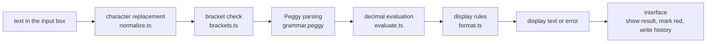
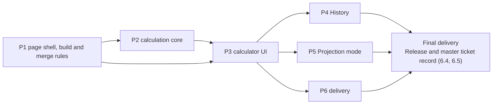

# Middle school computer-lab offline web calculator — research

**Date:** 2026-10-09 · **Brief:** [[Project Magi Eval/Features/r-20261009-dqva52/Brief|Brief]] · **Repository:** `txehq/wfe-r-20261009-dqva52` · **Status:** converged 2026-10-09 (eight rounds of adversarial review, see §10); D1–D5 decided on 2026-10-09 (§8); plan §7 locked on 2026-10-10 (§8)

## 1. Context

Students in grades 7 to 9 use a web calculator that opens with a double-click, both in the computer lab (Windows 7 + Chrome 109, often offline) and at home; teachers demo it on the projector. The calculator supports addition, subtraction, multiplication, division, parentheses, negative numbers, decimals, percentages, powers, square roots, and implicit multiplication, shows results by fixed rules, shows errors in Chinese and highlights the error position in red, keeps the last 20 history entries, and has a projector enlarged mode. Delivery date 2026-12-09. Full requirements are in the brief.

## 2. The tier call

**Standard tier.** Web calculators, expression parsing, decimal arithmetic, and single-file web pages all have many established approaches and mature libraries to draw on; requirements were confirmed item by item in interviews; the deliverable is a local web file involving no data, money, or production environment, so the impact is small. None of the three signals hold, so this does not follow the design-document-set scale.

All online research consists of targeted queries with definite answers (library APIs, versions, browser behavior), which the session looked up itself and verified locally. There are no questions requiring a broad comparison of community practices, so Deep Research is not used.

## 3. Local findings

### 3.1 Reuse

- **No reusable code in the repo.** `git ls-files` has only `README.md` (content `# wfe-r-20261009-dqva52`); `git log --all` has only `09d22b2 chore: initial commit`; only the `main` branch exists, with no PR (`gh pr list --state all` is empty).
- **The same organization's evaluation repo shows how CI and merge rules are written.** `txehq/wfe-r-20261009-qujfww/.github/workflows/ci.yml` lines 1–24: job name `ci`, runs on `pull_request` and on pushes to `main`, cancels in-progress old runs on PRs (`concurrency`, lines 8–10), `ubuntu-latest`, `timeout-minutes: 10`, `actions/checkout@v5` + `actions/setup-node@v5` (Node 22, `cache: npm`), `npm ci` + `npm test`. The same repo's `package.json` lines 1–17: `"type": "module"`, `engines.node ">=22.12.0"`, `"test": "vitest run"`, `vitest 5.0.3`. These repos all have a ruleset named `ci-required` (for example `gh api repos/txehq/wfe-r-20261009-qujfww/rulesets/24789442`): it applies to the default branch, its only rule is the required status check `ci` (`integration_id 15368`), `strict_required_status_checks_policy: false`, and there are no roles that can bypass it.
- **Chromium 109 probe from another run on this machine.** Lines 1–24 of `/Users/linhaoz/orca/workspaces/wf-dashboard/wfd-w4/data/runs/r-20261009-a9piql/workspace/.research/probe-chrome109/probe.mjs`: persistent profile, `offline: true`, logging all non-`file:` requests, and checking stored data across two launches after a restart. This time I re-ran it in `.research/probe-chrome109/` with the same approach (§4.2). That run's brief differed from this one (it did not forbid omitting the multiplication sign, had no scientific notation, and used intranet URLs), so this document only carries over its environment conclusions; the requirements and acceptance table are written entirely against this brief.
- **Local tools.** `node -v` → v22.15.0, `npm -v` → 10.9.2; `/Applications/Google Chrome.app` → 154.0.8037.98 (`defaults read .../Info CFBundleShortVersionString`). The parent directory `wfd-w4/node_modules` contains Playwright 1.64.0, and `npx playwright` resolves to it (`npx --no-install playwright --version` → `Version 1.64.0`), so the repo must pin its own Playwright version and call `./node_modules/.bin/playwright`.

### 3.2 Coverage

Every "feature to build" in the brief is new work. To do it fully, you need to cover these areas:

- **Deliverable:** a single `.html` file with all scripts and styles inlined; `<meta charset="utf-8">` within the first 1024 bytes of the file (without it on Chinese Windows, `file://` pages are read as GBK); `<link rel="icon" href="data:,">` avoids icon requests; `Content-Security-Policy` meta set to `default-src 'none'; script-src 'unsafe-inline'; style-src 'unsafe-inline'; img-src data:`, so the page cannot make network requests by rule.
- **How to open:** double-click the file (`file://`), including paths with Chinese characters and spaces, e.g. `file:///C:/Users/student/Desktop/calculator.html`. On Windows 7, double-clicking an HTML file may open it in IE, which does not run `type="module"` scripts, so the page needs a Chinese hint that does not depend on scripts, "Please open this file with Chrome", which is hidden once the script runs.
- **Input:**
  - On-screen keys: `0–9`, `.`, `+`, `−`, `×`, `÷`, `(`, `)`, `^`, `√`, `%`, `=`, backspace, clear all; the history's "Clear" and each history entry; projection mode button.
  - Keyboard: digits, `.`, `+ - * / ^ ( ) %`, space, `=` and Enter (evaluate), Backspace, Delete, arrow keys, Home, End, Escape (clear all), `r` (enter `√`); numeric keypad `NumpadAdd/Subtract/Multiply/Divide/Decimal/Enter`.
  - Characters produced by pasting or from a Chinese IME must be replaced with half-width operators: `()` → `()`, `+` → `+`, `-`, `−`(U+2212) → `-`, `*` → `*`, `/`, `,` → `/`, `^`, `...` → `^`, `%` → `%`, `.` → `.`, full-width digits → half-width digits, full-width space → half-width space. In Chinese punctuation mode, Shift+6 types `...`, and Sogou Pinyin types `,` when `/` is pressed (§4.1), so these two characters are treated as the operators the student intended; they have no other meaning in the calculator, so replacing them does not change any expression that was already correct. Letters are never replaced; treat them as spelling errors. Spaces are not deleted; grammar treats them as delimiters (§6.2).
  - After clicking an on-screen key, focus must return to the input box, so that Enter does not both "click" the key and trigger evaluation.
- **Interface states:** empty input; typing input; showing result; hint and red-highlight position for each of the eight errors; history empty, 1–19 entries, full at 20, 21st entry pushes out the oldest, after clearing; projection mode on and off.
- **Data path:** character replacement → bracket pairing check → parse into a syntax tree with positions → decimal evaluation (checking errors at each step) → format per display rules → display → write to history → store in `localStorage`.
- **Storage:** in Chromium, all `file://` pages share one `localStorage` (§4.1); key names must carry a dedicated prefix; copies in different folders on the same computer share one history.
- **Things that must stay absent:** each item in the brief's "Not doing this time" list corresponds: no trig or logarithm keys, no fractions, no plotting, no equation solving, no calculation steps, no phone or tablet layout, no memory keys, no network requests, no installer.

### 3.3 Gaps

- **All repo infrastructure is missing:** no `package.json`, `.gitignore`, `LICENSE`, `CLAUDE.md`, `.github/`, PR template (checked one by one with `test -e`; `gh api .../contents/.github` → 404).
- **No merge rules exist:** `gh api repos/txehq/wfe-r-20261009-dqva52` → `"allow_auto_merge": false`, `"delete_branch_on_merge": false`, `"private": true`; `.../branches/main/protection` → 404 "Branch not protected"; `.../rulesets` → `[]`; `.../actions/workflows` → `total_count: 0`. The current account is a repository admin (`permissions.admin: true`), and Actions is enabled (`allowed_actions: "all"`). The organization `txehq` is on the Team plan (`gh api orgs/txehq --jq .plan.name` → `team`), so rulesets on private repositories take effect. The brief says "merging is done per the repository's auto-merge rules", so those rules need to be set up first.
- **Windows 7 cannot be tested automatically on this machine:** this machine is macOS 27.0.1 arm64, with no virtual machine or Docker (`which docker prlctl VBoxManage utmctl qemu-system-x86_64` all find nothing). Chromium 109 can run on this machine and in CI (§4.2), but the Windows 7 fonts (how `√ × ÷` look in Microsoft YaHei) and the actual behavior of Chinese IMEs can only be confirmed on real machines in the lab.
- **decimal.js returns special values for invalid operations:** dividing by 0 gives `Infinity`, and square roots or fractional roots of negative numbers give `NaN` (§4.2). The evaluation code must check for these itself before each operation, so that it can give the specified Chinese messages and error positions.
- **Vite 8's default build target is higher than Chrome 109:** the default value `baseline-widely-available` corresponds to Chrome 111 (§4.1), so the build config must explicitly set `build.target: 'chrome109'` and `build.cssTarget: 'chrome109'`.
- **Design constraints from the user's global rules:** fail immediately where errors occur, do not catch errors, and do not use fallback paths (when `localStorage` is unavailable for history, do not switch to memory); do not use mock objects, tests run the real evaluation code and real build artifacts; use mature libraries rather than inventing your own; write comments in Chinese; intermediate results go in a dedicated folder under the current directory and are added to `.gitignore`; read `/ci-optimise` before modifying CI.

## 4. Web findings

### 4.1 Targeted lookups (checked 2026-10-09)

| Question | Conclusion | Source |
|---|---|---|
| Chrome 109 and Windows 7 | Chrome 109 is the last major version that supports Windows 7; from Chrome 110 onward, Windows 10 is required | [How-To Geek](https://www.howtogeek.com/853970/google-chrome-is-finally-saying-goodbye-to-windows-7/) |
| Which Playwright bundles Chromium 109 | Playwright 1.29 bundles Chromium 109.0.5414.46; npm has 1.29.0, 1.29.1, 1.29.2 | [Playwright release notes](https://playwright.dev/docs/release-notes); `npm view playwright@1.29 version` |
| How to run Chromium 109 in CI | Microsoft's container registry still provides `mcr.microsoft.com/playwright:v1.29.2-jammy` (Ubuntu 22.04, with the browser and system dependencies included in the image) | `curl https://mcr.microsoft.com/v2/playwright/tags/list` |
| Decimal arithmetic library | decimal.js 10.6.0, MIT; `Decimal.clone()` creates an independent configuration; supports `pow` (non-integer exponents), `sqrt`, `toDecimalPlaces`, `toSignificantDigits`, `ROUND_HALF_UP` | [decimal.js API](https://mikemcl.github.io/decimal.js/); `npm view decimal.js version license` |
| Expression parsing | Peggy 5.1.0, MIT: generates a parser from a grammar file, can output `es` format; the `offset` of location objects starts at 0; `error(message, where)` in actions throws an error with a position; syntax errors carry `location`, `expected`, `found`; a pre-generated parser needs no runtime dependencies | [Peggy docs](https://peggyjs.org/documentation.html); `npm view peggy version license` |
| Single-file build | vite-plugin-singlefile 2.3.3, MIT: inlines all JS and CSS into one HTML file; `useRecommendedBuildConfig` is on by default; files under `public/` are not inlined; History API routing and Cookies do not work under `file://`; peer dependency `vite ^5.4.21 \|\| ^6 \|\| ^7 \|\| ^8` | [vite-plugin-singlefile](https://github.com/richardtallent/vite-plugin-singlefile); `npm view vite-plugin-singlefile version peerDependencies` |
| Vite build target | Vite 8.3.4: `build.target` defaults to `baseline-widely-available`, i.e. Chrome 111; can be set to any target Oxc supports, e.g. `chrome58`; `build.cssTarget` defaults to following `build.target` | [Vite build options](https://vite.dev/config/build-options); `npm view vite version` |
| Testing tools | Vitest 5.0.3; TypeScript 7.0.2; @playwright/test 1.29.2 | `npm view` |
| Dependencies added during planning | zod 4.6.5 (structural validation of history records); parse5 8.0.1 (checking build artifacts and usage instructions); fast-check 4.10.2, MIT (property testing); yaml 2.9.1, ISC (reading workflow files to check permissions) | `npm view <package> version license`(2026-10-09) |
| `localStorage` under `file://` | MDN notes that browsers behave differently; Chromium treats all `file://` pages as the same origin, sharing one storage | [MDN localStorage](https://developer.mozilla.org/en-US/docs/Web/API/Window/localStorage); §4.2 measured |
| Chinese IME punctuation | Microsoft Pinyin, Ziguang and other IMEs type the ideographic comma `,` with `\` in Chinese punctuation mode, and Sogou Pinyin also types `,` with `/`; Shift+6 (`^` key) types the ellipsis `...` | [Wikipedia: ideographic comma](https://zh.wikipedia.org/zh-hans/%E9%A0%93%E8%99%9F); [ZOL Q&A](https://wap.zol.com.cn/ask/x_18590149.html) |
| Rulesets for private repositories | The organization `txehq` is on the Team plan, so rulesets apply to private repositories | `gh api orgs/txehq --jq .plan.name` → `team` |

### 4.2 Local measurements

**Chromium 109 (`.research/probe-chrome109/`):**

- `PLAYWRIGHT_SKIP_BROWSER_DOWNLOAD=1 npm install` (`playwright 1.29.2`), then `PLAYWRIGHT_BROWSERS_PATH=<probe dir>/browsers ./node_modules/.bin/playwright install chromium`: downloaded `chromium-1041` successfully; it runs on macOS arm64.
- `probe.mjs` opens `a.html` under `file://` twice with a persistent profile and `offline: true`, closing the browser in between:
  - UA is `HeadlessChrome/109.0.5414.46`;
  - The inlined `<script type="module">` in the file runs normally;
  - The first run reads `null` and writes, the second reads `saved`: **`localStorage` under `file://` persists in Chromium 109 after the browser is closed and reopened**;
  - Neither run made any non-`file:` requests;
  - `Array.prototype.at`, `findLast`, `structuredClone`, and CSS `:has()` are available.
- `probe-current.mjs` uses the same Playwright 1.29.2 to drive the local Google Chrome via `executablePath`: browser version `154.0.8037.98`, opening `file://` pages offline and keyboard input both work fine, with no non-`file:` requests. **The same Playwright 1.29.2 tests can cover both Chromium 109 and the current version of Chrome.**

**decimal.js 10.6.0 (`.research/probe-decimal/`, precision 120 digits, `ROUND_HALF_UP`):**

| Operation | Result |
|---|---|
| `0.1+0.2` | `0.3` |
| `1/0` | `Infinity` |
| `sqrt(-4)` | `NaN` |
| `(-8)^0.5` | `NaN` |
| `(-8)^-1` | `-0.125` |
| `8^(1/3)` | `2` |
| `0^0` | `1` |
| `0^-1` | `Infinity` |
| `10^100+1 > 10^100` | `true` (120-digit precision is enough to tell that it exceeds 10^100) |
| `1/3*3` | `0.999…9` (120 nines), rounds to `1` under the display rule |
| `9^(9^9)` | `4.28…e+369693099`, took 1 ms |
| `1.0001^123456789` | took 2 ms |

Huge powers will not freeze the page; the check for exceeding 10^100 only needs to run after each operation.

## 5. Recommendations

1. **Build: Vite 8.3.4 + vite-plugin-singlefile 2.3.3 + TypeScript 7.0.2, no UI framework.** The output is a single `dist/calculator.html` with all scripts and styles inlined. `build.target` and `build.cssTarget` are set to `chrome109`; styles avoid CSS nesting, `color-mix()`, `popover` and other features newer than Chrome 109. The UI has one screen and a few states, so native DOM is enough. Sources: §4.1 vite-plugin-singlefile, Vite.
2. **Expression parsing: a Peggy 5.1.0 grammar file generates the parser.** Operator precedence, implicit multiplication, the prefix `√` and the suffix `%` are all written in the grammar; each node carries start and end positions from `location()`, so error positions come directly from the syntax tree. The generated parser is output in `es` format and generated as a build step; no Peggy is needed at runtime. Sources: §4.1 Peggy.
3. **Decimal arithmetic: decimal.js 10.6.0, with an independent configuration created by `Decimal.clone({ precision: 120, rounding: ROUND_HALF_UP })`.** Before each operation, check for division by 0, square root of a negative number, and a negative base raised to a non-integer power; after each operation, check whether the absolute value exceeds 10^100. Sources: §4.1 decimal.js, §4.2 measured.
4. **Testing: Vitest 5.0.3 tests evaluation and formatting; @playwright/test 1.29.2 runs end-to-end tests by opening the built `dist/calculator.html` (`file://`, offline) in Chromium 109, and runs them again in the current version of Chrome.** The end-to-end tests record all non-`file:` requests and assert there are none; screenshots serve as acceptance evidence. Sources: §4.1 Playwright, §4.2 measured.
5. **CI and merge rules: copy the approach of the evaluation repo in the same organization.** In GitHub Actions, unit tests, the build and the end-to-end tests in both browsers are required checks; the Chromium 109 job runs in the `mcr.microsoft.com/playwright:v1.29.2-jammy` container; create a `ci-required` ruleset and turn on `allow_auto_merge` and `delete_branch_on_merge`. When implementing, run `/ci-optimise` first to order jobs by how long developers wait. Sources: §3.1, §4.1.
6. **Local development also uses Chromium 109:** browsers are downloaded to the git-ignored `.browsers/` directory (`PLAYWRIGHT_BROWSERS_PATH`), and scripts all call `./node_modules/.bin/playwright`. Sources: §3.1, §4.2.

## 6. Spec

### 6.1 Story and goals

Students double-click `calculator.html` on an offline lab computer and open it in Chrome; they click the on-screen keys with the mouse or type an expression on the keyboard, then press "=" or Enter to get a result displayed by fixed rules. If the expression is wrong, they see a short hint in Chinese and the error spot in the expression is marked in red; they fix it and calculate again. The 20 earlier problems are listed on the side; clicking one puts it back in the input box. When the teacher clicks "projection mode" in class, the whole class can read the screen.

**Feature goals:** implement "features to build" 1–7 of the brief one by one; all acceptance checks in §7 pass.

**Non-functional goals:**

- Runs in Chrome 109 and the current version of Chrome; page load and every evaluation make no network requests.
- The deliverable is a single file that opens on double-click when copied into any folder (including paths with Chinese characters and spaces).
- Each evaluation shows its result within 50 ms (measured in Chromium 109).
- All UI text, accessible names of keys, and hints are in Chinese.

### 6.2 Operation rules (complete definition of parsing and evaluation)

**Precedence, tightest to loosest:**

0. Spaces: spaces before and after operators and parentheses are ignored; a number cannot contain spaces inside it, and two numbers separated only by a space (e.g. `2 3`) is a spelling error.
1. Numbers: `12`, `0.5`, `.5` (= 0.5), `5.` (= 5); parentheses `( … )`.
2. Suffix `%`: placed right after a number, a closing parenthesis or another `%`; the value is divided by 100. `50%` = 0.5, `(1+1)%` = 0.02, `5%%` = 0.0005.
3. Prefix `√`: written as the production `root := "√" sign* ( root | a %-number or parenthesized expression )`. `√` applies only to the one operand immediately after it; a sign after `√` applies only to that one operand. `√16` = 4, `√25%` = √0.25 = 0.5, `√√16` = 2, `√-4` = √(-4) → Error "Cannot take square root of a negative number".
4. Exponent `^`: right-associative, written as the production `power := operand ( "^" sign? power )?`. `operand` is the result of levels 1–3 (number, parentheses, `%`, `√`), so the base itself does not contain `^`; to use a power as a base you must add parentheses. The `^` on the right is a complete `power`, which can continue with `^`; the optional sign (`-` or `+`) right after `^` applies to the whole `power` on its right. `2^3^2` = 2^(3^2) = 512, `2^-1` = 0.5, `2^-2^2` = 2^(-(2^2)) = 0.0625, `√2^2` = (√2)^2 = 2, `2^50%` = 2^0.5, `4%^2` = 0.04^2 = 0.0016.
5. Prefix minus and plus signs: written as a production, `signed power := sign signed power | power`. A sign that appears at the start of the expression, after an open parenthesis, after an addition, subtraction, multiplication or division operator, or after another prefix sign belongs to this level, which binds looser than power, applying to the entire `signed power` on its right; a sign immediately after `^` is handled at level 4, and a sign immediately after `√` is handled at level 3. Together these are all the positions in an expression that need an operand. `-2^2` = -(2^2) = -4, `-2^-2` = -(2^(-2)) = -0.25, `-√4` = -2, `--3` = 3, `+5` = 5, `3--2` = 5, `3*-2` = -6.
6. Multiplication and division: the operands are `signed power`; `*`, `×`, `/`, `÷`, and implicit multiplication, same level, left to right. An implicit multiplication sign appears after a complete operand (a number, a right parenthesis, `%`) when followed immediately by `(` or `√`, or when a right parenthesis is followed immediately by a number. `2(3+4)` = 14, `2√9` = 6, `(2+3)4` = 20, `(2)(3)` = 6, `1/2(3+4)` = (1/2)×7 = 3.5, `2^3(2)` = 8×2 = 16.
7. Addition and subtraction: same level, left to right. `200+10%` = 200.1, `200-10%` = 199.9.

**Evaluation:** decimal.js, 120-digit precision, `ROUND_HALF_UP`. Each step:

- Division: divisor is 0 → "Cannot divide by 0".
- Power: base 0 and negative exponent → "Cannot divide by 0"; base 0 and exponent 0 → "0 to the power of 0 is meaningless"; negative base and non-integer exponent value → "A negative number cannot take this root" (`(-8)^(1/3)` is an error, `(-8)^(0.5*2)` = -8).
- Square root: radicand is negative → "Cannot take square root of a negative number".
- If the absolute value of any step's result exceeds 10^100 → "Result too large to compute" (`10^100` itself can be displayed as `1×10^100`).

**Result display:** let v be the exact value obtained by evaluation (120 digits).

1. v = 0 → `0` (never show `-0`).
2. 0 < |v| < 10^-10 → scientific notation; when |v| = 10^-10, display `0.0000000001` as usual.
3. The integer part of v (before rounding) already exceeds 12 digits → scientific notation.
4. Otherwise, the number of decimal places kept d = min(10, 12 − number of digits in the integer part) (if the integer part is 0, count it as 0 digits), round v to d decimal places (round only once), and remove trailing zeros and any redundant decimal point. If rounding carries the integer part to 13 digits (e.g. `999999999999.5`), use scientific notation instead.
5. Scientific notation: round the mantissa directly from the exact value v to 12 significant digits (do not use the value rounded in step 4), remove trailing zeros, and write it as `mantissa×10^exponent`, e.g. `1.12589990684×10^15`, `3.33333333333×10^-12`, `1×10^100`; when the exponent is negative, write `^-12`.
6. Prefix negative numbers with `-`.

**Error check order and red-highlight position:**

Parenthesis check scans once from left to right: upon encountering a `)` with no matching `(`, report that `)` immediately; after the scan, if there are unmatched `(` remaining, report the rightmost one. Therefore `(3+4))+(5` reports the 6th character `)`, and `((2+3` reports the 2nd character `(`.

| Order | Case | Message | Highlight position |
|---|---|---|---|
| 0 | After trimming leading and trailing spaces, the input box is empty (including only spaces) | No message is shown; pressing "=" does nothing | None |
| 1 | Extra closing bracket | Unmatched brackets | The extra `)` |
| 1 | Unmatched left parenthesis | Parentheses do not match | The rightmost unmatched `(` |
| 2 | Expression ends after an operator, `√` or `^`, e.g. `3+`, `√`, `2^` | Incomplete expression | A placeholder box at the end of the expression |
| 2 | Other syntax errors, e.g. `3..2`, `*5`, `()`, `2 3`, letters | Expression syntax is wrong | The first character that cannot be parsed |
| 3 | The first operation in evaluation order that fails | Divide by 0, 0 to the power of 0, square root, nth root, too large (five kinds) | See "Red-highlight range for evaluation errors" below |

**Red-marking range for evaluation errors:**

- Cannot divide by 0 (division): the division sign and the divisor, e.g. `1/0` marks `/0`, `1+5/0` marks `/0`, `1/(2-2)` marks `/(2-2)`.
- Cannot divide by 0 (0 to a negative power): the whole power, e.g. `0^-1` marks `0^-1`.
- 0 to the power of 0 is meaningless: the whole power, e.g. `1+0^0` marks `0^0`.
- Negative numbers cannot take a square root: `√` and the radicand, e.g. `2*√(2-6)` marks `√(2-6)`.
- Negative numbers cannot take this root: the whole power, e.g. `1+(-8)^0.5` marks `(-8)^0.5`.
- Result too large to compute: the whole range of the operation step whose result exceeds 10^100, e.g. `1+10^101` marks `10^101`, and `10^100+1` marks the whole expression.
- When a multiplication with the multiplication sign omitted fails, the range runs from the start of the left operand to the end of the right operand.

**Red-marking style (the only definition in this document):** The "expression display line" below the input box shows the whole expression again; erroneous characters are shown in red text, with a light red background and a red wavy underline. The placeholder block is a blank block in the same style. Normal mode and projector mode use the same style and only change the font size.

When an error occurs, the expression stays in the input box with the cursor at the error position; it is not written to history. When the expression ends with an unmatched `(` (e.g. `(`, `3+(`), step 1 always reports "Unmatched parentheses".

### 6.3 Default approach for the interface

brief leaves the following two items to the developers to decide; the chosen approaches are recorded here.

- **On-screen key layout:** 5 columns by 5 rows; the digit area is arranged like the Windows Calculator and the numeric keypad (7 8 9 on top), with operators concentrated in the two rightmost columns:

  | Column 1 | Column 2 | Column 3 | Column 4 | Column 5 |
  |---|---|---|---|---|
  | Clear all | Backspace | `(` | `)` | `÷` |
  | `7` | `8` | `9` | `√` | `×` |
  | `4` | `5` | `6` | `^` | `−` |
  | `1` | `2` | `3` | `%` | `+` |
  | `0` | `.` | `=` (spans columns 3–5) | | |

  "=" key is the largest and most eye-catching in color; keys are at least 48×48 pixels, for easy clicking with a mouse in the lab and on the projection. The "Projection mode" button and the history's "Clear" button are placed outside the key area to avoid mixing them with calculator keys. Reason: students are already familiar with this layout and don't need to look for keys again.
- **Projection mode:** All text and keys are enlarged to 1.6 times normal mode (normal body text 20 px, projection mode 32 px). The layout is designed for 1024×768 (a common classroom projector resolution), and no scrollbar appears on the whole page. The history list scrolls up and down within its own area; the latest few entries are directly visible, and the rest are viewed by scrolling. Every time the page is opened, it starts in normal mode. Reason: 1.6 times lets students at the back of the classroom read 32 px text, while at 1024×768 all keys and the most recent history entries still fit.

### 6.4 Parts

| Part | Observable result | Reuses |
|---|---|---|
| **P1 Repo basics and merge rules** | `npm run build` produces one `dist/calculator.html` containing a single inline script and one inline style block; on a PR, unit tests, build, and end-to-end tests in two browsers run automatically, and auto-merge happens only if all pass | §3.1 `ci.yml` and `ci-required` ruleset in the same-org repo; §4.2 Chromium 109 probe approach |
| **P2 Calculation core** | `evaluate(expression)` gives, for each row of the §7 calculation table, the specified display text, or the specified error (message and position) | decimal.js, Peggy |
| **P3 calculator UI** | On the page opened by double-clicking in Chromium 109, you can enter expressions with on-screen keys and the keyboard and see the result; on error, a message in Chinese appears and the location is highlighted in red; no network requests are sent; when opened in IE, you see "Please open this file in Chrome" | P1 build, P2 `evaluate` |
| **P4 History** | After each correct calculation, the result appears at the top of the history, up to 20 entries; still there after closing and reopening the browser; clicking an entry puts its expression back in the input box; "Clear" deletes all | P3 UI, browser `localStorage` |
| **P5 Projection mode** | After clicking "Projection mode", the font size of the input, results, keys, history, and messages is enlarged to 1.6×; at 1024×768 projection resolution no scrollbars appear; click again to restore | P3 UI |
| **P6 Delivery** | Generate the delivery package on the PR (`calculator.html` and the Chinese `usage-instructions.html`); after each merge into `main`, the delivery package is automatically published to this repo's GitHub Releases, and the colleague responsible for delivery picks it up there and sends it to the teacher via WeChat or email | P1's build, P3's UI |

## 7. Plan

**Status:** locked · 2026-10-10 · **From:** Research.md §7 · **Brief:** `Project Magi Eval/Features/r-20261009-dqva52/Brief.md`

### 7.0 Goals and non-goals

**Goals (brief's Done means):** The teacher's test problems all compute correctly and display exactly as expected: `0.1+0.2` → `0.3`, `(2+3)*4` → `20`, `2^10` → `1024`, `√16` → `4`, `50%*200` → `100`, `1/3` → `0.3333333333`, `-5+3` → `-2`, `1/0` → "Cannot divide by 0" and shown in red, `(2+3` → "Brackets don't match" with the brackets marked; each of the brief's "Features to build" 1–7 can be demonstrated in Chrome 109, offline, by double-clicking the web file; evidence is a screenshot of each problem above, plus screenshots of history (still there after closing and reopening, click to restore, clear) and projection mode. Delivery date 2026-12-09.

**Non-goals (brief's "Not doing this time", verbatim):**

- Trigonometric functions, logarithms
- Fraction calculations, and displaying results as fractions
- Plotting function graphs
- Solving equations
- Showing calculation steps
- Use on phones and tablets
- Memory keys such as M+
- Any online features (online updates, statistics, uploads, external fonts or scripts)
- Installers or browser extensions
- Copying files to the computer room PCs (the teacher does this)

### 7.1 Approach

One repo, one build: TypeScript source is bundled by Vite 8 and vite-plugin-singlefile into a single `dist/calculator.html` with all scripts and styles inlined, targeting Chrome 109. The code is split into two layers: the **calculation core**, which does not depend on the interface, and the **interface** that uses it:

- **The calculation core exposes only one function** `calculate(input: string): CalcResult`, where `CalcResult` is one of `{ kind: 'value', display }`, `{ kind: 'error', message, span }` or `{ kind: 'empty' }`. A student writing a wrong expression is a normal result, expressed as a return value; the calculation core never throws an exception for student input.
- **The grammar is total:** the Peggy grammar produces a syntax tree for any input; where an operand is expected and the input ends, it produces an "expression incomplete" node; on a character that cannot be consumed, it produces a "syntax error" node with the character position. The error node earliest in the syntax tree is the error to report. So a Peggy syntax exception can only be a program defect; under the global rules it is not caught, and the test fails directly.
- **Evaluation** uses a separate decimal.js configuration (120-digit precision, `ROUND_HALF_UP`), computing left to right, child nodes before parent nodes. Before each operation, it checks for division by 0, square root of a negative number, and non-integer power of a negative number; after each operation, it checks whether the absolute value exceeds 10^100. The first failing operation produces an error result and the red-highlight range specified in §6.2.
- **Interface** uses native DOM: one `<input>` handles editing (the Chinese IME and the cursor are handled by the browser), the "expression display line" below shows the expression again and marks the erroneous characters, and the result line is below that. On-screen keys insert characters at the cursor. History is stored in `localStorage`; when read back, its structure is validated with zod, and if the structure is wrong it reports the error directly.
- **Verification** has three layers: Vitest runs table-driven tests on the calculation core; a build-artifact check script uses parse5 to check single-file output, CSP and encoding declarations; Playwright 1.29.2 opens the built file in Chromium 109 and current Chrome for end-to-end tests, and takes screenshots as acceptance evidence.

### 7.2 Parts, in order

P2 runs after P1, using the project config and CI that P1 sets up; P3 needs P1 and P2; P4, P5 and P6 can run in parallel after P3 (P6's 6.3 must run the full calculation problems on the packaged artifact, so it needs P3's UI); final delivery (6.4, 6.5) completes after P4, P5 and P6 are all merged. P1 is the minimal step that proves value: it makes a real page shell (encoding declaration, CSP, the "Please open with Chrome" prompt) pass end-to-end tests on Chromium 109 and current Chrome, and puts every PR after it under merge-rule protection.

#### P1 page shell, build and merge rules

- **Outcome:** `npm run build` produces `dist/calculator.html`, which when double-clicked in Chromium 109 and current Chrome shows the page shell without making any network requests; with scripts disabled it shows 'Please open this file with Chrome'. Every PR automatically runs all checks, and it can only be auto-merged after all pass.
- **Changes:**
  - `package.json` (`"type": "module"`, `engines.node ">=22.12.0"`, scripts `generate`, `build`, `test:unit`, `test:e2e`, `check:dist`) and `package-lock.json`; dependencies pinned to: vite 8.3.4, vite-plugin-singlefile 2.3.3, typescript 7.0.2, vitest 5.0.3, @playwright/test 1.29.2, parse5 8.0.1, peggy 5.1.0, decimal.js 10.6.0, zod 4.6.5, fast-check 4.10.2, yaml 2.9.1 (used by P6's workflow check).
  - `calculator.html` (Vite entry): `<meta charset="utf-8">` placed first, `<link rel="icon" href="data:,">`, CSP meta, `lang="zh-CN"`, page title "calculator", and a paragraph shown by default reading "Please open this file with Chrome".
  - `src/main.ts`: hides the hint above after the script runs.
  - `vite.config.ts`: vite-plugin-singlefile, `build.target` and `build.cssTarget` set to `chrome109`, entry `calculator.html`.
  - `tsconfig.json`, root `.gitignore` (`node_modules/`, `dist/`, `.browsers/`, `test-results/`, `playwright-report/`, `src/core/generated/`).
  - `scripts/check-dist.mjs`: uses parse5 to check the build output (acceptance 1.2).
  - `playwright.config.ts`: two projects, `chromium-109` uses the Chromium bundled with Playwright 1.29.2, `chrome-current` specifies the current Chrome via the environment variable `CHROME_PATH`; tests copy the build output into a directory whose name contains Chinese characters and spaces, then open it via `file://`, `offline: true`.
  - `e2e/fixtures.ts`: records all non-`file:` requests, asserts the list is empty at the end of each test, and asserts the page has no uncaught errors.
  - `.github/workflows/ci.yml`: top-level `permissions: contents: read`; jobs `unit`, `build` (uploads artifacts), `e2e-chromium-109` (runs in the digest-pinned `mcr.microsoft.com/playwright:v1.29.2-jammy` container), `e2e-chrome-current` (Google Chrome preinstalled on `ubuntu-latest`), and the summary job `ci` (depends on the first four). Only P6's `package` job declares `permissions: contents: write` separately, and does not rely on the repo's default workflow permissions. Before starting, go through `/ci-optimise`.
  - Repository settings: create the `ci-required` ruleset (required check `ci`), enable `allow_auto_merge` and `delete_branch_on_merge`; the `gh api` commands used are written into the "Repository settings" section of `README.md`.
  - `README.md`: local development steps (`PLAYWRIGHT_BROWSERS_PATH=.browsers ./node_modules/.bin/playwright install chromium`).
- **Depends on:** none.
- **Verification:** all four CI jobs pass; the build-output check script; the end-to-end shell scenario (including with scripts disabled); observe the ruleset taking effect on a PR.
- **Criteria:** table 1.1–1.7 below.

**Test plan:** the build-output check script uses parse5 to parse `dist/calculator.html`, asserting there is exactly one `<script type="module">` with no `src`, no `<link rel="stylesheet">`, `<meta charset="utf-8">` within the first 1024 bytes, and the CSP meta is present; the end-to-end test opens the shell; observe CI and the ruleset on this PR.

**Acceptance criteria: **

| # | Criterion | Verification method |
|---|---|---|
| 1.1 | On a clean checkout, `npm ci && npm run build` generates only `dist/calculator.html` | Test (CI build job) |
| 1.2 | The artifact has no `src`, `href`, or `url(...)` pointing to external resources; `<meta charset="utf-8">` is within the first 1024 bytes; CSP is `default-src 'none'; script-src 'unsafe-inline'; style-src 'unsafe-inline'; img-src data:` | Test (artifact check script) |
| 1.3 | End-to-end tests run on Chromium 109.0.5414.46, and the test log prints the browser version | Test (CI log) |
| 1.4 | `main` has a `ci-required` ruleset; required checks include unit tests, build, end-to-end tests on Chromium 109, and end-to-end tests on current Chrome; `allow_auto_merge` and `delete_branch_on_merge` are `true` | Test (`gh api repos/txehq/wfe-r-20261009-dqva52` and `.../rulesets`) |
| 1.5 | A PR with a failing check cannot be merged; a PR with all checks passing and auto-merge enabled merges automatically | Test (observe on the PR) |
| 1.6 | Root `.gitignore` ignores `node_modules/`, `dist/`, `.browsers/`, and test output directories | Test (`git check-ignore`) |
| 1.7 | Opening the page with scripts disabled shows "Please open this file with Chrome"; with scripts enabled this text is hidden; in both cases there are no non-`file:` requests | Test (end-to-end, `javaScriptEnabled: false` and default, once each) |

#### P2 Calculation core

- **Outcome:** `calculate(input)` gives the specified display text for each row of the table below, or the specified error message and highlight range.
- **Changes:**
  - `src/core/grammar.peggy`: a total grammar for levels 0–7 of §6.2, each node carrying `location()` start and end positions; "incomplete expression" and "malformed syntax" as error nodes. `npm run generate` uses `peggy --format es` to generate `src/core/generated/parser.js` (not committed; generated automatically before `build` and `test:unit`).
  - `src/core/normalize.ts`: the character replacement table in §3.2; replacing `..` (two characters) with `^` (one character) changes the length, so the replacement also records the original position corresponding to each new position, and both highlighting and the cursor use original positions.
  - `src/core/brackets.ts`: the left-to-right bracket scan from §6.2.
  - `src/core/evaluate.ts`: evaluate with decimal.js using its own configuration, checking the five evaluation error kinds and their red-highlight ranges step by step.
  - `src/core/format.ts`: display rules, steps 1–6 from §6.2.
  - `src/core/messages.ts`: all eight kinds of Chinese hint text are kept in one place.
  - `src/core/calculate.ts`: chains the steps above in judgement order 0 → 1 → 2 → 3; exports `calculate` and the `CalculationResult` type.
  - `src/core/*.test.ts`: table-driven tests.
  - `src/core/calculate.property.test.ts`: fast-check property test.
- **Depends on: ** P1 (uses its `package.json`, TypeScript config, and the `unit` job in CI).
- **Verification:** Vitest table-driven tests cover all rows of the table below. Test cases are organised by equivalence classes and boundary values: display rules are exercised on both sides of the three thresholds 10^-10, 12-digit integers, and 10^100; judgement order is covered by a decision table over combinations of "bracket error × syntax error × evaluation error" occurring together (brackets first, then syntax, evaluation last).
- **Criteria:** acceptance criterion 2.1 and all rows of the calculation table below.

| # | Criterion | Verification method |
|---|---|---|
| 2.1 | For any input, `calculate` returns one of three results: `value`, `error`, or `empty`, and never throws an exception; the highlighted range of `error` falls within the input string. fast-check randomly generates strings of length 0–200 from all allowed characters (digits, `.`, `+ - * / × ÷ ( ) ^ √ %`, spaces, the full-width characters from §3.2, letters), at least 10000 per run, and also includes deeply nested parentheses and long runs of `√`, `%`, `^`, and symbols | Test (Vitest + fast-check, print minimal counterexample on failure) |

**Test plan:** Vitest table-driven tests, where each row is an input and the expected display text or expected error (hint text, start and end positions of the highlight). Tests call the real parser and decimal.js directly. The 50 ms figure for the `9^9^9` row is a supplementary check of the evaluation code in Node; the 50 ms target in §6.1 is judged by the measurement under acceptance criterion 3.9 on Chromium 109. Another property test: fast-check 4.10.2 randomly generates expressions to prove that `calculate` returns one of the three results for any input and never throws an exception (acceptance criterion 2.1).

**Acceptance criteria (calculation table, all verified by tests): **

| Input | Expected |
|---|---|
| `0.1+0.2` | `0.3` |
| `(2+3)*4` | `20` |
| `2^10` | `1024` |
| `√16` | `4` |
| `50%*200` | `100` |
| `1/3` | `0.3333333333` |
| `2/3` | `0.6666666667` |
| `-2/3` | `-0.6666666667` |
| `-5+3` | `-2` |
| `50%` | `0.5` |
| `200+10%` | `200.1` |
| `200-10%` | `199.9` |
| `(1+1)%` | `0.02` |
| `-2^2` | `-4` |
| `(-2)^2` | `4` |
| `2^3^2` | `512` |
| `2^-1` | `0.5` |
| `2^-2^2` | `0.0625` |
| `-2^-2` | `-0.25` |
| `2(3+4)` | `14` |
| `2√9` | `6` |
| `(2+3)4` | `20` |
| `(2)(3)` | `6` |
| `1/2(3+4)` | `3.5` |
| `2^3(2)` | `16` |
| `√16+9` | `13` |
| `√(9+7)` | `4` |
| `-√4` | `-2` |
| `√25%` | `0.5` |
| `√2` | `1.4142135624` |
| `√2^2` | `2` |
| `2^50%` | `1.4142135624` |
| `4%^2` | `0.0016` |
| `2 + 3` | `5` |
| `8^(1/3)` | `2` |
| `(-8)^(0.5*2)` | `-8` |
| `(-8)^-1` | `-0.125` |
| `1/3*3` | `1` |
| `0*-1` | `0` |
| `3--2` | `5` |
| `--3` | `3` |
| `-+3` | `-3` |
| `+5` | `5` |
| `√√16` | `2` |
| `5%%` | `0.0005` |
| `3*-2` | `-6` |
| `.5+5.` | `5.5` |
| `123456.789012345` | `123456.789012` |
| `999999999999` | `999999999999` |
| `999999999999.5` | `1×10^12` |
| `0.0000000001` | `0.0000000001` |
| `0.00000000005` | `5×10^-11` |
| `2^40` | `1.09951162778×10^12` |
| `2^50` | `1.12589990684×10^15` |
| `1/300000000000` | `3.33333333333×10^-12` |
| `10^100` | `1×10^100` |
| `(2+3)×4` (full-width characters) | `20` |
| `2……3` (IME ellipsis) | `8` |
| `6,3` (IME enumeration comma) | `2` |
| `2……` | Expression unfinished, mark at end (after the 3rd character of the original; `……` is two characters) |
| `0……0` | 0 to the power of 0 is meaningless, mark the entire original `0……0` (characters 1–4) |
| `1,0` | Cannot divide by 0, mark original `,0` (characters 2–3) |
| `1+2……√-4` | Cannot take the square root of a negative number, mark original `√-4` (characters 6–8) |
| `6÷2×3` | `9` |
| `1/0` | Cannot divide by 0, mark `/0` |
| `1+5/0` | Cannot divide by 0, marks `/0` |
| `1/(2-2)` | Cannot divide by 0, mark `/(2-2)` |
| `0^-1` | Cannot divide by 0, mark the whole span |
| `√-4` | Negative numbers cannot take a square root, mark the whole span |
| `√(2-6)` | Negative numbers cannot take a square root, mark the whole span |
| `2*√(2-6)` | Negative numbers cannot take a square root, mark `√(2-6)` |
| `(-8)^0.5` | Negative numbers cannot be raised to this power, mark the whole span |
| `1+(-8)^0.5` | Negative numbers cannot take this root, marks `(-8)^0.5` |
| `(-8)^(1/3)` | Negative numbers cannot be raised to this power, mark the whole span |
| `3+` | Expression incomplete, mark the end |
| `√` | Expression incomplete, mark the end |
| `2^` | expression unfinished, mark at end |
| `3+(` | Unbalanced parentheses, marks the 3rd character `(` |
| (empty), `   ` (only spaces) | Pressing "=" changes nothing |
| `(2+3` | Unmatched parentheses, mark the 1st character `(` |
| `(2+` | Unbalanced parentheses, marks the 1st character `(` |
| `(2+3))` | Unmatched parentheses, mark the last `)` |
| `(3+4))+(5` | Unmatched parentheses, marks the 6th character `)` |
| `((2+3` | Unmatched parentheses, marks the 2nd character `(` |
| `10^101` | Result too large to compute, mark the whole span |
| `1+10^101` | Result too large to compute, marks `10^101` |
| `1+(10^60)(10^50)` | Result too large, cannot compute, marked `(10^60)(10^50)` |
| `10^100+1` | Result too large to compute, mark the whole span |
| `9^9^9` | Result too large, cannot compute, highlight whole segment, returns within 50 ms |
| `3..2` | Expression syntax is wrong; marks the 3rd character `.` |
| `*5` | Expression syntax is wrong; marks the 1st character `*` |
| `()` | Expression syntax is wrong; marks the 2nd character `)` |
| `2 3` | Expression syntax is wrong; marks the 3rd character `3` |
| `2a` | Expression syntax is wrong; marks the 2nd character `a` |
| `0^0` | 0 to the power of 0 is meaningless; marks the whole expression |
| `1+0^0` | 0 to the power of 0 is meaningless; marks `0^0` |

#### P3 calculator UI

- **Outcome: ** On the page opened by double-click in Chromium 109 and current Chrome, you can enter the expression with on-screen keys or the keyboard, press "=" or Enter to see the result; on error, show a Chinese-language hint, mark the error position in red in the expression display line, and keep the cursor at the error position; no network requests are sent.
- **Changes:**
  - `calculator.html`: input box (`aria-label="expression"`), expression display line, result line, hint line, 5×5 on-screen keys laid out per §6.3 (each key has a Chinese accessible name).
  - `src/ui/keypad.ts`: keys insert characters at the cursor, backspace, clear all, evaluate; after clicking, focus returns to the input box.
  - `src/ui/keyboard.ts`: §3.2 keyboard mapping (including numeric keypad, `r` → `√`, Escape → clear all, Enter and `=` → evaluate); keys pressed while IME composition is in progress (`isComposing`) are not handled.
  - `src/ui/display.ts`: show `calculation result`: result line, hint line, red marking of the expression display line (the single style definition in §6.2), cursor position; when the expression changes, clear the old result and hint.
  - `src/styles.css`: font `"Microsoft YaHei", "Microsoft YaHei", sans-serif`, CSS variables control font size (used by P5), no features newer than Chrome 109.
  - `e2e/calculator.spec.ts`: scenarios and screenshots for acceptance 3.1–3.9.
- **Depends on: ** P1, P2.
- **Verification: ** End-to-end tests cover the table below in two browsers; UI states are designed as test cases by state transitions: empty → entering → result → back to entering after a change; entering → error → back to entering after a fix.
- **Criteria:** the table below 3.1–3.9.

**Test plan: ** Playwright 1.29.2 end-to-end tests; on Chromium 109 and current Chrome, open `dist/calculator.html` under `file://` (copied to a path with Chinese characters and spaces), `offline: true`, and listen to all requests. Save a screenshot of each scenario as acceptance evidence.

**Acceptance criteria: **

| # | Criterion | Verification method |
|---|---|---|
| 3.1 | Enter every problem in the brief "Done means" table using only the on-screen buttons; displayed results and messages match the table | Test + screenshot |
| 3.2 | Enter the same problems using only the keyboard (including the numeric keypad, Enter, `=`, and `r` to input `√`); results match | Test |
| 3.3 | Paste an expression with full-width characters, e.g. `(2+3)×4`; the result is `20` | Test |
| 3.4 | The error message text is correct, the red-highlighted character range matches the P2 calculation table (rules in the evaluation-order table in §6.2 and "Red-highlight range for evaluation errors"), the style matches the single definition in §6.2, the expression stays in the input box, and the cursor is at the error position; for errors involving `...` and `,` typed with a Chinese IME, the red highlight falls on those characters in the original text | Test (read the text, range and computed style of the highlighted element) + screenshot |
| 3.5 | After clicking on-screen buttons, pressing Enter evaluates only once and does not re-enter the keys | Test |
| 3.6 | Backspace, clear all, Escape, and arrow keys all work correctly when inserting and deleting characters in the middle of an expression | Test |
| 3.7 | No non-`file:` requests occur during the entire test run | Test (request listener) |
| 3.8 | All page text and button accessible names are in Chinese; there are no trigonometric, logarithm, fraction, memory, or other "not doing this time" buttons | Test (iterate over button accessible names) |
| 3.9 | Evaluation time: from the `click` handler of the "=" key until the next frame after the result text is written to the page (`requestAnimationFrame` callback), measured with `performance.now()`; for each of the 9 problems in the brief's "Done means" table, run 20 times, median not exceeding 50 ms | Measurement (Chromium 109, run in CI) |

#### P4 History

- **Outcome:** After each correct calculation, "expression = result" appears at the top of the history, up to 20 entries; it persists after closing and reopening the browser; clicking an entry puts the expression back in the input; "Clear" deletes all.
- **Changes:**
  - `src/storage/history-store.ts`: key name `wfe-calculator:v1:history`, value is `{ version: 1, entries: [{ expression, display }] }`; validated with zod when read, throws an error directly if it does not match (risk R8); when writing, keeps the latest 20 entries.
  - `src/ui/history.ts`: history list (newest on top), click to put back in the input, "Clear" button; the list scrolls within its own area.
  - `calculator.html`, `src/styles.css`: history area.
  - `e2e/history.spec.ts`: launches twice with a persistent profile.
- **Depends on:** P3.
- **Verification:** end-to-end tests; test cases designed by state transitions for entry counts: 0 entries, 1 entry, 19, 20, the 21st entry pushes out the oldest one, 0 after clearing; compare before and after restart.
- **Criteria:** the table below: 4.1–4.6.

**Test plan:** Playwright persistent profile, closing the browser between two launches; read `localStorage` directly to verify key names and contents.

**Acceptance criteria: **

| # | Criterion | Verification method |
|---|---|---|
| 4.1 | After a problem is solved correctly, "expression = result" appears at the top of the history; incorrect expressions are not saved | Test + screenshot |
| 4.2 | After solving 21 problems in a row, only the most recent 20 entries remain; the earliest one is deleted | Test |
| 4.3 | After closing and reopening the browser, the history is exactly the same | Test (persistent profile, two launches) + screenshot |
| 4.4 | Clicking an entry puts that expression into the input box, where it can be edited and recalculated | Test + screenshot |
| 4.5 | After clicking "Clear", the history is empty; it stays empty after closing and reopening | Test + screenshot |
| 4.6 | Storage key names carry the dedicated prefix `wfe-calculator:` , and the content is versioned JSON; when malformed data is read, the page reports an error directly rather than silently discarding it | Test |

#### P5 Projection mode

- **Outcome:** After clicking "Projection mode", all text and buttons are enlarged to 1.6×, and at 1024×768 the whole page does not scroll; clicking again restores it; every time it opens, it is in normal mode.
- **Changes:** `src/ui/projection.ts` (toggles `data-mode` on the root element, and `aria-pressed` on the button); `src/styles.css` (two sets of font-size variables: 20px and 32px; buttons with a minimum of 48×48px scale up by the same multiple); `e2e/projection.spec.ts`.
- **Depends on:** P3 (if P4 is merged first, 5.2's "fill up 20 history entries" uses P4; if P5 is merged first, 5.2 gets this check added by P4's PR after P4 is merged).
- **Verification:** end-to-end tests read the computed styles and scroll dimensions; screenshots.
- **Criteria:** the table below: 5.1–5.4.

**Test plan:** Playwright reads the computed font sizes; set a 1024×768 viewport and check scroll dimensions.

**Acceptance criteria: **

| # | Criterion | Verification method |
|---|---|---|
| 5.1 | With projection mode on, the font sizes of the input box, results, keys, history and hints are all 1.6 times those in normal mode | Test (`getComputedStyle`) + screenshot |
| 5.2 | With the history filled to 20 entries, then projector mode opened: at a 1024×768 viewport, the whole page has no horizontal or vertical scrollbars (`document.documentElement`'s `scrollWidth`/`scrollHeight` do not exceed the viewport), all keys are visible, and the history list can scroll within its own area to entry 20 | Test + screenshot |
| 5.3 | Clicking again restores normal font sizes; when the page is reopened it is in normal mode | Test |
| 5.4 | In projection mode, error markers use the same style defined in §6.2, only with a larger font size | Test (compare the computed styles of red-marked elements in both modes) + screenshot |

#### P6 Delivery

- **Outcome:** Each PR produces a delivery package (`calculator.html` and the Chinese `usage-guide.html`); after each merge to `main`, the delivery package is automatically published to this repo's GitHub Releases. The colleague in charge of delivery takes the two files from Releases and sends them to the teacher via WeChat or email (the teacher doesn't sign up for any website).
- **Changes:** `docs/usage-guide.html` (single-file Chinese-language page, five fixed headings, see 6.2); `scripts/package-release.mjs` (puts build output and the guide into `release/` and writes SHA-256); `scripts/check-guide.mjs` (parse5 checks the guide's headings and checklist lines); `.github/workflows/ci.yml` adds a `package` job (uploads the delivery package on PRs; on push to `main` publishes with `gh release create`, version is date plus run sequence number; only this job declares `permissions: contents: write`, other jobs keep the top-level `contents: read`); `scripts/check-workflow.mjs` (reads `ci.yml` with yaml 2.9.1, checks the permission split, runs as a step of the `unit` job); `e2e/` adds a pass over `calculator.html` in the delivery package.
- **Depends on:** P3 (6.3 runs all the brief's calculation problems on the packaged output); final delivery (6.4, 6.5) completes after P4, P5, P6 are all merged; the delivery package includes history and projection mode.
- **Verification:** hash comparison and documentation checks in CI; end-to-end tests on the delivery package; after merge, use `gh` to check the Release produced by the `main` run after P4, P5, P6 are all merged, and use Linear MCP to check the record on the master ticket.
- **Criteria:** Table 6.1–6.6 below.

**Test plan:** The release process has two stages: on the PR, run the "package" task, which generates the delivery package (`calculator.html` and `usage-guide.html`) and uploads it as this run's artifacts; after merging into `main`, the same task publishes the delivery package to this repo's GitHub Releases. On the PR, verify the package task and guide content; the release after P4, P5, and P6 are all merged is checked by the session and recorded on the master ticket.

**Acceptance criteria: **

| # | Criterion | Verification method |
|---|---|---|
| 6.1 | The `calculator.html` produced by the package job on the PR matches the hash of the build job's artifact in the same run | Test (compare SHA-256 in CI) |
| 6.2 | `usage-guide.html` is a single-file Chinese page with five headings in order: "Copy the calculator to the lab computer", "Open with Chrome", "If the browser opened is a different one", "Check on the lab computer", "History and restore card"; the "Check on the lab computer" section lists line by line the 9 questions and expected displays in the brief's "Done means" table, plus the check of typing `(2+3)×4` with a Chinese IME on; the "History and restore card" section states that the lab computers have a restore card, so history is cleared after a restart, which is the restore card's job and the web page cannot keep it; on the home computer, history is kept until "Clear" is clicked | Test (parse with parse5, assert the headings, checklist lines and the restore-card sentence) |
| 6.3 | After the `calculator.html` in the package is copied to a new path containing Chinese characters, all questions in the brief "Done means" table are completed in Chromium 109 | Test (end-to-end test runs again against the package artifact) |
| 6.4 | After P4, P5 and P6 are all merged, the GitHub Release that the run on `main` creates in this repo carries `calculator.html` and `usage-guide.html`, with hashes matching that build, and the calculator in the delivery package includes history and projection mode | Test (after merge, the session reads with `gh release view` and `gh release download` and compares SHA-256, and runs an end-to-end test on the downloaded files) |
| 6.5 | The Release link and hashes are recorded as a comment on the master ticket created by `/ticketing`; the comment states that the colleague in charge of delivery sends the two files to the teacher via WeChat or email | Test (read the master ticket comments with Linear MCP's `list_comments`) |
| 6.6 | Top-level permissions in `ci.yml` are `contents: read`; only the `package` job has `contents: write`; no other jobs have separately elevated permissions | Test (`scripts/check-workflow.mjs`) |

### 7.3 Decisions

**ADR-1 Build and code structure**

- **Context:** The deliverable must be a single file that runs in Chrome 109, over `file://`, offline; the calculation rules (§6.2) have seven precedence levels, implicit multiplication, prefix `√`, suffix `%`, and errors must report the character position; the global rules require using mature libraries, not hand-writing a parser, failing immediately on errors, and tests that don't use mock objects.
- **Options:**
  - A: Vite 8 + vite-plugin-singlefile bundling; Peggy grammar generates the parser; decimal.js evaluation; native DOM UI.
  - B: Hand-write a single HTML file, inlining a hand-written parser and the minified decimal.js file, with no build tool.
  - C: Parse and evaluate with math.js.
- **Decision:** A.
- **Consequences:** Parsing rules live in one grammar file, and error positions come directly from Peggy's `location()`; the build output can be checked automatically and tested in two browsers; Chrome 109 must be explicitly targeted in the build config (risk R4 is covered by end-to-end tests). B requires a hand-written parser, which violates the global rules. In C, `%` is the remainder operator, and its implicit-multiplication precedence differs from §6.2 (`1/2(3+4)` gives 1/14 under math.js rules); its parsing rules would need rewriting to meet the requirements, and the packaged file would be noticeably larger. Measured by ISO 25010, A is best for functional correctness (the rules are fully determined by our grammar), maintainability (core and UI separated, one grammar), and portability (build target under control).

**ADR-2 Represent invalid student expressions with return values**

- **Context:** The global rules require not catching errors and not using fallback paths; students entering invalid expressions is normal use of the calculator.
- **Decision:** The calculation core represents all input errors with a `CalcResult` return value; the grammar is a total function, and Peggy only throws on program defects, which are not caught here. When history records are read back with the wrong structure, the error is thrown directly (R8).
- **Consequences:** The UI code has no `try`/`catch` at all; tests can compare return values line by line.

**Decision record (from the brief and research, all confirmed or delegated):** See the brief's Decision ledger. Decisions delegated during the research phase: the full operation rules in §6.2 (an omitted multiplication sign has the same precedence as multiply/divide, `√` applies only to the one operand after it, `%` binds tightest, and each step checks whether it exceeds 10^100), the key layout and projection multiple in §6.3, history only saves correctly answered questions, projection mode does not remember the last state, and the `r` key enters `√`.

**User's decision:** See the decision record in §8 (D1–D5, 2026-10-09).

### 7.4 Risks and rollback

Risks and checks are in §9. Rollback method:

| Part | Rollback method |
|---|---|
| P1 | Delete the build and CI files with a new PR; delete the ruleset with `gh api -X DELETE repos/txehq/wfe-r-20261009-dqva52/rulesets/<id>`, and restore the original values with `gh api -X PATCH repos/txehq/wfe-r-20261009-dqva52 -F allow_auto_merge=false -F delete_branch_on_merge=false` |
| P2–P5 | Revert the corresponding changes with a new PR; they only change code in the repo and have no data migration |
| P4 | Also, the `wfe-calculator:v1:history` key left by the old version does not affect the page after rollback; to clear it, delete it under "Clear" |
| P6 | Use a new PR to remove the `package` task; list all Releases created by this task with `gh release list`, and delete them one by one with `gh release delete <tag> --cleanup-tag` |

### 7.5 Open for ticketing

- P1–P6 are each a PR that can be reviewed separately; P1 → P2 → P3 is the serial main line, after which P4, P5 and P6 can proceed in parallel. Whether to put tightly interdependent parts into the same ticket is decided by `/ticketing` according to the rule "keep dependent work together".
- Each ticket's estimate and recommended owner are derived by `/ticketing` from Linear history.
- Before the delivery date 2026-12-09, the teacher checks each item once on real lab machines against `user-guide.html` (R1, R2, R8); this is the teacher's action, recorded on the master ticket, and is not a merge condition for any PR.

## 8. Decision log

Five open questions left from the research phase. D1–D4 were narrowed down through adversarial review and handed to the teacher; the teacher could not open the web selection page, so on 2026-10-09 they answered each one in text in the conversation. D5 is a technical decision the brief hands to the developer side, decided by the session.

| # | Date | Question | Decision | Rationale |
|---|---|---|---|---|
| D1 | 2026-10-09 | What to show for syntax errors not covered by the six existing messages (`3..2`, `*5`, `()`, `2 3`, letters) | Add the message "Invalid expression syntax"; mark the first unparseable character in red (confirmed by teacher) | Teacher: "Students will immediately see they mistyped it"; showing "Expression incomplete" doesn't match reality |
| D2 | 2026-10-09 | What to show for `0^0` | Add the message "0 to the power of 0 is meaningless", mark the whole power in red (confirmed by teacher) | Teacher: follow the textbook, so students don't think it is a definite number; the textbook's a⁰ = 1 applies only when a ≠ 0 |
| D3 | 2026-10-09 | How to deliver the finished file to the teacher | Send directly to the teacher by WeChat or email; the teacher does not register on any website (confirmed by teacher). Implementation: after each merge to `main`, the delivery package is published to this repo's GitHub Releases, and the colleague in charge of delivery takes it from there and sends it | The teacher only uses software already installed on the computer |
| D4 | 2026-10-09 | Whether the lab computers have a restore card installed | Yes, they are restored daily or periodically, so anything saved is wiped on restart (fact confirmed by teacher). Design unchanged; the guide states that lab history is cleared on restart, while home computers keep it until "Clear" is clicked | A restore card wipes all changes to the system drive, which a web page cannot preserve; teacher said "just be aware" |
| D5 | 2026-10-09 | Who enables `allow_auto_merge` and creates the `ci-required` ruleset | Modified by P1 (decided by session) | The brief authorizes "merging follows the repo's auto-merge rules" and leaves technical choices to the developer side; the session has admin rights |

Error messages thus go from six to eight: Cannot divide by 0, Unmatched parentheses, Cannot take square root of a negative number, Cannot raise a negative number to this power, Expression incomplete, Result too large to compute, Invalid expression syntax, 0 to the power of 0 is meaningless.

**2026-10-10 · Plan locked.** The plan in §7 (P1–P6, ADR-1, ADR-2, revocation method) was approved by the teacher after the following reviews, and its status changed to locked:

- Plan review ran six rounds, completed by the Plan agent of the Sonnet model (Codex is not logged in on this machine, and `codex exec` returns 401). Round 1, 3 items: add fast-check property tests (acceptance 2.1), split workflow permissions by task, P3 acceptance numbering made consecutive. Round 2, 3 items: the reference in 3.4, a test for red-underline position when IME characters change length, permission check (acceptance 6.6). Round 3, 2 items: declare yaml dependency, the reference scope of 3.4. Round 4, 2 items: P6 acceptance scope is 6.1–6.6, P6 changed to depend on P3. Round 5, 3 items: P6's check target, the reuse note in §6.4, delete all Releases on revoke. Round 6 had no medium-or-higher comments; 1 minor comment was addressed.
- The teacher replied in the conversation on 2026-10-10: "Okay, I looked at this plan, no problem, just do it this way."

## 9. Risks

| # | Risk | Verification method |
|---|---|---|
| R1 | On Windows 7, font, scaling and Chinese input method behaviour differs from Chromium 109 on macOS/Linux | P6's instructions list real-machine checks, and the teacher checks them item by item on one lab computer before the start of term; the font is set to `"Microsoft YaHei", "Microsoft YaHei", sans-serif`, and `√ × ÷` use characters present in this font |
| R2 | Lab computers have restore cards (confirmed in D4), so `localStorage` is cleared after a restart, and the lab's history records disappear after restart | Accepted: the web page cannot change how restore cards behave; the usage guide section "History and restore cards" documents this (acceptance 6.2) |
| R3 | The Chromium 109 download address for Playwright 1.29 is no longer valid | CI uses the `mcr.microsoft.com/playwright:v1.29.2-jammy` image pinned by digest; locally, check by running `./node_modules/.bin/playwright install chromium` in `/readiness` |
| R4 | Code downleveled by Vite 8 to `chrome109` still contains syntax that Chrome 109 does not support | End-to-end tests target only the build output and run on Chromium 109; the test fails if the page has an uncaught error |
| R5 | Double-clicking HTML on Windows 7 opens it in IE by default | The page shows a script-free "Please open this file in Chrome" (acceptance 1.7); the instructions explain how to right-click and choose Chrome to open it |
| R6 | All `file://` pages share one `localStorage`, and other local web pages may write keys with the same name | Key names carry a dedicated prefix and version number (acceptance 4.6) |
| R7 | The current Chrome is incompatible with the debugging protocol of Playwright 1.29.2 | Already tested this time: Playwright 1.29.2 driving Chrome 154.0.8037.98 (§4.2 `probe-current.mjs`); in CI, the end-to-end task for the current Chrome runs on the Google Chrome bundled with GitHub-hosted runners, logs print the version, and failures surface immediately |
| R8 | The school's computer management policy blocks web pages from saving data, or the storage contains data in the wrong format; reading `localStorage` throws an error and the whole page stops working (per the global rule, errors are reported immediately, with no fallback path) | Key names have a dedicated prefix and version number, only this page writes them (acceptance 4.6); the "Check on the lab computers" section of P6 covers checking history; the teacher confirms on a real machine |

## 10. Review passes

**2026-10-09, Round 1.** Codex was not logged in on this machine (`codex exec` returned `401 Unauthorized: Missing bearer or basic authentication in header`, `codex login status` → `Not logged in`), so the adversarial review was done by a Plan agent using a Sonnet model, with 15 comments in total:

| # | Comment | Handling |
|---|---|---|
| 1 | Replacing `x`/`X` with `*` contradicts "letters are syntax errors", and also goes beyond the brief | Accepted: remove this replacement; letters are always treated as syntax errors |
| 2 | "Whitespace deletion" would turn `2 3` into `23` | Accepted: spaces are handled by the grammar as separators, `2 3` is a syntax error; add `2 + 3` = 5 |
| 3 | Feasibility of current Chrome only cited a probe from another run | Accepted: re-tested this time; Playwright 1.29.2 drives Chrome 154 normally (§4.2) |
| 4 | The brief does not require current Chrome | Not accepted: the brief confirmed "home computers also use Chrome, version no lower than 109"; home computers mostly run newer Chrome, so testing current Chrome directly serves this requirement; kept as a required check |
| 5 | Projection multiplier and key layout are not recorded | Accepted: add §6.3 |
| 6 | Red-marking style is defined inconsistently in two places | Accepted: §6.2 gives the single definition; 3.4 and 5.4 reference it |
| 7 | No order rule when bracket errors occur at the same time | Accepted: §6.2 specifies a left-to-right scanning rule, add two test lines |
| 8 | No tests for the combination of `%` and `^` | Accepted: add `2^50%`, `4%^2` |
| 9 | When storage fails the whole page stops working; only the history should be disabled | Handling not accepted: the global rule requires errors to be reported immediately with no fallback path; recorded as risk R8, and a real-device check added |
| 10 | Rulesets for private repositories require the Team plan | Accepted: verified the organization is on the Team plan (§3.3, §4.1) |
| 11 | The acceptance of the explanatory document cannot be determined | Accepted: change 6.2 to fixed headings and a checklist, checked by tests |
| 12 | Post-merge release exceeds session permissions | Partially accepted: the release process verifies the package build on the PR; the first release after merge is checked and recorded by the session (6.4); the delivery location is decided by D3 |
| 13 | No tests for boundary values; the algorithm for scientific notation mantissas is unclear | Accepted: add `0.0000000001`; §6.2 specifies that the mantissa is rounded directly from the exact value |
| 14 | The measurement method for 50 ms is unclear | Accepted: 3.10 specifies start and end events and the median method |
| 15 | Input method character mappings have no source | Accepted: source added (§4.1); both mappings have a basis and are kept |

**2026-10-09, Round 2.** Same method (Plan agent of the Sonnet model), 4 comments, all accepted:

| # | Comment | Handling |
|---|---|---|
| 1 | When the integer part already exceeds 12 digits, the display rules have no matching branch | §6.2 adds step 3 |
| 2 | The red-highlighting range rules for evaluation errors are inconsistent, and there is no test for errors appearing in the middle of a long expression | §6.2 specifies the range for each error type, §7.3 adds `1+5/0`, `2*√(2-6)`, `1+(-8)^0.5`, `1+10^101` |
| 3 | In projection mode, 20 history entries do not fit, which conflicts with "no scrollbar" | §6.3 specifies that the page does not scroll and the history list scrolls within its own area; 5.2 fills up 20 entries before checking |
| 4 | 6.4 cannot check Linear tickets with `gh` | Split into 6.4 (`gh`) and 6.5 (Linear MCP) |

**2026-10-09, Round 3.** Same approach, 2 comments, all accepted:

| # | Comment | Handling |
|---|---|---|
| 1 | The power rule text says "the exponent is just one operand", which contradicts the examples `2^3^2` and `2^-2^2`; the relationship between the sign after `^` and level 5 is not explained | §6.2 level 4 changed to a production; level 5 explains which level the signs in the two positions each follow |
| 2 | No test for the highlighted range when a multiplication with an omitted multiplication sign errors | §7.3 adds `1+(10^60)(10^50)` |

**2026-10-09, Round 4.** Same approach, 1 comment, accepted: the sign positions listed at level 5 omitted the positions after `√` and after another sign, which contradicts the `√-4` and `--3` examples. Handling: §6.2 level 3 is written as a production and specifies that a sign after `√` applies only to one operand; level 5 adds "after another prefix sign", and notes that the three positions together match the positions in "Expression incomplete".

**2026-10-09, Round 5.** Same method, 1 comment, accepted: the operand of level 5 was written as the non-recursive `power`, so `--3` could not be derived. Fix: §6.2 level 5 is written as the production `signed power := sign signed power | power`, and the operand of level 6 is changed to `signed power`. The remaining 50-odd lines were derived line by line and are consistent.

**2026-10-09, Round 6.** Same approach. Derived line by line the 80-plus lines of calculations, error hints and highlight ranges; all consistent. 2 comments, accepted: the `(` listed under "Expression incomplete" is always reported first by step 1 as "Unmatched parentheses", so it was removed from the list and this rule was stated explicitly; added the `3+(` and empty expression rows; added the highlight range to the `9^9^9` row.

**2026-10-09, Round 7.** Same approach: 1 medium and 2 minor comments, all accepted: the decision-order table gains step 0 (when the input is empty after trimming spaces, do nothing), and the "Incomplete expression" condition drops "start"; `(2+` and `3+(` specify which character is marked in red; §7.3 notes that the 50 ms for `9^9^9` is an extra check.

**2026-10-09, Round 8.** Same method; no comments on the rules themselves; noted that several examples in §6.2 have no corresponding test rows in §7.3; accepted: add `--3`, `-+3`, `+5`, `√√16`, `5%%`, `2^`. This round changed no rules; the document converges.
