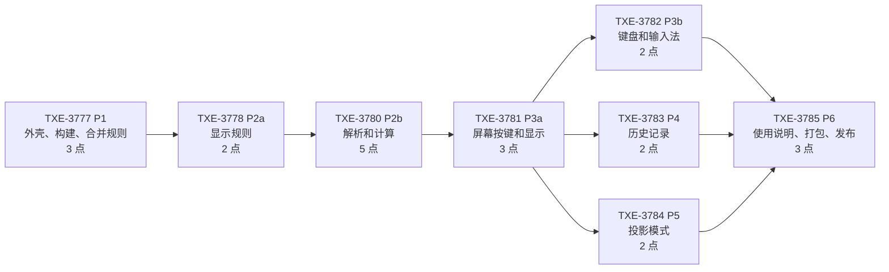

# 初中机房离线网页计算器 — tickets

**Date:** 2026-10-10 · **Epic:** [TXE-3776](https://linear.app/capso/issue/TXE-3776) · **Project:** Workflow Eval（Linear 团队 TXE）· **Repository:** `txehq/wfe-r-20261009-dqva52` · **Plan:** `Project Magi Eval/Features/r-20261009-dqva52/Research.md` §7（2026-10-10 锁定）· **Brief:** `Project Magi Eval/Features/r-20261009-dqva52/Brief.md`

## 1. Reconciliation

搜索范围：Linear 团队 TXE 的“Workflow Eval”项目（含已归档）；全团队按 `calculator`、`计算器` 搜索最近 120 天的工单；vault 的 `Linear Issues/` 按 `dqva52`、计算器、单文件、decimal、peggy、离线搜索。

| 计划的部分 | 找到的已有工单 | 决定 | 结果 |
|---|---|---|---|
| 整个功能 | 无（Workflow Eval 项目里只有 `ic-money-format`、`w7-fixture` 和 `eval-spike` 的评测工单，与计算器无关；TXE-131、TXE-1271 是 TokenFeeds 的价格计算器小组件，已完成，不同产品） | new | 总工单 TXE-3776 |
| P1 页面外壳、构建和合并规则 | 无 | new | TXE-3777 |
| P2 计算核心 | 无 | new，按最窄的依赖点拆成两张 | TXE-3778（P2a 显示规则）、TXE-3780（P2b 解析和计算） |
| P3 计算器界面 | 无 | new，按最窄的依赖点拆成两张 | TXE-3781（P3a 屏幕按键和显示）、TXE-3782（P3b 键盘和输入法） |
| P4 历史记录 | 无 | new | TXE-3783 |
| P5 投影模式 | 无 | new | TXE-3784 |
| P6 交付 | 无 | new | TXE-3785 |

没有 update、relate 或 surface 的情况。

## 2. Ticket map

| 工单 | 部分 | 结果 | 预估 | 推荐负责人（备选） | 分支 |
|---|---|---|---|---|---|
| [TXE-3776](https://linear.app/capso/issue/TXE-3776) | 总工单 | 整个功能交付，2026-12-09 前文件发到老师手里 | 合计 22 点 | — | — |
| [TXE-3777](https://linear.app/capso/issue/TXE-3777) | P1 | 单文件 `计算器.html` 的外壳和构建；Chromium 109 和当前 Chrome 上的自动测试；`ci-required` 规则集和自动合并 | 3 | lin luo（Connor Wang） | `luolinc2023/txe-3777-eval-lfg-calculator-r-20261009-dqva52-p1` |
| [TXE-3778](https://linear.app/capso/issue/TXE-3778) | P2a | `formatResult`：10 位小数、12 位有效数字、科学记数法 | 2 | lin luo（Connor Wang） | `luolinc2023/txe-3778-eval-lfg-calculator-r-20261009-dqva52-p2a-…` |
| [TXE-3780](https://linear.app/capso/issue/TXE-3780) | P2b | `calculate`：字符替换、括号检查、Peggy 语法、十进制求值、八种中文提示和标红范围 | 5 | lin luo（Connor Wang） | `luolinc2023/txe-3780-eval-lfg-calculator-r-20261009-dqva52-p2b` |
| [TXE-3781](https://linear.app/capso/issue/TXE-3781) | P3a | 页面、5×5 屏幕按键、结果和提示、标红 | 3 | lin luo（Connor Wang） | `luolinc2023/txe-3781-eval-lfg-calculator-r-20261009-dqva52-p3a` |
| [TXE-3782](https://linear.app/capso/issue/TXE-3782) | P3b | 键盘、小键盘、粘贴、中文输入法 | 2 | lin luo（Connor Wang） | `luolinc2023/txe-3782-eval-lfg-calculator-r-20261009-dqva52-p3b` |
| [TXE-3783](https://linear.app/capso/issue/TXE-3783) | P4 | 20 条历史记录，关掉再打开仍在，点击放回，清空 | 2 | lin luo（Connor Wang） | `luolinc2023/txe-3783-eval-lfg-calculator-r-20261009-dqva52-p4-…` |
| [TXE-3784](https://linear.app/capso/issue/TXE-3784) | P5 | 投影模式 1.6 倍，1024×768 不滚动 | 2 | lin luo（Connor Wang） | `luolinc2023/txe-3784-eval-lfg-calculator-r-20261009-dqva52-p5-…` |
| [TXE-3785](https://linear.app/capso/issue/TXE-3785) | P6 | 中文使用说明、打包、合并后发布 GitHub Release，供同事用微信或邮件发给老师 | 3 | lin luo（Connor Wang） | `luolinc2023/txe-3785-eval-lfg-calculator-r-20261009-dqva52-p6` |

## 3. Dependency DAG

每条边都在 Linear 里设为 `blocked by`。

## 4. Waves

| Wave | 工单 | 能同时进行的条数 | 前提 |
|---|---|---|---|
| 1 | TXE-3777 | 1 | 无 |
| 2 | TXE-3778 | 1 | TXE-3777 合并 |
| 3 | TXE-3780 | 1 | TXE-3778 合并 |
| 4 | TXE-3781 | 1 | TXE-3780 合并 |
| 5 | TXE-3782、TXE-3783、TXE-3784 | 3（等于同时进行的上限） | TXE-3781 合并 |
| 6 | TXE-3785 | 1 | Wave 5 的三张都合并 |

同时进行的上限：3 条。

## 5. How the split was cut

- 计划的 P1–P6 构成一条连通的依赖链（P1 → P2 → P3 → {P4, P5, P6}），按“依赖的工作放在一起”整条链会是一张工单，远超一个 PR 的合理大小（不含生成文件和锁文件约 2600 行），所以在最窄的依赖点切成串联的工单，每张都设 `blocked by`：
  - P1 和 P2 之间：P2 只用到 P1 的 `package.json`、Vitest 和 CI。
  - P2 拆成 P2a 和 P2b：P2b 只通过 `formatResult(v)` 这一个函数使用 P2a。
  - P2 和 P3 之间：P3 只通过 `calculate(输入)` 这一个函数使用 P2。
  - P3 拆成 P3a 和 P3b：P3b 只通过输入框和“求值”这一个入口使用 P3a 的页面。
  - P4、P5 只通过 P3a 的页面结构和样式变量接入，彼此不依赖。
  - P6 放在 P3b、P4、P5 之后：它合并时触发的 Release 就是包含全部功能的交付包（验收 6.4）。
- 每张工单的目标是一个 PR 少于 500 行改动、少于 15 个改动的函数（P2b 是最大的一张）。
- 横跨各部分的工作：CI 和合并规则在 P1；发布在 P6；使用说明（含 Windows 7 真机检查清单和还原卡说明）在 P6；老师在真机上的检查是总工单的验收项，不作为任何 PR 的合并条件。

## 6. Estimates and assignees

- **预估刻度：** 团队 TXE 使用点数（例如 TXE-2619 为 3 点、TXE-2620 为 5 点）；最近 90 天完成的工单大多没有填写预估，因此以完成时长对照：TXE-3135（Vitest/Playwright CI 任务，约 3 小时）、TXE-3707（大目录排序和分页，约 4 小时）、TXE-3547（发布桌面版本，约 4 小时）。每张工单的理由写在它的 Planning notes 里。
- **推荐负责人：** lin luo 是 Workflow Eval 项目里全部进行中工单的负责人（TXE-3759、TXE-3761、TXE-3764、TXE-3767），当前进行中的工单最少；备选 Connor Wang，最近 90 天完成的网页、CI 和发布工作最多，但进行中的工单约 70 张。负责人没有在 Linear 里设置，由派发门口的回答或领取工单的 `/ic` 确定。

## 7. Readiness per lane

每张工单 `/readiness` 要检查：`wf readiness --need node>=22.12.0 --need npm --need git --need gh`。另外：

- P1、P3a、P3b、P4、P5、P6：Chromium 109 用 `PLAYWRIGHT_BROWSERS_PATH=.browsers ./node_modules/.bin/playwright install chromium` 下载；当前 Chrome 在 `/Applications/Google Chrome.app`。
- P1：`gh` 对本仓库有管理员权限（修改规则集和合并设置）。
- P6：`gh` 能读写本仓库的 Releases。
