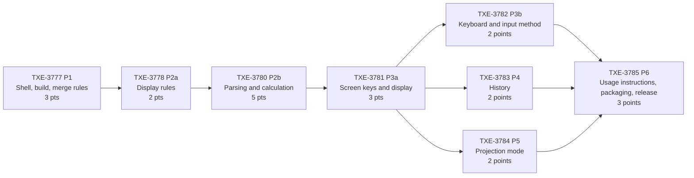

# Junior high computer lab offline web calculator — tickets

**Date:** 2026-10-10 · **Epic:** [TXE-3776](https://linear.app/capso/issue/TXE-3776) · **Project:** Workflow Eval(Linear team TXE) · **Repository:** `txehq/wfe-r-20261009-dqva52` · **Plan:** `Project Magi Eval/Features/r-20261009-dqva52/Research.md` §7 (locked 2026-10-10) · **Brief:** `Project Magi Eval/Features/r-20261009-dqva52/Brief.md`

## 1. Reconciliation

Search scope: Linear team TXE's "Workflow Eval" project (including archived); whole team searched for tickets from the last 120 days by `calculator`, `calculator`; vault's `Linear Issues/` searched by `dqva52`, calculator, single-file, decimal, peggy, offline search.

| Planned part | Existing tickets found | Decision | Result |
|---|---|---|---|
| Whole feature | None (the Workflow Eval project only has evaluation tickets for `ic-money-format`, `w7-fixture` and `eval-spike`, unrelated to the calculator; TXE-131 and TXE-1271 are the price calculator widget of TokenFeeds, completed, different product) | new | Parent ticket TXE-3776 |
| P1 page shell, build and merge rules | None | new | TXE-3777 |
| P2 calculation core | None | new, split into two at the narrowest dependency point | TXE-3778 (P2a display rules), TXE-3780 (P2b parsing and calculation) |
| P3 calculator UI | None | new, split into two at the narrowest dependency point | TXE-3781 (P3a on-screen keys and display), TXE-3782 (P3b keyboard and input method) |
| P4 history | None | new | TXE-3783 |
| P5 projection mode | None | new | TXE-3784 |
| P6 delivery | None | new | TXE-3785 |

There are no update, relate or surface cases.

## 2. Ticket map

| Ticket | Part | Result | Estimate | Recommended owner (alternate) | Branch |
|---|---|---|---|---|---|
| [TXE-3776](https://linear.app/capso/issue/TXE-3776) | Parent ticket | Deliver the whole feature; files delivered to the teacher by 2026-12-09 | 22 points total | — | — |
| [TXE-3777](https://linear.app/capso/issue/TXE-3777) | P1 | Shell and build of single-file `calculator.html`; automated tests on Chromium 109 and current Chrome; `ci-required` ruleset and auto-merge | 3 | lin luo (Connor Wang) | `luolinc2023/txe-3777-eval-lfg-calculator-r-20261009-dqva52-p1` |
| [TXE-3778](https://linear.app/capso/issue/TXE-3778) | P2a | `formatResult`: 10 decimal places, 12 significant digits, scientific notation | 2 | lin luo (Connor Wang) | `luolinc2023/txe-3778-eval-lfg-calculator-r-20261009-dqva52-p2a-…` |
| [TXE-3780](https://linear.app/capso/issue/TXE-3780) | P2b | `calculate`: character replacement, bracket check, Peggy grammar, decimal evaluation, eight Chinese hint messages and error highlight range | 5 | lin luo (Connor Wang) | `luolinc2023/txe-3780-eval-lfg-calculator-r-20261009-dqva52-p2b` |
| [TXE-3781](https://linear.app/capso/issue/TXE-3781) | P3a | calculator page, 5×5 screen keys, results and hints, marked red | 3 | lin luo(Connor Wang) | `luolinc2023/txe-3781-eval-lfg-calculator-r-20261009-dqva52-p3a` |
| [TXE-3782](https://linear.app/capso/issue/TXE-3782) | P3b | Keyboard, numeric keypad, paste, Chinese IME | 2 | lin luo (Connor Wang) | `luolinc2023/txe-3782-eval-lfg-calculator-r-20261009-dqva52-p3b` |
| [TXE-3783](https://linear.app/capso/issue/TXE-3783) | P4 | 20 history entries, still present after closing and reopening, click to put back, clear | 2 | lin luo (Connor Wang) | `luolinc2023/txe-3783-eval-lfg-calculator-r-20261009-dqva52-p4-…` |
| [TXE-3784](https://linear.app/capso/issue/TXE-3784) | P5 | Projection mode at 1.6x, no scrolling at 1024×768 | 2 | lin luo (Connor Wang) | `luolinc2023/txe-3784-eval-lfg-calculator-r-20261009-dqva52-p5-…` |
| [TXE-3785](https://linear.app/capso/issue/TXE-3785) | P6 | User guide, packaging, and a GitHub Release after merging, for colleagues to send to the teacher by WeChat or email | 3 | lin luo (Connor Wang) | `luolinc2023/txe-3785-eval-lfg-calculator-r-20261009-dqva52-p6` |

## 3. Dependency DAG

Set every edge to `blocked by` in Linear.

## 4. Waves

| Wave | Ticket | Number that can run concurrently | Prerequisite |
|---|---|---|---|
| 1 | TXE-3777 | 1 | None |
| 2 | TXE-3778 | 1 | TXE-3777 merged |
| 3 | TXE-3780 | 1 | TXE-3778 merged |
| 4 | TXE-3781 | 1 | TXE-3780 merged |
| 5 | TXE-3782, TXE-3783, TXE-3784 | 3 (equal to the concurrent limit) | Merge TXE-3781 |
| 6 | TXE-3785 | 1 | Merge all three of Wave 5 |

Concurrent limit: 3 items.

## 5. How the split was cut

- The planned P1–P6 form a single connected dependency chain (P1 → P2 → P3 → {P4, P5, P6}). Keeping "dependent work together" would make the whole chain one ticket, far beyond a reasonable PR size (about 2600 lines excluding generated and lock files). So we split it into serial tickets at the narrowest dependency points, and each one sets `blocked by`:
  - Between P1 and P2: P2 only uses P1's `package.json`, Vitest, and CI.
  - Split P2 into P2a and P2b: P2b uses P2a only through this one function, `formatResult(v)`.
  - Between P2 and P3: P3 uses P2 only through this one function, `calculate(input)`.
  - Split P3 into P3a and P3b: P3b uses the P3a page only through the input box and this one entry point, "Evaluate".
  - P4 and P5 connect only through the page structure and style variables of P3a, and do not depend on each other.
  - P6 goes after P3b, P4, and P5: the Release triggered when it is merged is the delivery package containing all features (acceptance 6.4).
- The goal for each ticket is one PR with fewer than 500 changed lines and fewer than 15 changed functions (P2b is the largest one).
- Cross-cutting work: CI and merge rules are in P1; release is in P6; usage instructions (including the Windows 7 real-device checklist and restore card instructions) are in P6; the teacher's real-device check is an acceptance item of the umbrella ticket and is not a merge condition for any PR.

## 6. Estimates and assignees

- **Estimate scale:** The TXE team uses story points (for example, TXE-2619 is 3 points and TXE-2620 is 5 points). Most tickets completed in the last 90 days have no estimate, so compare by completion time instead: TXE-3135 (Vitest/Playwright CI task, about 3 hours), TXE-3707 (sorting and paging large directories, about 4 hours), TXE-3547 (release desktop version, about 4 hours). The reasoning for each ticket is written in its Planning notes.
- **Recommended owner:** lin luo is the owner of all in-progress tickets in the Workflow Eval project (TXE-3759, TXE-3761, TXE-3764, TXE-3767) and has the fewest tickets in progress; alternative Connor Wang has completed the most web, CI and release work in the last 90 days, but has about 70 tickets in progress. The owner is not set in Linear; it is determined by the answer at the dispatch gate or by the `/ic` used to claim the ticket.

## 7. Readiness per lane

For each ticket, `/readiness` should check: `wf readiness --need node>=22.12.0 --need npm --need git --need gh`. Also:

- P1, P3a, P3b, P4, P5, P6: Chromium 109 is downloaded with `PLAYWRIGHT_BROWSERS_PATH=.browsers ./node_modules/.bin/playwright install chromium`; the current Chrome is at `/Applications/Google Chrome.app`.
- P1: `gh` has admin permissions on this repository (modifying rulesets and merge settings).
- P6: `gh` can read and write this repository's Releases.
