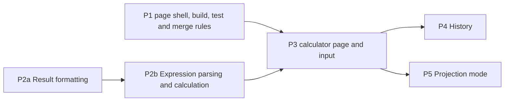

# Junior high classroom offline web calculator — research

**Status:** draft, parked at §6 step 3 (adversarial review not yet run; §8 not yet put to the decider) · **Date:** 2026-10-10 · **Author:** Claude (Opus 5.5), `/lfg` stage 2 · **Brief:** [[Brief]] (`Project Magi Eval/Features/r-20261009-i6vxt1/Brief.md`)

## 1. Context

Students in grades 7 to 9 use a web calculator to solve problems in the computer room (Windows 7, Chrome 109, often offline) and at home, and the teacher demonstrates it on a projector. Results must be precise and neat (`0.1+0.2` shows `0.3`, keeping 10 decimal places). When input is wrong, it shows the seven Chinese error messages the teacher specified and highlights the error position in red; it also has keyboard and on-screen button input, a history that saves 20 entries, and projection mode. The deliverable is a single `.html` file with no external dependencies, usable both when double-clicked and when placed on the school intranet website, delivered before 2026-12-09. The repository `txehq/wfe-r-20261009-i6vxt1` currently has only one line, `README.md`.

## 2. The tier call

**Standard level.** Three signals:

- **Reference available:** web calculators, decimal exact-arithmetic libraries, and single-file packaging all have mature practices and documentation.
- **Ambiguity:** the rest are behavioural questions the teacher can answer directly (§8).
- **Impact scope:** very small, an offline single file, with no data, money, or online environment.

All technical questions were resolved through targeted lookups and local testing (§4.2), so Deep Research was not used; the product questions in §8 are left for the teacher to decide in a `/decide` vote.

## 3. Local findings

### 3.1 Reuse

- **Code:** the repository has no reusable code, tests, configuration, CI, PR templates, or repository documentation files.
  - `git ls-files` → only `README.md`;
  - `gh api repos/txehq/wfe-r-20261009-i6vxt1/contents/.github` → 404;
  - The organization has no shared `.github` repository: `gh api repos/txehq/.github/contents` → 404.
- **GitHub settings** (`gh api repos/txehq/wfe-r-20261009-i6vxt1`):
  - Actions is enabled, allowing all actions (`.../actions/permissions` → `{"enabled":true,"allowed_actions":"all"}`);
  - We have admin permissions (`permissions.admin:true`), so we can configure rulesets and Auto Merge ourselves.
- **Local tools:**
  - node v22.15.0, npm 10.9.2, pnpm 12.10.1;
  - `codex-cli 0.162.0`, logged in;
  - Chromium 156.0.8078.4 in the Playwright cache (`~/Library/Caches/ms-playwright/chromium-1248`);
  - System Chrome 154.0.8037.98.
- **Chrome 109 verified to work on this machine:** Playwright 1.29.2 can download and run Chromium 109.0.5414.46 on macOS arm64 (§4.2, probe P-1).

### 3.2 Coverage

The full feature must cover the following areas (each comes from the brief's "Features to build" and Done means):

- **How to open it:**
  - `file://` double-click to open (Chrome 109, offline);
  - Opened from an `http(s)://` website;
  - Current versions of Chrome and Edge;
  - Phones and tablets show the full layout, and the keys are tappable.
- **Input:**
  - On-screen keys;
  - Keyboard, including the number pad, where Enter on the main keyboard and Enter on the keypad both produce a result;
  - Paste;
  - Full-width characters typed with a Chinese input method. Pressing Enter while the IME is still selecting characters (`isComposing`) only confirms the selection and must not trigger a calculation.
- **Calculation path:** raw text → character normalization (full-width to half-width, `× ÷` converted to operators) → tokenize, each token carrying its position in the original text → parse by textbook operator precedence → compute with decimal → format and show the result, or show the message and highlight the error range in red.
- **UI states:**
  - Empty input, typing in progress;
  - Showing a result;
  - Seven error messages, each with red highlighting;
  - History empty, 1 to 20 entries, and over 20 entries, where the oldest one is pushed out;
  - Projection mode on and off.
- **History:** only successful calculations are recorded; clicking an entry puts the expression back in the input box; "Clear history"; entries persist after closing and reopening the browser.
- **Things that must not happen:**
  - Any network requests. When opened via `http(s)`, the browser automatically requests `/favicon.ico`, so the page must inline a `data:` icon;
  - Any data collection;
  - Results in fraction or square-root form;
  - Trigonometric functions and logarithms. Input like `sin` shows "Unrecognized character: s";
  - Printing;
  - UI text in languages other than Chinese.

### 3.3 Gaps

- **No build, test, or CI:** the package manager, build tool, Chrome 109 target, test runner, and output file names must all be set up in part one.
- **Auto merge is not turned on yet:** `allow_auto_merge:false`, `rulesets` → `[]`, `branches/main/protection` → 404, so `main` has no required checks. The brief's permission scope requires "merge via Auto Merge after code checks and CI pass," which needs:
  - Turn on Auto Merge;
  - Create a ruleset that requires merging through a PR, all required status checks to pass, and all review conversations to be resolved.
- **Nothing published:** `releases` → `[]`, no Pages.
- **No test tools for network request counting, test persistence, and screenshots:** all must be set up in part one.
- **Cannot test on Windows 7:** the brief rules out testing on real devices. Chromium 109 on Linux and macOS uses the same Blink/V8, so Windows-specific font and input method behavior cannot be verified (risk R1).

### 3.4 Machine history, corpus and Linear

- **corpus:** `Project Magi Eval/` only has `Features/`, with no `Decisions/` or `Specs/`, so there are no settled decisions constraining this feature.
- **Linear:** no tickets for this feature ID (searched `r-20261009-i6vxt1` and `calculator` on 2026-10-10).
  - Under the same project, Workflow Eval, there is a calculator umbrella ticket TXE-3776 for another repository (`txehq/wfe-r-20261009-dqva52`) and its sub-tickets, all in Todo status.
  - It belongs to a different repository and requirement from this feature, so the tickets on the two sides don't need to be linked.
- **Local history (`/history`):** No attempts recorded in this repository.

## 4. Web findings

### 4.1 Targeted lookups (looked up 2026-10-10)

| # | Question | Conclusion | Source |
|---|---|---|---|
| W1 | Which Playwright version bundles Chromium 109 | v1.29.0 bundles "Chromium 109.0.5414.46"; the latest 1.29 patch version on npm is 1.29.2 (`npm view @playwright/test@1.29.2 version`) | https://github.com/microsoft/playwright/releases/tag/v1.29.0 |
| W2 | Is there a matching official Docker image | `mcr.microsoft.com/playwright:v1.29.2-jammy` and `v1.29.2-focal` both exist (manifest request returns 200) | `curl https://mcr.microsoft.com/v2/playwright/manifests/v1.29.2-jammy` |
| W3 | Single-file bundling | vite-plugin-singlefile 2.3.3 inlines all JS and CSS into `index.html` and automatically sets suitable build options; `localStorage` works under `file://`; its peer dependencies support Vite 8 | https://github.com/richardtallent/vite-plugin-singlefile; `npm view vite-plugin-singlefile version peerDependencies` |
| W4 | Build tool versions | Vite 8.3.4, Vitest 5.0.3 | `npm view vite version`, `npm view vitest version` |
| W5 | Decimal arithmetic library | decimal.js 10.6.0: `Decimal.set({precision, rounding})`; the default rounding mode is `ROUND_HALF_UP` (round half up); it has `sqrt()`, `pow()` (supports both integer and non-integer exponents; non-integer exponents are computed with `exp(y*ln(x))`), `toDecimalPlaces()`, `toSignificantDigits()`; when the exponent exceeds `maxE`, the result becomes `Infinity` | https://mikemcl.github.io/decimal.js/ |
| W6 | `localStorage` under `file:` URLs | MDN: the behavior is "not specified by any standard and may differ between browsers", and "current browsers seem to provide a separate storage area for each `file:` URL". This disagrees with the measured result in Chrome 109 (P-1); this plan follows the measurement | https://developer.mozilla.org/en-US/docs/Web/API/Window/localStorage |
| W7 | Do existing expression libraries follow the textbook rules | math.js docs: `100 + 3%` gives `103`, `8 % 3` is the remainder, and it supports unary plus (so `3++4` evaluates). All three conflict with the teacher's rules (`200+10%=200.1`; `%` means only percent; `3++4` shows "signs are run together"). math.js also does not recognize the `√` character | https://mathjs.org/docs/expressions/syntax.html |
| W8 | Can GitHub Release use Chinese filenames | Docs: "GitHub renames asset filenames that have special characters, non-alphanumeric characters...". Measured: after uploading `calculator.html`, the filename became `default.html` (P-3) | https://docs.github.com/en/rest/releases/assets?apiVersion=2022-11-28 |

### 4.2 Probes run on this machine (`.research/probe/`, 2026-10-10)

| # | Probe | Result |
|---|---|---|
| P-1 | `persist.mjs`: Chromium 109.0.5414.46 downloaded by Playwright 1.29.2, using a persistent browser profile directory (`launchPersistentContext`). Open `a/write.html` and write, close the browser, then open again; then open `b/read.html` in another directory | On the second open it read `before=written-by-a`, showing data persisted after the browser was closed; `b/read.html` read `written-by-a`, and `location.origin` is `file://`, showing **all local files share the same `localStorage`**. In addition, the page's own `file://` address also appears in `request` events |
| P-2 | `singlefile.mjs`: Built a page with Vite 8.3.4, vite-plugin-singlefile 2.3.3, decimal.js 10.6.0 and `build.target: 'chrome109'`, then opened it via `file://` on Chromium 109 with the network offline (`offline: true`) | Output 33.24 kB, with only one inlined `<script type="module">`, and no `http` string anywhere in the file; run results: `0.1+0.2` → `0.3`, `1/3` → `0.3333333333`, `√2` → `1.4142135624`, `2^50` → `1.1258999068e+15`; `localStorage` works; requests other than the page itself: 0; no errors |
| P-3 | Create a draft Release in this repository, upload `calculator.html`, read back the filename, then delete it | Filename was changed to `default.html`; the draft was deleted, and the `releases` count is 0 |

## 5. Recommendations

1. **Technology used:** TypeScript, Vite 8.3.4, plus vite-plugin-singlefile 2.3.3, `build.target: 'chrome109'`. No UI framework is used; native DOM is written directly.
   - **Why:** The single built HTML has run successfully offline under `file://` in Chromium 109, with 0 network requests (P-2). The page has only one input box, a set of keys, a result line, a hint line and a history list, which native DOM can handle, and the output file is also small.
   - **Constraint:** The source must not use CSS unsupported by Chrome 109, such as CSS nesting (supported starting from Chrome 112) and `color-mix()` (111). Because CSS is not transpiled, tests must be checked with screenshots in Chromium 109.
2. **Exact arithmetic:** decimal.js 10.6.0 (W5, P-2).
   - Set `precision: 40`, `rounding: ROUND_HALF_UP`;
   - Round for display with `toDecimalPlaces(10)`.
3. **Expression parsing:** In `src/core/`, write a tokenizer and add a recursive descent parser that parses by precedence.
   - Every token and syntax node carries its start and end position in the source text; red highlighting uses this position.
   - The seven error messages are a fixed table of error types; each type carries its error range.
   - **Why write it separately:** Existing expression libraries conflict with the teacher's rules on percent, unary plus and `√` (W7). What is parsed here is an expression syntax defined specifically for the classroom, not a file format that belongs to an existing standard.
   - **Operator precedence** (low to high):
     1. `+ -` (binary, left to right);
     2. `× ÷`, and implicit multiplication (left to right; see §8 D4 for the exact syntax);
     3. Unary minus;
     4. `^` (right to left; a minus sign is also allowed in the exponent: `2^-1`, see §8 D1);
     5. Postfix `%`;
     6. `√` (applies to the immediately following number, parenthesis, or another `√`; see §8 D2).

     In this order, `-2^2` = `-(2^2)` = `-4`.
4. **Prevent the page from freezing:** Before computing a power, estimate the number of digits in the result with `|exponent × log10|base||`. When the estimate exceeds the limit, report "Number too big, cannot compute" directly without calculating, so expressions like `2^99999999` also will not freeze the page.
5. **History:** Stored in `localStorage`, with key `txehq.wfe-calculator.history.v1` and a JSON array as the value.
   - Because all local files share one storage area (P-1), the key name needs a dedicated prefix.
   - When reading, check the format with zod 4. If the format is wrong, throw an error directly; when the storage format changes, switch to a new key name.
6. **Testing:**
   - **Calculation core:** Test with Vitest in Node, covering the 10 acceptance questions, the textbook rules, the seven messages and their red highlight ranges.
   - **Page:** Use Playwright for end-to-end tests; the same test files run on two browser groups:
     - **Chromium 109:** `@playwright/test@1.29.2`, runs in the `mcr.microsoft.com/playwright:v1.29.2-jammy` container in CI (W1, W2);
     - **Current Chrome and Edge:** current `@playwright/test`, using `channel: 'chrome'` and `channel: 'msedge'`.
   - **Two Playwright versions in one repo:** install via npm aliases (for example `"playwright-current": "npm:@playwright/test@^1.64"`). Test files get `test` and `expect` from a shared fixture file, which imports them from the same package as the current test runner, based on an environment variable.
7. **Zero network requests:** End-to-end tests record all `request` events on the page; after excluding the page's own address, the count must be 0. Test both `file://` and `http://` (local static server) ways of opening the page.
8. **CI:** GitHub Actions.
   - Core calculation tests, Chromium 109 end-to-end tests, current-browser end-to-end tests, and build are four separate required checks, run at the same time.
   - Read `/ci-optimise` before creating CI.
9. **Merge rules:**
   - Enable `allow_auto_merge` and `delete_branch_on_merge`, allow only squash merges;
   - Create a ruleset for `main`: changes must go through a PR merge, all required status checks must pass (branch must be up to date), all review discussions must be resolved, force pushes and deletions are blocked.
10. **Release:** After each merge to `main`, the workflow builds `calculator.html` and publishes it as a GitHub Release, tagged `v0.<run_number>` and marked as latest.
    - Use English file names, because GitHub changes Chinese file names (W8, P-3).
    - The page's `<title>` is "calculator".
    - The copy sent to the teacher is renamed to `calculator.html` by whoever on our side handles delivery. Ask the user before sending (per the brief's permission scope).
11. **Fonts:** Use system fonts only: `"Microsoft YaHei", "PingFang SC", "Noto Sans CJK SC", sans-serif`. Do not load any web fonts.
12. **Key notes:** This is a suggestion that we decide ourselves; recorded as default values that can be changed.
    - Keyboard input `r` inserts `√`, and the on-screen key shows this shortcut;
    - `Esc` clears the input;
    - `Backspace` deletes the character before the cursor;
    - Numpad keys `* / + - .` type as usual.

## 6. Spec

### 6.1 Story and goals

As a junior high student, on an offline lab computer I double-click `calculator.html`, enter expressions with parentheses, percent signs, powers and square roots using the on-screen keys or keyboard, press Enter or "=", and see the result computed by textbook rules and rounded to 10 decimal places; when I type something wrong, I see the teacher's Chinese prompt, the wrong characters turn red, and I fix them and calculate again. Problems I've already solved stay alongside, and remain after I close and reopen the browser. When the teacher teaches, they click "Projection mode", so the whole class can see clearly.

- **Feature goal:** items 1 to 9 of the brief's "Features to build" section all have automated tests or screenshot evidence.
- **Non-functional goals:**
  - **Offline:** Network request count is 0.
  - **Single file:** One file, no dependence on external resources.
  - **Compatibility:** All features work on Chrome 109, and current Chrome and Edge are also supported.
  - **Speed:** Any input gives a result or prompt within 100 ms.
  - **UI text:** All in Chinese; prompts match the brief word for word.

### 6.2 Parts

| Part | An observable result | Reuse / basis |
|---|---|---|
| **P1 Page shell, build, tests and merge rules** | A PR builds `dist/calculator.html` (title "calculator", page shows "calculator"); after all four required checks pass, the PR is merged by Auto Merge; after merging, Release `v0.N` contains `calculator.html` | §5 items 1, 6, 7, 8, 9, 10; P-2 build config |
| **P2a Result formatting** | `formatResult(Decimal)` returns a string per the display rules, or returns "Number too large, cannot compute" | §5 item 2; W5 |
| **P2b Expression parsing and calculation** | `calculate(text)` returns a result string, or returns one of seven prompts and the error range; the 10 acceptance problems and all textbook rules pass | §5 items 2, 3, 4; P2a |
| **P3 Calculator page and input** | On Chromium 109, results are computed using on-screen keys, keyboard, numpad, paste and full-width characters; on error, the prompt and error position are both red | P1 page shell and end-to-end tests; P2b |
| **P4 History** | The latest 20 successful calculations show in the list; clicking one puts it back in the input box; after "Clear history" the list is empty; still there after closing and reopening the browser | §5 item 5; P-1; P3 |
| **P5 Projection mode** | After clicking "Projection mode", text and keys are enlarged to 1.6 times, with no scrollbars at 1024×768; click again to restore | P3 |

**Display rules (P2a):** The following are recommended values; final numbers are decided by §8 D5.

- When the result is 0, show `0`, not `-0`.
- When `1e-6 ≤ |x| < 1e15`, round to 10 decimal places and remove trailing 0s and any unnecessary decimal point.
- Other non-zero results use scientific notation, written as `a×10^n`:
  - `a` rounded to 10 decimal places, trailing 0s removed;
  - After rounding, if `a` carries to 10, change it to `1`, and add 1 to `n`.
  - Example: `2^50` → `1.1258999068×10^15`.
- When `|x| ≥ 1e100`, show "Number too large, cannot compute."

**Judgment of the seven hint types (P2b):** When an expression has several errors at once, report only the first type in the order below; for the same type of error, report the leftmost one.

1. **Unrecognized character:** After normalization, any character that is not a digit, `. + - × ÷ ^ % √ ( )`, or a space, shows "Unrecognized character: X", where X is that character in the original text. Highlight that character in red.
2. **Unbalanced parentheses:** An extra `)`, or an unclosed `(`. Highlight that parenthesis in red.
3. **Consecutive operators:** Two binary operators are adjacent, for example `3++4`, `5×÷2`, `3%%`. Allowed forms are in §8 D1 and D3. Highlight the second operator in red.
4. **Incomplete expression:**
   - Ends with an operator or `√`, for example `3+`, `√`;
   - Starts with a binary operator (except `-`);
   - Contains empty parentheses `()`;
   - A number contains two decimal points, for example `1.2.3`.

   Highlight where content is missing: the trailing operator itself, or that empty pair of parentheses.
5. **Calculation stage**, the first operation from left to right that fails:
   - Divisor is 0 → "Cannot divide by 0"; highlight `÷` and the divisor;
   - Square root of a negative number → "Cannot take the square root of a negative number"; highlight `√` and the part it applies to;
   - Non-integer power of a negative number, for example `(-8)^0.5` → "Cannot take the square root of a negative number"; highlight this power operation;
   - Absolute value of the result ≥ 1e100, or the estimated number of digits exceeds the limit → "Number too large, cannot compute"; highlight the entire expression;
   - A negative power of `0`, treated as division by 0 → "Cannot divide by 0".

With empty input, pressing Enter or "=" does nothing.

**Character normalization (P2b):**

| Character in original text | Normalized to |
|---|---|
| Full-width digits `0`–`9` | `0`–`9` |
| Full-width `(` `)` | `(` `)` |
| Full-width `+` | `+` |
| Full-width `-`, minus sign `−`, em dash `—` | `-` |
| Full-width `*`, `×`, `x`, `X` | `×` |
| `/` `÷` `,` | `÷` |
| `^` `...` | `^` |
| Full-width `%` | `%` |
| `.` `.` | `.` |
| Full-width space | Half-width space |

Keep each character's position mapping between before and after normalization; highlighting uses positions in the original text. The handling of `x`/`X` is decided by §8 D6.

## 7. Plan

P1 and P2a start together; after P2a finishes, P2b starts; P3 needs both P1 and P2b to finish; P4 and P5 run in parallel after P3.

### P1 Page shell, build, test and merge rules

**Test plan:**

- Build;
- Vitest smoke test;
- Playwright end-to-end smoke test: on Chromium 109 and the current Chrome and Edge, open the built file via `file://` and `http://` respectively;
- Count network requests;
- Actually run CI once on the PR;
- Read out the rulesets and repository settings with `gh api`;
- Check the Release after merging.

**Acceptance criteria:**

1. `npm run build` generates `dist/calculator.html`, with no other files under `dist/`; the file contains no external references starting with `http://`, `https://` or `//`. (Test: post-build check script)
2. On Chromium 109.0.5414.46, with the network offline, open via `file://`; the page title is "calculator", it shows "calculator", there are no console errors, and the number of requests other than the page itself is 0. (Test: Playwright 1.29.2)
3. Open via `http://` from a local static server; item 2 holds equally, including no `/favicon.ico` request. (Test: Playwright 1.29.2 and current version)
4. Items 2 and 3 also hold on the current Chrome and Edge (`channel: 'chrome'`, `'msedge'`). (Test: current version of Playwright)
5. CI has four independent checks: core calculation tests, Chromium 109 end-to-end tests, end-to-end tests on current-version browsers, and the build. All four start running at the same time, and all pass on a PR that changes only the shell. (Measurement: CI run records)
6. `allow_auto_merge` is `true`, `delete_branch_on_merge` is `true`, and only squash merges are allowed; the rule set for `main` requires: merging through a PR, all four checks passing with the branch up to date, all review discussions resolved, and it blocks force pushes and deletion. (Test: the settings read out by `gh api` match the check names in item 5)
7. After merging to `main`, the workflow creates Release `v0.<run_number>`, marks it as latest, and it contains `calculator.html`, whose content matches the output of `npm run build`. (Measurement: `gh release view` and the file's sha256)
8. The repository has a PR template and `AGENTS.md` (`CLAUDE.md` references it), stating how to install, build, and test, as well as the syntax restrictions for Chrome 109. (Check: the files exist, and the commands in them actually run successfully on a clean clone)

### P2a Result formatting

**Test plan:** Vitest table tests for `formatResult`, covering both sides of every boundary.

**Acceptance criteria:** (all are tests, Vitest)

1. `0.3` → `0.3`; the Decimal of `1/3` → `0.3333333333`; `2/3` → `0.6666666667`; `1024` → `1024`; `-2` → `-2`; `2.50` → `2.5`; `5.0000000000001` → `5`.
2. 0 and negative 0 both display `0`; `-0.00000000001` displays `-1×10^-11` at the recommended boundary.
3. `2^50` → `1.1258999068×10^15`; `999999999999999` → `999999999999999`; `1e15` → `1×10^15`; the case of `9.99999999999×10^15` carrying over after rounding displays `1×10^16`.
4. `0.000001` → `0.000001`; `0.0000001` → `1×10^-7`.
5. `|x| ≥ 1e100` returns "Number too large to calculate".

### P2b Expression parsing and calculation

**Test plan:** Vitest table tests for `calculate`. Each test states the input, the expected result or message, and the expected highlight range (start and end positions). Additionally, test every row of the normalization table, and the time taken for worst-case input.

**Acceptance criteria:** (all are tests, Vitest)

1. All 10 of the teacher's acceptance questions produce the expected result or message.
2. Textbook rules: `-2^2` → `-4`, `200+10%` → `200.1`, `50%*200` → `100`, `2^3^2` → `512`, `2(3+4)` → `14`, `√16` → `4`, `√2` → `1.4142135624`.
3. Seven kinds of message, each with at least two examples; the message text matches the brief word for word, and the highlight range is correct:
   - `5/0`;
   - `(1+2`, `1+2)`;
   - `√-4`, `√(1-5)`;
   - `3++4`, `5×÷2`;
   - `3+`, `√`, `()`;
   - `a`, `2sin3` (message "Unknown character: s");
   - `10^100`, `2^99999999`.
4. When there are several errors at once, only the first kind is reported, in the order of §6.2; for example, `(a+` → "Unknown character: a".
5. Every row of the normalization table has a test, for example `(1+2)×3` → `9`, `8, 2` → `4`, `2...3` → `8`; the positions marked in red correspond to characters in the original text.
6. `2^99999999`, `9^9^9`, and expressions 2000 characters long all return within 100 ms.
7. Every notation chosen by the §8 vote has a test.

### P3 calculator page and input

**Test plan:** Playwright end-to-end tests, run on Chromium 109 and current-version browsers:

- Click on-screen keys;
- `keyboard.type` and `keyboard.press`, including keypad keys such as `NumpadEnter`;
- Paste;
- Typing full-width characters;
- Simulating IME composition (`compositionstart`/`compositionend` events, `isComposing` is true on Enter);
- Screenshot comparison.

**Acceptance criteria:**

1. Use only on-screen keys to enter the 10 acceptance problems in order; after pressing "=" for each, the expected result or message is shown. (Test: Playwright 1.29.2 and current version)
2. Enter the same 10 problems with the keyboard; pressing both the main Enter key and the keypad Enter key produces the result. (Test)
3. Paste `(1+2)×3` and press Enter; `9` is shown. (Test)
4. Pressing Enter while the IME is still choosing a candidate does not trigger a calculation; after the selection is complete, pressing Enter calculates normally. (Test: simulated composition events)
5. When there is an error, the message is shown in red, the error range is marked in red, and the result line is empty; after the expression is edited, the message and red marking disappear automatically. (Test: calculator styles; screenshot: Chromium 109)
6. Press `Esc` to clear the input, press `Backspace` to delete the character before the cursor, and press `r` to insert `√`. (Test)
7. In a 375×667 window, all keys are visible and clickable, and the page has no horizontal scrollbar. (Test: Playwright, with screenshot)
8. All visible text on the page and all `aria-label` values are in Chinese. (Test: check page text)

### P4 History

**Test plan:** Playwright end-to-end tests, using a persistent browser profile directory (`launchPersistentContext`), close and reopen the browser under both `file://` and `http://` opening methods. In addition, run Vitest tests on the storage module.

**Acceptance criteria:**

1. After a problem is calculated successfully, its expression and result appear at the top of the list; an expression that was entered incorrectly does not enter the list. (Test)
2. Calculate 21 problems in a row; the list keeps only the most recent 20, and the earliest one is pushed out. (Test)
3. Click a problem in the list; its expression is put back in the input box with the cursor at the end, so it can be edited and calculated again. (Test)
4. After clicking "Clear history", the list is empty; after closing and reopening the browser, it is still empty. (Test)
5. Calculate a few problems, close the browser, and reopen it; the list is the same as before closing. Both `file://` and `http://` must be tested, running on Chromium 109. (Test: `launchPersistentContext`)
6. The storage key name is `txehq.wfe-calculator.history.v1`; keys written by other local pages do not affect the list. (Test: first write another key, then check the list)

### P5 Projection mode

**Test plan:** Playwright end-to-end tests, measuring element font sizes and key sizes; take screenshots at 1024×768, one before and one after zooming.

**Acceptance criteria:**

1. After clicking "Projection mode", the font sizes of the input box, result, messages, keys and history, as well as the key sizes, are all 1.6 times the original (within ±1 px); click again to restore the original size. (Measurement: Playwright reads the computed styles)
2. In a 1024×768 window, with projection mode on, the page has no scrollbar and all keys are visible. (Test, with screenshot)
3. Put one screenshot each from before and after zooming into the acceptance report. (Visual comparison)
4. After refreshing the page, projection mode returns to the off state. (Test)

### Delivery (not part of any section)

After all sections are merged, take `calculator.html` from the latest Release, rename it to `calculator.html`, and send it to the teacher's email. The teacher will provide the email address; ask the user before sending.

## 8. Open decisions

The teacher decides these questions in a `/decide` vote; each question lists a recommendation.

| # | Issue | Options | Recommendation |
|---|---|---|---|
| D1 | Minus sign right after an operator: `3×-2`, `2^-1`, `5+-3` | A. Allowed, computing `-6`, `0.5`, `2`; B. Show message "Symbols run together" | A: a minus sign is part of a number; common in students' homework |
| D2 | Where `√` applies: `√9+7` | A. Applies only to the number or parentheses right after it: `√9+7=10`, `√(9+7)=4`; B. Applies to the whole expression after it: `√9+7=4` | A: consistent with the textbook, where what is under the root is what gets rooted; to root a whole expression, add parentheses |
| D3 | Percent sign combined with other notation: `(1+2)%`, `50%^2`, `10%%` | A. `(1+2)%=0.03`, `50%^2=0.25`, `10%%` shows "Symbols run together"; B. The percent sign can only follow a number; `(1+2)%` shows "Symbols run together" | A |
| D4 | Implicit multiplication used together with division: `6÷2(1+2)` | A. Same as writing the multiplication sign, calculated left to right: `9`; B. Implicit multiplication is calculated first: `1` | A: consistent with the method the teacher requires when students write the multiplication sign |
| D5 | When to switch to scientific notation, and when to show "Number too big" | A. Use scientific notation when less than `0.000001` or not less than `10^15`; show "Number too big, cannot compute" when not less than `10^100`; B. Use scientific notation only when not less than `10^15`; very small numbers are always rounded to 10 decimal places (`0.00000000001` shows `0`); the `10^100` limit stays the same | A: very small numbers will not show as `0` |
| D6 | Letter `x` treated as multiplication | A. Treated as multiplication: `3x4=12`; B. Show "Unknown character: x" | A: some students are used to using `x` as the multiplication sign |

## 9. Risks

| # | Risk | How to verify |
|---|---|---|
| R1 | Fonts on Windows 7 (glyphs for `√`, `×`, `÷`), IME and keypad behavior differ from Linux and macOS, and we cannot test on real machines | Use only system fonts, set per §5 item 11; check glyphs with screenshots on Chromium 109; the teacher will try it themselves after delivery |
| R2 | Two versions of Playwright are in one repository, and the test files and test runner versions do not match (error "did not expect test() to be called here") | The CI runs of P1 items 2 to 5 are the check; this is also the first part of P1 that must be made to work |
| R3 | All local files share one `localStorage` (P-1), and other local pages may read or write the same key | Key names carry a prefix and version number; P4 item 6 |
| R4 | Very large exponentiation makes the page hang | §5 item 4 estimate; P2b item 6 timing test |
| R5 | CSS uses syntax that Chrome 109 does not support, and the build does not report an error | P3 item 5, P5 item 2 screenshots on Chromium 109; `AGENTS.md` documents this restriction |
| R6 | Ruleset and required check names do not match, so Auto Merge waits forever for a check result, or merges without waiting for checks | P1 item 6 reads the settings and compares them with the check names |
| R7 | The lab's restore system clears history records after a reboot | Teacher has accepted; no verification needed |
| R8 | Delivery date 2026-12-09 | The plan has six parts. The longest dependency chain is P2a → P2b → P3 → P4/P5, and each part is usable on `main` once completed |
