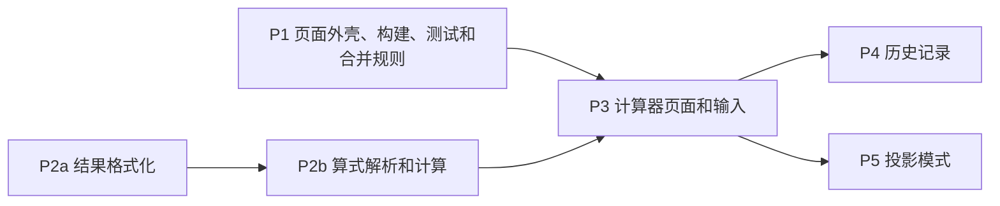

# 初中课堂离线网页计算器 — research

**Status:** draft, parked at §6 step 3 (adversarial review not yet run; §8 not yet put to the decider) · **Date:** 2026-10-10 · **Author:** Claude (Opus 5.5), `/lfg` stage 2 · **Brief:** [[Brief]]（`Project Magi Eval/Features/r-20261009-i6vxt1/Brief.md`）

## 1. Context

初一到初三的学生在机房（Windows 7，Chrome 109，经常断网）和家里用一个网页计算器算题，老师在投影上演示。结果要精确、整齐（`0.1+0.2` 显示 `0.3`，保留 10 位小数），写错时显示老师定的七种中文提示，并把出错位置标红；还要有键盘和屏幕按键输入、能保存 20 条的历史记录和投影模式。交付物是一个不依赖外部资源的 `.html` 文件，双击打开和放到学校内网网站上都能使用，2026-12-09 之前交付。仓库 `txehq/wfe-r-20261009-i6vxt1` 目前只有一行 `README.md`。

## 2. The tier call

**标准级别。** 三个信号：

- **有参考：** 网页计算器、十进制精确计算库、单文件打包都有成熟的做法和文档。
- **歧义：** 剩下的都是老师可以直接回答的行为问题（§8）。
- **影响范围：** 很小，一个离线的单文件，没有数据、金钱和线上环境。

所有技术问题都通过定向查找和本机实测（§4.2）解决了，所以没有使用 Deep Research；§8 的产品问题交给老师在 `/decide` 投票中决定。

## 3. Local findings

### 3.1 Reuse

- **代码：** 仓库里没有可以沿用的代码、测试、配置、CI、PR 模板或仓库说明文件。
  - `git ls-files` → 只有 `README.md`；
  - `gh api repos/txehq/wfe-r-20261009-i6vxt1/contents/.github` → 404；
  - 组织没有共享的 `.github` 仓库：`gh api repos/txehq/.github/contents` → 404。
- **GitHub 设置**（`gh api repos/txehq/wfe-r-20261009-i6vxt1`）：
  - 已开启 Actions，允许所有 action（`.../actions/permissions` → `{"enabled":true,"allowed_actions":"all"}`）；
  - 我们有管理员权限（`permissions.admin:true`），可以自己配置规则集和 Auto Merge。
- **本机工具：**
  - node v22.15.0、npm 10.9.2、pnpm 12.10.1；
  - `codex-cli 0.162.0`，已登录；
  - Playwright 缓存中的 Chromium 156.0.8078.4（`~/Library/Caches/ms-playwright/chromium-1248`）；
  - 系统 Chrome 154.0.8037.98。
- **本机已验证可用的 Chrome 109：** Playwright 1.29.2 在 macOS arm64 上可以下载并运行 Chromium 109.0.5414.46（§4.2，探针 P-1）。

### 3.2 Coverage

完整的功能要覆盖下面这些地方（每条都来自 brief 的“要做的功能”和 Done means）：

- **打开方式：**
  - `file://` 双击打开（Chrome 109，断网）；
  - `http(s)://` 网站打开；
  - 当前版本的 Chrome 和 Edge；
  - 手机和平板能显示完整、按键能点。
- **输入：**
  - 屏幕按键；
  - 键盘，包括数字小键盘，主键盘和小键盘的回车都出结果；
  - 粘贴；
  - 中文输入法打出的全角字符。输入法正在选字时（`isComposing`）按回车，只是确认选字，不能触发计算。
- **计算路径：** 原始文字 → 字符规范化（全角转半角，`× ÷` 转成运算符）→ 切分记号，每个记号带原文中的位置 → 按课本优先级解析 → 用 decimal 计算 → 格式化显示结果，或者显示提示语并标红出错范围。
- **界面状态：**
  - 空输入、正在输入；
  - 显示结果；
  - 七种出错提示，各自带标红；
  - 历史为空、有 1 到 20 条、超过 20 条时挤掉最早的一条；
  - 投影模式打开和关闭。
- **历史记录：** 只记成功的计算；点一条，式子放回输入框；「清空历史」；关掉浏览器再打开仍在。
- **不能发生的：**
  - 任何网络请求。通过 `http(s)` 打开时，浏览器会自动请求 `/favicon.ico`，所以页面要内联一个 `data:` 图标；
  - 任何数据收集；
  - 分数和根号形式的结果；
  - 三角函数和对数。`sin` 这类输入显示「有不认识的字：s」；
  - 打印；
  - 中文以外的界面文字。

### 3.3 Gaps

- **没有构建、测试和 CI：** 包管理器、构建工具、Chrome 109 目标、测试运行器、输出文件名都要在第一部分建立。
- **自动合并的设置还没打开：** `allow_auto_merge:false`，`rulesets` → `[]`，`branches/main/protection` → 404，所以 `main` 没有任何必需检查。brief 的权限范围要求“代码检查和 CI 通过后经 Auto Merge 合并”，这需要：
  - 打开 Auto Merge；
  - 建一个规则集，要求通过 PR 合并、必需的状态检查全部通过、评审讨论全部解决。
- **没有发布的地方：** `releases` → `[]`，没有 Pages。
- **没有统计网络请求、测试持久化和截图的测试工具：** 都要在第一部分建立。
- **测不了 Windows 7：** brief 把真机测试列为不做。Linux 和 macOS 上的 Chromium 109 用的是同一套 Blink/V8，Windows 特有的字体和输入法行为无法验证（风险 R1）。

### 3.4 Machine history, corpus and Linear

- **corpus：** `Project Magi Eval/` 下只有 `Features/`，没有 `Decisions/` 和 `Specs/`，没有约束这个功能的已定决定。
- **Linear：** 没有这个功能编号的工单（2026-10-10 搜索 `r-20261009-i6vxt1`、`计算器`）。
  - 同一个项目 Workflow Eval 下，有一个针对另一个仓库（`txehq/wfe-r-20261009-dqva52`）的计算器总工单 TXE-3776 及其子工单，状态都是 Todo。
  - 它和这个功能属于不同的仓库和需求，两边的工单不需要关联。
- **本机历史（`/history`）：** 没有在这个仓库里做过尝试的记录。

## 4. Web findings

### 4.1 Targeted lookups（2026-10-10 查阅）

| # | 问题 | 结论 | 来源 |
|---|---|---|---|
| W1 | 哪个 Playwright 版本自带 Chromium 109 | v1.29.0 自带 “Chromium 109.0.5414.46”；npm 上最新的 1.29 补丁版本是 1.29.2（`npm view @playwright/test@1.29.2 version`） | https://github.com/microsoft/playwright/releases/tag/v1.29.0 |
| W2 | 有没有对应的官方 Docker 镜像 | `mcr.microsoft.com/playwright:v1.29.2-jammy`、`v1.29.2-focal` 都存在（manifest 请求返回 200） | `curl https://mcr.microsoft.com/v2/playwright/manifests/v1.29.2-jammy` |
| W3 | 单文件打包 | vite-plugin-singlefile 2.3.3 把 JS 和 CSS 全部内联进 `index.html`，并自动设置合适的构建选项；在 `file://` 下 `localStorage` 可用；它的 peer 依赖支持 Vite 8 | https://github.com/richardtallent/vite-plugin-singlefile；`npm view vite-plugin-singlefile version peerDependencies` |
| W4 | 构建工具版本 | Vite 8.3.4，Vitest 5.0.3 | `npm view vite version`、`npm view vitest version` |
| W5 | 十进制计算库 | decimal.js 10.6.0：`Decimal.set({precision, rounding})`，默认的舍入方式是 `ROUND_HALF_UP`（四舍五入）；有 `sqrt()`、`pow()`（整数和非整数指数都支持，非整数指数用 `exp(y*ln(x))` 计算）、`toDecimalPlaces()`、`toSignificantDigits()`；指数超过 `maxE` 时结果变成 `Infinity` | https://mikemcl.github.io/decimal.js/ |
| W6 | `file:` 网址下的 `localStorage` | MDN：行为“没有标准规定，各浏览器可能不同”，“当前浏览器似乎为每个 `file:` 网址各自提供一块存储”。这和 Chrome 109 上的实测结果不一致（P-1），本计划以实测为准 | https://developer.mozilla.org/en-US/docs/Web/API/Window/localStorage |
| W7 | 现成的表达式库是否符合课本规则 | math.js 文档：`100 + 3%` 的结果是 `103`，`8 % 3` 是求余数，还支持一元加号（所以 `3++4` 能算出结果）。这三点都和老师定的规则冲突（`200+10%=200.1`；`%` 只表示百分号；`3++4` 显示「符号连在一起了」）。math.js 也不认识 `√` 这个字符 | https://mathjs.org/docs/expressions/syntax.html |
| W8 | GitHub Release 能否使用中文文件名 | 文档：“GitHub renames asset filenames that have special characters, non-alphanumeric characters…”。实测上传 `计算器.html` 后，文件名变成了 `default.html`（P-3） | https://docs.github.com/en/rest/releases/assets?apiVersion=2022-11-28 |

### 4.2 Probes run on this machine（`.research/probe/`，2026-10-10）

| # | 探针 | 结果 |
|---|---|---|
| P-1 | `persist.mjs`：Playwright 1.29.2 下载的 Chromium 109.0.5414.46，使用持久的浏览器配置目录（`launchPersistentContext`）。打开 `a/write.html` 写入，关闭浏览器，再打开；然后打开另一个目录里的 `b/read.html` | 第二次打开时读到 `before=written-by-a`，说明关闭浏览器后数据仍然保留；`b/read.html` 读到 `written-by-a`，`location.origin` 是 `file://`，说明**所有本地文件共用同一块 `localStorage`**。另外，页面本身的 `file://` 地址也会出现在 `request` 事件里 |
| P-2 | `singlefile.mjs`：用 Vite 8.3.4、vite-plugin-singlefile 2.3.3、decimal.js 10.6.0 和 `build.target: 'chrome109'` 构建一个页面，在 Chromium 109 上断网（`offline: true`）后用 `file://` 打开 | 输出 33.24 kB，只有一个内联的 `<script type="module">`，文件里没有任何 `http` 字样；运行结果：`0.1+0.2` → `0.3`、`1/3` → `0.3333333333`、`√2` → `1.4142135624`、`2^50` → `1.1258999068e+15`；`localStorage` 可用；除页面本身之外的请求数为 0，没有报错 |
| P-3 | 在本仓库建一个草稿 Release，上传 `计算器.html`，读出文件名后删除 | 文件名被改成 `default.html`；草稿已删除，`releases` 数量是 0 |

## 5. Recommendations

1. **使用的技术：** TypeScript，Vite 8.3.4，再加 vite-plugin-singlefile 2.3.3，`build.target: 'chrome109'`。不使用任何界面框架，直接写原生 DOM。
   - **为什么：** 构建出的单个 HTML 已在 Chromium 109 的 `file://` 下断网运行成功，网络请求为 0（P-2）。页面只有一个输入框、一组按键、结果行、提示行和历史列表，原生 DOM 就能完成，打出来的文件也小。
   - **限制：** 源码中不能使用 Chrome 109 不支持的 CSS，例如 CSS 嵌套（Chrome 112 开始支持）和 `color-mix()`（111）。因为 CSS 不会被转译，测试要在 Chromium 109 上截图检查。
2. **精确计算：** decimal.js 10.6.0（W5，P-2）。
   - 设置 `precision: 40`、`rounding: ROUND_HALF_UP`；
   - 显示前用 `toDecimalPlaces(10)` 四舍五入。
3. **算式解析：** 在 `src/core/` 中写一个记号切分器，加一个按优先级解析的递归下降解析器。
   - 每个记号和语法节点都带原文中的起止位置，标红就用这个位置。
   - 七种出错提示是一个固定的错误类型表，每种类型带出错范围。
   - **为什么单独写：** 现成的表达式库在百分号、一元加号和 `√` 上都和老师的规则冲突（W7）。这里解析的是一套专门为课堂定的算式写法，不属于已有标准的文件格式。
   - **运算优先级**（从低到高）：
     1. `+ -`（二元，从左往右）；
     2. `× ÷`，以及省略乘号（从左往右，具体写法见 §8 D4）；
     3. 一元负号；
     4. `^`（从右往左；指数里也允许负号：`2^-1`，见 §8 D1）；
     5. 后缀 `%`；
     6. `√`（作用于紧跟着的一个数、一个括号或另一个 `√`，见 §8 D2）。

     按这个顺序，`-2^2` = `-(2^2)` = `-4`。
4. **防止页面卡住：** 计算乘方之前，先用 `|指数 × log10|底数||` 估算结果的位数。估算超过界限时，直接报「数太大，算不出来」，不做计算，所以 `2^99999999` 这样的式子也不会让页面卡住。
5. **历史记录：** 存在 `localStorage` 里，键名是 `txehq.wfe-calculator.history.v1`，值是 JSON 数组。
   - 因为所有本地文件共用一块存储（P-1），键名要带专门的前缀。
   - 读出来时用 zod 4 检查格式。格式不对时直接抛出错误，存储格式改变时换一个新的键名。
6. **测试：**
   - **计算核心：** 在 Node 里用 Vitest 测试，覆盖 10 道验收题、课本规则、七种提示和它们的标红范围。
   - **页面：** 用 Playwright 做端到端测试，同一套测试文件在两组浏览器上运行：
     - **Chromium 109：** `@playwright/test@1.29.2`，CI 中运行在 `mcr.microsoft.com/playwright:v1.29.2-jammy` 容器里（W1，W2）；
     - **当前版本的 Chrome 和 Edge：** 当前版本的 `@playwright/test`，使用 `channel: 'chrome'` 和 `channel: 'msedge'`。
   - **两个版本的 Playwright 放在一个仓库里：** 用 npm 别名安装（例如 `"playwright-current": "npm:@playwright/test@^1.64"`）。测试文件从一个共用的 fixture 文件里取得 `test` 和 `expect`，这个文件根据环境变量，从与当前测试运行器相同的包里导入。
7. **网络请求为 0：** 端到端测试记录页面的所有 `request` 事件，排除页面本身的地址后，数量必须为 0。`file://` 和 `http://`（本地静态服务器）两种打开方式都要测。
8. **CI：** GitHub Actions。
   - 计算核心测试、Chromium 109 端到端测试、当前版本浏览器的端到端测试、构建，这四项分别是独立的必需检查，同时运行。
   - 创建 CI 之前先读 `/ci-optimise`。
9. **合并规则：**
   - 打开 `allow_auto_merge` 和 `delete_branch_on_merge`，只允许 squash 合并；
   - 给 `main` 建一个规则集：必须通过 PR 合并，必需的状态检查全部通过（要求分支是最新的），评审讨论全部解决，禁止强制推送和删除。
10. **发布：** 每次合并到 `main` 后，工作流构建出 `calculator.html`，发布成一个 GitHub Release，标签是 `v0.<run_number>`，并标成 latest。
    - 文件名用英文，因为 GitHub 会把中文文件名改掉（W8，P-3）。
    - 页面的 `<title>` 是“计算器”。
    - 发给老师的那一份，由我们这边负责交付的人改名为 `计算器.html`。发送前先问用户（brief 的权限范围）。
11. **字体：** 只用系统字体：`"Microsoft YaHei", "PingFang SC", "Noto Sans CJK SC", sans-serif`。不加载任何网络字体。
12. **按键说明：** 建议由我们自己决定，记为可以改的默认值。
    - 键盘输入 `r` 插入 `√`，屏幕按键上写出这个快捷键；
    - `Esc` 清空输入；
    - `Backspace` 删除光标前的一个字；
    - 小键盘的 `* / + - .` 照常输入。

## 6. Spec

### 6.1 Story and goals

作为初中学生，我在断网的机房电脑上双击 `计算器.html`，用屏幕按键或键盘输入带括号、百分号、乘方和开平方的式子，按回车或「=」，看到按课本规则算出、四舍五入到 10 位小数的结果；写错时看到老师定的中文提示，出错的字标成红色，改好后再算。算过的题保留在旁边，关掉浏览器再打开还在。老师上课时点「投影模式」，全班都能看清。

- **功能目标：** brief “要做的功能”第 1 到 9 条，全部有自动测试或带截图的证明。
- **非功能目标：**
  - **离线：** 网络请求数为 0。
  - **单文件：** 一个文件，不依赖外部资源。
  - **兼容：** Chrome 109 上全部功能可用，同时支持当前版本的 Chrome 和 Edge。
  - **速度：** 任何输入都在 100 ms 内给出结果或提示。
  - **界面文字：** 全部是中文，提示语与 brief 一字不差。

### 6.2 Parts

| Part | 一个可观察的结果 | 复用 / 依据 |
|---|---|---|
| **P1 页面外壳、构建、测试和合并规则** | 一个 PR 构建出 `dist/calculator.html`（标题“计算器”，页面上显示“计算器”）；四项必需检查都通过后，PR 由 Auto Merge 合并；合并后 Release `v0.N` 里有 `calculator.html` | §5 第 1、6、7、8、9、10 条；P-2 的构建配置 |
| **P2a 结果格式化** | `formatResult(Decimal)` 按显示规则返回字符串，或者返回「数太大，算不出来」 | §5 第 2 条；W5 |
| **P2b 算式解析和计算** | `calculate(text)` 返回结果字符串，或者返回七种提示之一和出错范围；10 道验收题和全部课本规则都通过 | §5 第 2、3、4 条；P2a |
| **P3 计算器页面和输入** | 在 Chromium 109 上用屏幕按键、键盘、小键盘、粘贴和全角字符算出结果；出错时提示语和出错位置都是红色 | P1 的页面外壳和端到端测试；P2b |
| **P4 历史记录** | 最近 20 条成功的计算显示在列表里，点一条放回输入框，「清空历史」后列表为空，关闭浏览器再打开仍在 | §5 第 5 条；P-1；P3 |
| **P5 投影模式** | 点「投影模式」后，字和按键放大到 1.6 倍，在 1024×768 下没有滚动条；再点一下恢复 | P3 |

**显示规则（P2a）：** 下面是推荐值，最终数值由 §8 D5 决定。

- 结果为 0 时显示 `0`，不显示 `-0`。
- 当 `1e-6 ≤ |x| < 1e15` 时，四舍五入到 10 位小数，去掉末尾的 0 和多余的小数点。
- 其他非零结果用科学记数法，写成 `a×10^n`：
  - `a` 四舍五入到 10 位小数，去掉末尾的 0；
  - 四舍五入以后，如果 `a` 进位成了 10，就改成 `1`，同时 `n` 加 1。
  - 例：`2^50` → `1.1258999068×10^15`。
- 当 `|x| ≥ 1e100` 时，显示「数太大，算不出来」。

**七种提示的判定（P2b）：** 一个式子同时有几处错误时，按下面的顺序只报第一种；同一种错误报最左边的一处。

1. **有不认识的字：** 规范化以后，仍然不属于数字、`. + - × ÷ ^ % √ ( )` 和空格的字符，显示「有不认识的字：X」，X 是原文中的那个字，标红这个字。
2. **括号不配对：** 多出来的 `)`，或者没有关上的 `(`，标红这个括号。
3. **符号连在一起了：** 两个二元运算符相邻，例如 `3++4`、`5×÷2`、`3%%`。允许的写法见 §8 D1、D3。标红第二个符号。
4. **式子没写完：**
   - 末尾是运算符或 `√`，例如 `3+`、`√`；
   - 开头是二元运算符（`-` 除外）；
   - 有空括号 `()`；
   - 一个数里有两个小数点，例如 `1.2.3`。

   标红缺少内容的位置：末尾的运算符本身，或者那对空括号。
5. **计算阶段**，从左往右第一处出错的运算：
   - 除数是 0 → 「不能除以 0」，标红 `÷` 和除数；
   - 对负数开平方 → 「负数不能开平方」，标红 `√` 和它作用的部分；
   - 负数的非整数次方，例如 `(-8)^0.5` → 「负数不能开平方」，标红这个乘方；
   - 结果的绝对值 ≥ 1e100，或者估算的位数超过界限 → 「数太大，算不出来」，标红整个式子；
   - `0` 的负数次方，按除以 0 处理 → 「不能除以 0」。

空输入时按回车或「=」，什么也不做。

**字符规范化（P2b）：**

| 原文中的字符 | 规范化为 |
|---|---|
| 全角数字 `０`–`９` | `0`–`9` |
| `（` `）` | `(` `)` |
| `＋` | `+` |
| `－` `−` `—` | `-` |
| `＊` `×` `x` `X` | `×` |
| `／` `÷` `、` | `÷` |
| `＾` `……` | `^` |
| `％` | `%` |
| `．` `。` | `.` |
| 全角空格 | 半角空格 |

规范化前后保持每个字符在原文中的位置对应关系，标红按原文的位置。`x`/`X` 的处理由 §8 D6 决定。

## 7. Plan

P1 和 P2a 同时开始，P2a 完成后开始 P2b，P3 需要 P1 和 P2b 都完成；P4 和 P5 在 P3 之后同时进行。

### P1 页面外壳、构建、测试和合并规则

**Test plan：**

- 构建；
- Vitest 冒烟测试；
- Playwright 端到端冒烟测试：在 Chromium 109 和当前版本的 Chrome、Edge 上，分别用 `file://` 和 `http://` 打开构建出的文件；
- 统计网络请求；
- 在 PR 上实际运行一次 CI；
- 用 `gh api` 读出规则集和仓库设置；
- 合并后检查 Release。

**Acceptance criteria：**

1. `npm run build` 生成 `dist/calculator.html`，`dist/` 下没有其他文件；文件中不含 `http://`、`https://` 和 `//` 开头的外部引用。（测试：构建后的检查脚本）
2. 在 Chromium 109.0.5414.46 上，断网用 `file://` 打开，页面标题是“计算器”，显示“计算器”，没有控制台错误，除页面本身之外的请求数为 0。（测试：Playwright 1.29.2）
3. 用本地静态服务器通过 `http://` 打开，第 2 条同样成立，包括没有 `/favicon.ico` 请求。（测试：Playwright 1.29.2 和当前版本）
4. 第 2、3 条在当前版本的 Chrome 和 Edge（`channel: 'chrome'`、`'msedge'`）上同样成立。（测试：当前版本的 Playwright）
5. CI 有四项独立的检查：计算核心测试、Chromium 109 端到端测试、当前版本浏览器的端到端测试、构建。四项同时开始运行，在一个只改了外壳的 PR 上全部通过。（测量：CI 运行记录）
6. `allow_auto_merge` 为 `true`，`delete_branch_on_merge` 为 `true`，只允许 squash 合并；`main` 的规则集要求：通过 PR 合并、四项检查全部通过且分支是最新的、评审讨论全部解决，禁止强制推送和删除。（测试：`gh api` 读出的设置和第 5 条的检查名称一致）
7. 合并到 `main` 后，工作流创建 Release `v0.<run_number>`，标成 latest，里面有 `calculator.html`，内容与 `npm run build` 的输出一致。（测量：`gh release view` 和文件的 sha256）
8. 仓库有 PR 模板和 `AGENTS.md`（`CLAUDE.md` 引用它），写明如何安装、构建、测试，以及 Chrome 109 的语法限制。（检查：文件存在，里面的命令在干净的克隆上实际运行通过）

### P2a 结果格式化

**Test plan：** 对 `formatResult` 做 Vitest 表格测试，覆盖每一个界限的两侧。

**Acceptance criteria：**（全部是测试，Vitest）

1. `0.3` → `0.3`；`1/3` 的 Decimal → `0.3333333333`；`2/3` → `0.6666666667`；`1024` → `1024`；`-2` → `-2`；`2.50` → `2.5`；`5.0000000000001` → `5`。
2. 0 和负 0 都显示 `0`；`-0.00000000001` 在推荐的界限下显示 `-1×10^-11`。
3. `2^50` → `1.1258999068×10^15`；`999999999999999` → `999999999999999`；`1e15` → `1×10^15`；`9.99999999999×10^15` 四舍五入后进位的情况显示 `1×10^16`。
4. `0.000001` → `0.000001`；`0.0000001` → `1×10^-7`。
5. `|x| ≥ 1e100` 返回「数太大，算不出来」。

### P2b 算式解析和计算

**Test plan：** 对 `calculate` 做 Vitest 表格测试。每条测试写明输入、期望的结果或提示，以及期望的标红范围（起止位置）。另外测试规范化表的每一行，以及最坏输入的耗时。

**Acceptance criteria：**（全部是测试，Vitest）

1. 老师的 10 道验收题全部得到期望的结果或提示。
2. 课本规则：`-2^2` → `-4`，`200+10%` → `200.1`，`50%*200` → `100`，`2^3^2` → `512`，`2(3+4)` → `14`，`√16` → `4`，`√2` → `1.4142135624`。
3. 七种提示，每种至少两个例子，提示语与 brief 一字不差，标红范围正确：
   - `5/0`；
   - `(1+2`、`1+2)`；
   - `√-4`、`√(1-5)`；
   - `3++4`、`5×÷2`；
   - `3+`、`√`、`()`；
   - `a`、`2sin3`（提示「有不认识的字：s」）；
   - `10^100`、`2^99999999`。
4. 同时有几处错误时，按 §6.2 的顺序只报第一种，例如 `(a+` → 「有不认识的字：a」。
5. 规范化表每一行都有测试，例如 `（１＋２）×３` → `9`，`8、2` → `4`，`2……3` → `8`；标红的位置对应原文中的字符。
6. `2^99999999`、`9^9^9`，以及 2000 个字符长的式子，都在 100 ms 内返回。
7. §8 投票决定的每一种写法都有测试。

### P3 计算器页面和输入

**Test plan：** Playwright 端到端测试，在 Chromium 109 和当前版本的浏览器上运行：

- 点击屏幕按键；
- `keyboard.type` 和 `keyboard.press`，包括小键盘的 `NumpadEnter` 等按键；
- 粘贴；
- 输入全角字符；
- 模拟输入法组合（`compositionstart`/`compositionend` 事件，回车时 `isComposing` 为 true）；
- 截图对比。

**Acceptance criteria：**

1. 只用屏幕按键依次输入 10 道验收题，每题按「=」后都显示期望的结果或提示。（测试：Playwright 1.29.2 和当前版本）
2. 用键盘输入同样的 10 道题，按主键盘回车和小键盘回车都能出结果。（测试）
3. 粘贴 `（１＋２）×３` 后按回车，显示 `9`。（测试）
4. 输入法正在选字时按回车，不触发计算；选字完成后按回车，正常计算。（测试：模拟组合事件）
5. 出错时提示语的颜色是红色，出错范围用红色标出，结果行为空；修改式子后，提示和标红自动消失。（测试：计算样式；截图：Chromium 109）
6. 按 `Esc` 清空输入，按 `Backspace` 删除光标前的一个字，按 `r` 插入 `√`。（测试）
7. 在 375×667 的窗口里，所有按键都能看到、能点，页面没有横向滚动条。（测试：Playwright，加截图）
8. 页面上所有可见的文字和 `aria-label` 都是中文。（测试：检查页面文字）

### P4 历史记录

**Test plan：** Playwright 端到端测试，使用持久的浏览器配置目录（`launchPersistentContext`），在 `file://` 和 `http://` 两种打开方式下分别关闭、重新打开浏览器。另外对存储模块做 Vitest 测试。

**Acceptance criteria：**

1. 成功算一道题后，列表最上面出现这道题的式子和结果；写错的式子不进入列表。（测试）
2. 连续算 21 道题，列表只保留最近的 20 道，最早的一道被挤掉。（测试）
3. 点列表中的一道题，式子放回输入框，光标在末尾，可以修改后重新算。（测试）
4. 点「清空历史」后列表为空，关闭浏览器再打开仍为空。（测试）
5. 算几道题后关闭浏览器，再打开，列表和关闭前一样。`file://` 和 `http://` 都要测，在 Chromium 109 上运行。（测试：`launchPersistentContext`）
6. 存储用的键名是 `txehq.wfe-calculator.history.v1`，其他本地页面写的键不影响列表。（测试：先写入一个别的键，再检查列表）

### P5 投影模式

**Test plan：** Playwright 端到端测试，测量元素的字号和按键尺寸；在 1024×768 下截图，放大前后各一张。

**Acceptance criteria：**

1. 点「投影模式」后，输入框、结果、提示、按键和历史的字号，以及按键的尺寸，都是原来的 1.6 倍（误差在 ±1 px 以内）；再点一下，恢复原来的大小。（测量：Playwright 读取计算后的样式）
2. 在 1024×768 的窗口里，投影模式打开时页面没有滚动条，所有按键都能看到。（测试，加截图）
3. 放大前后的截图各一张，放进验收报告。（视觉对比）
4. 刷新页面后，投影模式回到关闭状态。（测试）

### 交付（不属于任何部分）

全部部分合并以后，取最新 Release 里的 `calculator.html`，改名为 `计算器.html`，发到老师的邮箱。邮箱地址由老师提供，发送前先问用户。

## 8. Open decisions

这些问题由老师在 `/decide` 投票中决定，每题都列出了推荐。

| # | 问题 | 选项 | 推荐 |
|---|---|---|---|
| D1 | 负号跟在运算符后面：`3×-2`、`2^-1`、`5+-3` | A. 允许，算出 `-6`、`0.5`、`2`；B. 提示「符号连在一起了」 | A：负号是一个数的一部分，学生作业里常见 |
| D2 | `√` 作用到哪里：`√9+7` | A. 只作用于紧跟着的数或括号：`√9+7=10`，`√(9+7)=4`；B. 作用到后面整个式子：`√9+7=4` | A：和课本上根号下写什么就开什么一致，要开整个式子就加括号 |
| D3 | 百分号和别的写法一起用：`(1+2)%`、`50%^2`、`10%%` | A. `(1+2)%=0.03`，`50%^2=0.25`，`10%%` 提示「符号连在一起了」；B. 百分号只能跟在数后面，`(1+2)%` 提示「符号连在一起了」 | A |
| D4 | 省略乘号和除号一起用：`6÷2(1+2)` | A. 和写出乘号一样，从左往右算：`9`；B. 省略乘号的先算：`1` | A：和老师要求学生写清乘号时的算法一致 |
| D5 | 什么时候改用科学记数法，什么时候提示「数太大」 | A. 小于 `0.000001` 或者不小于 `10^15` 时用科学记数法，不小于 `10^100` 时提示「数太大，算不出来」；B. 只有不小于 `10^15` 时用科学记数法，很小的数一律四舍五入到 10 位小数（`0.00000000001` 显示 `0`）；`10^100` 的界限不变 | A：很小的数不会显示成 `0` |
| D6 | 字母 `x` 当作乘号 | A. 当作乘号：`3x4=12`；B. 提示「有不认识的字：x」 | A：有些学生习惯用 `x` 当乘号 |

## 9. Risks

| # | 风险 | 怎样检验 |
|---|---|---|
| R1 | Windows 7 上的字体（`√`、`×`、`÷` 的字形）、输入法和小键盘行为与 Linux、macOS 不同，而我们不能在真机上测试 | 只使用系统字体，按 §5 第 11 条设置；在 Chromium 109 上截图检查字形；老师交付后会自己试用 |
| R2 | 两个版本的 Playwright 放在一个仓库里，测试文件和测试运行器的版本对不上（报错 “did not expect test() to be called here”） | P1 第 2 到 5 条的 CI 运行就是检验；这也是 P1 最先要做通的部分 |
| R3 | 所有本地文件共用一块 `localStorage`（P-1），别的本地页面可能读写同一个键 | 键名带前缀和版本号；P4 第 6 条 |
| R4 | 很大的乘方让页面卡住 | §5 第 4 条的估算；P2b 第 6 条的计时测试 |
| R5 | CSS 中使用了 Chrome 109 不支持的写法，打包时不会报错 | P3 第 5 条、P5 第 2 条在 Chromium 109 上截图；`AGENTS.md` 写明这条限制 |
| R6 | 规则集和必需检查的名称不一致，Auto Merge 永远等不到检查结果，或者不等检查就合并 | P1 第 6 条读出设置，和检查名称对照 |
| R7 | 机房的还原系统在重启后清掉历史记录 | 老师已接受；不需要检验 |
| R8 | 交付日期 2026-12-09 | 计划共有六个部分，最长的依赖链是 P2a → P2b → P3 → P4/P5，每个部分完成后都在 `main` 上可用 |
